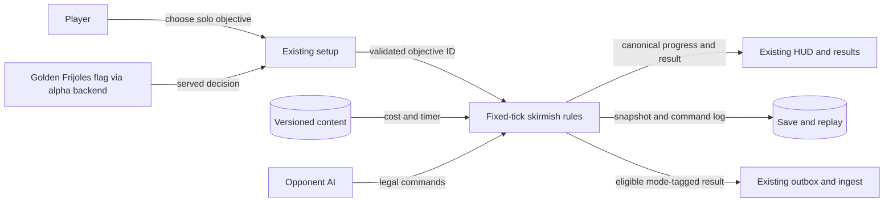
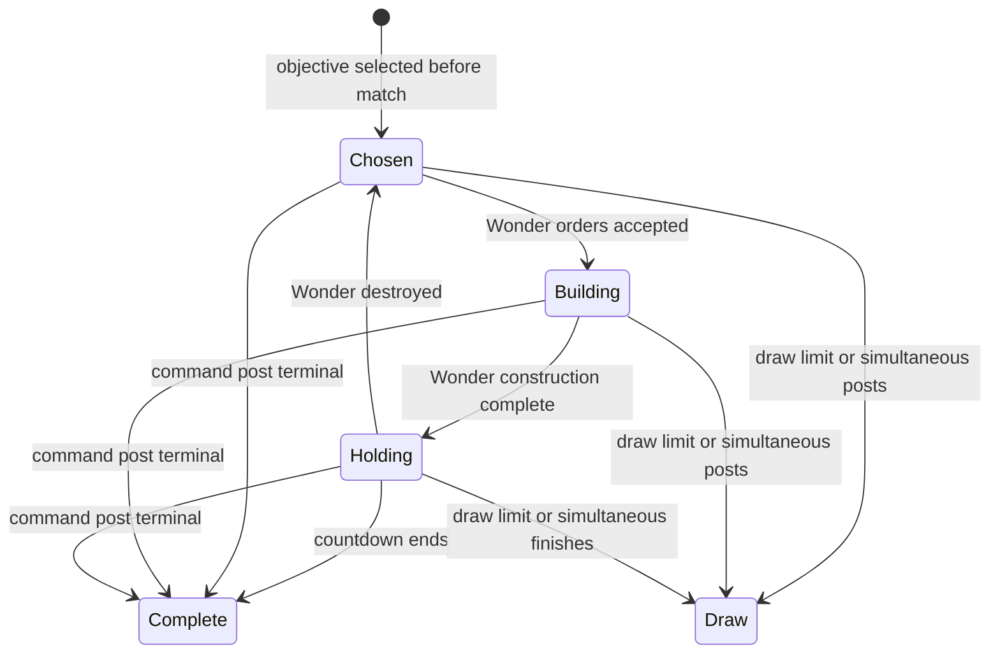

# Pitch — Add more ways to play

Moves: `return_to_match` · Tests: value proposition. A different objective might invite another match; there is no observed retention lift or baseline. The 15% later-day launch target remains provisional.

## The ask, as given

> Hi codex Refine seed:
> #21 add-more-ways-to-play as per golden frijoles methodology, ensure to follow ways of work, team memory etc to ensure a smooth flight

The [original raw idea](https://github.com/danybgoode/aomx/blob/a60bec496311687ddd6c41dce8dfcae9383a1227/Roadmap/00-ideas/seeds/add-more-ways-to-play.md) names conquest, wonder, La Roma territory, team/online play, campaign/scenario dependencies and several candidate neighborhood mechanics. The [full-game path](../../full-game-build-path.md) records the wider intent; the proposal below chooses one first playable cut.

### Claims

1. Refine #21 into a reviewable Golden Frijoles plan using Ways of Working and project memory.
2. Give a returning player a genuinely different, complete match objective beyond today's combined command-post/center finish.
3. Preserve clear terminal rules, progress, AI counterplay, save/replay and match measurement.
4. Keep multiplayer, campaign/scenario and optional city modifiers within their own approved boundaries.

**Teach-back:** Pending owner response — “You want a fresh way to finish a complete RTS match so returning players have a reason to play again, while keeping team play and campaigns separate. Right?”

## Problem

Solo setup offers faction, map and AI difficulty, but every ordinary match ends by command-post destruction or an uncontested center hold. A player cannot choose a victory format. The [GDD](../../../docs/design/GDD.md#41-signature-victory-ideas) proposes conquest, wonder and territorial play but calls the present 3×3 hold a prototype. The [private 1v1 epic](../../03-multiplayer-and-retention/prove-multiplayer/README.md) proved a Restricted match, not teams or public play. The [campaign epic](../../03-multiplayer-and-retention/create-campaigns-and-scenarios/README.md) owns guided missions and remains in progress. There is no public release or eligible repeat-play cohort.

## Appetite

**M — several connected slices with a rules and compatibility decision.** This buys selectable solo Conquest, La Roma and Wonder objectives on the fixed-tick match, including AI, HUD, save/replay and a bounded Restricted-build proof. It does not buy teams, new maps, extra factions, missions, an editor or neighborhood modifiers. If Wonder cannot fit M with an understandable whole match, return to the owner with a smaller Conquest/La Roma choice; do not expand the appetite during the build.

quote: $20–120 (M, n=0, wide)

## Outcome & signal

A player chooses a victory objective before a solo skirmish, understands what will win and what can stop the opponent, then completes a match against AI. The owner verifies each objective on a signed Restricted download, including save/resume. Uncoached players unfamiliar with CDMX references can explain how to win from setup and in-match progress. Later, compare accepted `return_to_match` by mode only after a mature cohort exists; do not infer lift from owner testing or use 15% as a baseline.

## Stage-2.5 bucket

**Light enhancement available first:** expose today's command-post and center-hold rules as separate choices. That can test whether players understand the selector. **Genuinely new in this bet:** Wonder needs a buildable objective, countdown, AI plans and versioned persistence. This M proposal includes it because the raw idea asks for another strategic route. The selector-only cut is the fallback if the new route proves too large.

**Lane:** shaped feature bet awaiting the owner's Plan decision. No status or approval for #20, #14 or any other epic changes here.

## Bill of materials (What / Why)

| What | Why |
| --- | --- |
| Versioned solo objective selection | Players can choose a distinct victory goal without changing old matches. |
| One Wonder construction and hold rule | An economic investment creates a defend-and-counter battle. |
| AI plan and response for each objective | The new route must be finishable against a fair opponent. |
| Setup, HUD and result copy | Players must know the active rule and visible progress. |
| Save, replay and accepted event checks | A mode must survive restart and count only as a real eligible match. |
| Restricted owner and comprehension checks | Confirm a complete, readable battle before wider access. |

The owner can edit the Why column at the Plan gate.

## Scope

**In v1:** A solo selector with `Conquest`, `La Roma` and `Wonder`. `La Roma` preserves today's command-post-or-center rules as the default for old saves, replays and new players; `Conquest` enables command-post defeat without center-hold victory. `Wonder` adds one buildable monumental project per side and a visible fixed-tick countdown. Command-post defeat remains a terminal route in all three choices so a player cannot be trapped in an unwinnable battle. Simultaneous post defeat remains a draw and takes precedence over an objective timer; simultaneous Wonder completion is a draw. Both sides follow the same validated build and combat rules and legal fog. Selection, progress and result reason are canonical match state, enter save/replay hashes and survive compatible resume. Old files keep previous rules or fail safely with an intact-file error. A full Wonder match emits existing accepted start/completion events with a distinct mode value and one test-tagged completion per player-match; abandoned matches are excluded.

**Proposed Wonder rule card for the owner's Plan decision:** Pilot on the existing 28×28 La Roma map only; the other maps continue offering Conquest and La Roma. At the third age (`godin`), a worker may build one Wonder per side at a valid ordinary building site for 16 comida, 20 materiales, 20 varos and 12 terrenos. Construction takes 180 logical ticks (18 seconds); after completion, hold for 900 ticks (90 seconds) to win. Destroying the Wonder before or during the countdown resets that side's timer; rebuilding requires paying again. Both sides' completed-Wonder status and remaining time are public match information, but fog still hides unscouted units and structures. If QA shows this rule cannot finish or be countered fairly before the 9000-tick draw limit, revise the rule card with the owner before expanding map availability. These are proposed gameplay values, not existing rules.

**Out of v1 (no-gos):** Team slots, diplomacy, public matchmaking, new online protocol or live 1v1 admission; campaign objective changes, chapter rewards or editor tooling; extra maps/factions/ages/resources; neighborhood bonuses, water routes, vehicles, morale or weather; ranked balance claims, public rollout or a retention-lift claim. [Multiplayer](../../03-multiplayer-and-retention/prove-multiplayer/README.md) and [campaigns](../../03-multiplayer-and-retention/create-campaigns-and-scenarios/README.md) retain their own rules and release boundaries.

## Rabbit holes

- **Core rules are an owner decision.** The three-option model, Wonder rule card and post-defeat precedence are proposals for approval, not changes to the agreed game. If the owner changes one, update the pitch before implementation. The countdown must fit within the existing draw limit.
- **One rules authority.** `game/skirmish.gd` resolves objective state and terminal precedence on fixed ticks. Content validates stable IDs, costs and placements; the view selects and displays. AI builds and attacks through legal commands without hidden information.
- **Compatibility and online isolation.** Pin objective ID and rules/content hash in snapshots and replay. Preserve the legacy result path and campaign finale. Restricted 1v1 stays on its pinned rules version; solo Wonder must not silently change network hashes or join compatibility.
- **Eligibility.** Mode choice alone is not adoption, and a client-declared win is not an accepted completion. Test-tagged owner matches stay excluded. Verify the event contract accepts a distinct mode only when a real full match reaches terminal result, preserving duplicate/replay guards.
- **Fairness and readability.** A Wonder site must be reachable, cost resources each side can obtain and invite a meaningful siege or denial response. Name and imagery communicate “build and defend” without requiring Mexican cultural knowledge or treating a regional stereotype as a rule.
- **Measure flag.** Propose one Golden Frijoles enablement flag, off until deliberate rollout. The existing alpha backend resolves it for the same pseudonymous player ID and records a user-level evaluation; the client receives decision/version only. First use defaults off, and a running match pins its rule. This is a measurement and safety proposal for the owner's gate decision.

## What already exists (reuse, don't rebuild)

- [`game/skirmish.gd`](../../../game/skirmish.gd) has fixed-tick commands, two current terminal reasons, AI, snapshots and hashes; `district_hold_ticks` and draw limit are in [content](../../../game/content/skirmish.v1.json), validated by [`game/rules_content.gd`](../../../game/rules_content.gd).
- [`game/skirmish_main.gd`](../../../game/skirmish_main.gd) has solo setup, victory copy, campaign separation and results; [the HUD](../../../game/ui/battle_hud.gd) has the compact objective/status surface.
- [Persistence](../../../game/skirmish_persistence.gd), [replay](../../../game/skirmish_replay.gd), [ADR 003](../../../docs/architecture-decisions/003-simulation-contract.md) and Godot contract tests provide canonical compatibility and hash checks.
- [Campaign flag backend](../../../src/alpha/campaign-flags.mjs) and [client cache](../../../game/campaign_flag_cache.gd) demonstrate a server-served decision without a client provider key; reuse the pattern, not a parallel flag store.
- [Outbox](../../../game/funnel_outbox.gd), [ingest](../../../src/funnel/ingest.mjs) and [North Star](../../00-strategy/north-star.md) already carry match ID, mode, stable player proxy, test exclusion and accepted-result rules.

## Visuals

Review the [rendered setup and match sketches](../sketches/add-more-ways-to-play.html) alongside the states below.





```surface
state: objective-idle
route: /solo/setup
- head "Choose a solo objective" action "Start match"
- list columns "Conquest | La Roma | Wonder"
- note "Destroy the opposing command post in every mode. La Roma adds a center hold; Wonder adds a build-and-defend countdown."
```

```surface
state: wonder-disabled
route: /solo/setup
- head "Wonder unavailable"
- note "This objective is not enabled for this build. Conquest and La Roma are available."
```

```surface
state: wonder-idle
route: /solo/match
- head "Wonder in progress"
- summary "Build status, remaining hold time and opposing Wonder"
- note "Destroy the opposing Wonder before its timer ends."
```

## UX heuristics & rails check

- **CI guards:** Godot content, district/terminal, AI, save/replay and cross-platform hash suites plus Node game-to-ingest contracts; add explicit mode and Wonder fixtures.
- **Audits lens:** The [owner interface and movement audit](../audits/2026-10-23-owner-interface-movement-map.md) requires readable text, non-overlapping controls and unblocked routes. Check the new objective at 1024×700 and 1280×800.
- **Design-language debt:** Current copy says “command post or center” for every skirmish; setup, HUD and result need mode-specific plain-language explanations. A disabled mode must visibly differ from an unbuilt Wonder.

## Kill-switch / runtime gate

**Proposed Measure and Safety answer:** `modes.wonder_enabled` is an enablement flag, off with a served version in every Golden Frijoles environment until owner rollout. The alpha backend is the single resolver and reports each evaluation for the same user ID used by accepted events; the client holds no provider key. A match pins its objective at start. `wonder_match_completed` is proposed as adoption only after an accepted, eligible Wonder finish, with a seven-day repeat; it needs an event-contract review before creation. Conquest and La Roma remain locally available when Wonder is off. The owner's Plan answer confirms or changes this measurement choice. See the [flag reference](../../../.agents/skills/refine/references/kill-switch.md).

## Slices, risk and QA

| Sprint / story | Player outcome and observable check | Risk | QA stage and owner |
| --- | --- | --- | --- |
| 1.1 Objective contract | A player selects Conquest or La Roma; only the selected route can win, while old matches retain the previous default. | High | Godot terminal/precedence, content and save/replay fixtures; independent simulation review. |
| 1.2 Readable choice | A player can state the active win condition at setup and during a match, with no clipped progress. | Low | Rendered native capture at both target windows and owner smoke. |
| 2.1 Wonder match | A player builds or destroys a Wonder and completes or prevents its countdown; all four factions and AI use legal rules. | High | Resource/build/contest/terminal and AI scenarios, cross-OS hash and save/replay; independent rules review. |
| 2.2 Measured rollout | An operator sees a served flag evaluation and one accepted mode-tagged result; off, abandon, replay and duplicate paths do not count. | High | Provider version check, Godot/Node contract, test-identity audit and second data-integrity review. |
| 3.1 Whole-match proof | The owner finishes all three objectives on a signed Restricted download, including Wonder save/resume and unchanged campaign/private-match starts. | High | Numbered downloaded-build walkthrough, mode/faction matrix, source/build ID and result audit. |

Keep each sprint's numbered owner smoke and actual build ID. A merge to `master` is integration evidence; check the Restricted download separately. Review after Sprint 1 before committing Wonder numbers and after Sprint 2 if AI cannot finish the new mode within M.

## Acceptance criteria

1. Conquest, La Roma and Wonder have stable IDs, one selected objective per solo match, clear setup/HUD copy and deterministic terminal precedence. La Roma remains the old default; Conquest never wins from a center hold. Mission and private 1v1 objectives do not change implicitly.
2. The owner-approved Wonder rule card is versioned before build. Both sides can build one, destroy the other's, rebuild and win or lose by the fixed-tick countdown. Post destruction, simultaneous outcomes and draw limit resolve once.
3. AI completes or contests Wonder through legal commands and normal sight; controlled four-faction×objective scenarios show reachable wins and counterplay without permanent stalls. The offered La Roma Wonder map passes placement and resource-access validation.
4. Save/quit/resume and replay preserve objective ID, progress, match ID and final hash across compatible builds. Old files retain behavior or return a readable non-destructive error. Private network version/hash and campaign finale remain intact.
5. Each eligible full match produces at most one accepted completion per player-match, tagged with objective. Test traffic, abandon, duplicate and replay do not inflate the agreed North Star. Proposed adoption fires only after an accepted Wonder completion if approved.
6. A signed Restricted owner download passes numbered setup, Conquest, La Roma, Wonder, AI counter, save/resume, result and mode-off steps at 1024×700 and 1280×800; record build ID, expected/actual results and limitations. Record uncoached comprehension separately from owner play.

## Open risks / research

- The owner must approve the proposed victory model and Wonder rule card before code changes because they alter core game rules. The GDD's Wonder and territory language is design intent, not signed-off parameters.
- #20 campaign work remains in progress; its objective, save and flag contract may change before this bet begins. Re-read that epic and current code at architecture lock.
- No eligible cohort or repeat-play baseline exists. A seven-day comparison needs mature players in each exposed group; the 15% target is provisional.
- The pinned CLI's `whoami` and `doctor` checks could not reach the Golden Frijoles API on 2026-10-27. Confirm connection, served flag versions and live roadmap state before rollout; a local pitch is not a hosted sync.
