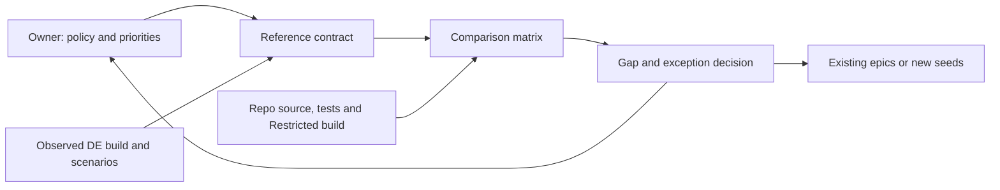

# Pitch — Audit gameplay fidelity against a pinned RTS reference

Moves · Tests: neither directly — tests the value proposition's classic RTS depth before a later implementation bet.

## The ask, as given

> #17 audit-gameplay-fidelity as per golden frijoles methodology, ensure to follow ways of work, team memory etc to ensure a smooth flight

### Claims
1. Refine #17 with Golden Frijoles.
2. Follow Ways of Working and team learnings.
3. Stop for owner review before scaffolding and building.

**Teach-back:** pending — you want an evidence-backed fidelity decision before approving broader rules work.

## Problem

[ADR 002](../../../docs/architecture-decisions/002-aoe2-definitive-edition-reference.md) chooses Age of Empires II: Definitive Edition, but no build/patch, exception policy or current scenario matrix is pinned. The [GDD](../../../docs/design/GDD.md) is the target; the [architecture review](../../../docs/architecture-review-2026-10-16.md) predates multiple gameplay epics. Neither proves parity.

## Appetite

**M:** several connected investigation slices ending in a written decision, not a time estimate.

quote: $20–120 (M, n=0, wide)

## Outcome & signal

The owner can inspect repeatable reference scenarios and current-game evidence, then accept, revise or reject prioritized gaps and intentional differences. No player retention or numerical parity claim follows from this spike.

## Stage-2.5 bucket

**Light enhancement to existing design evidence.** The edition, versioned simulation, replay and scenario tests exist. The build-specific comparison and exception decision do not.

## Bill of materials (What / Why)

| What | Why |
| --- | --- |
| Reference contract | A specific observed DE build, mode/settings, setup and tolerances make comparison repeatable. |
| Current-game matrix | Source paths, tests and real-build observations distinguish verified behavior from plans. |
| Gap and exception decision | The owner can prioritize faithful behavior, deliberate differences and deferred work. |

## Scope

**In v1:** Sample gathering/drop-off/depletion; construction and repair; queues, prerequisites and ages; orders, counters and siege; pathing/congestion; fog/scouting; opponent fairness; maps; save/replay; and both match outcomes. For each sampled scenario record reference build and setup, observation/tolerance, current source/test/build evidence, classification (verified, partial, planned, absent or unknown) and follow-on home. Compare mechanical, behavioral and experiential axes separately.

**Out of v1 (no-gos):** implementing or balancing mechanics, exhaustive unit/civilization tables, new telemetry, copied DE code/data/assets, full-parity claims, and implicit approval of Terrenos, cultural bonuses or neighborhood modifiers. Existing funded QA remains open.

## Rabbit holes

- A live patch is a moving target; official [DE update notes](https://www.ageofempires.com/news/age-of-empires-ii-definitive-edition-update-177723/) describe changes to unit behavior and pathfinding. Pin the actually observed installed build before numbers.
- Recheck current code and tests rather than copying the older architecture review. Similar outcomes can have different timing, orders or control feel.
- If lawful access to a specific DE build is unavailable, deliver qualitative findings and mark numerical parity unverified.

## What already exists (reuse, don't rebuild)

- [ADR 002](../../../docs/architecture-decisions/002-aoe2-definitive-edition-reference.md), the [GDD checklist](../../../docs/design/GDD.md#4-gameplay-feature-inventory-and-fidelity-checklist) and [full-game path](../../full-game-build-path.md) provide the design contract.
- `game/skirmish.gd`, `game/rules_content.gd`, `game/map_geography.gd` and `game/tests/` provide current simulation, content, geography and scenario evidence.
- [Strategic play](../../01-core-play/deepen-strategic-play/README.md), [warfare/world](../../01-core-play/expand-warfare-and-world/README.md), [opponent](../../01-core-play/build-strategic-opponent/README.md), [world expansion](../../02-civilizations-and-world/expand-civilizations-and-world/README.md) and [multiplayer/replay](../../03-multiplayer-and-retention/prove-multiplayer/README.md) already own implementation and unfinished QA.

## Visuals

These are **sample record shapes, not findings**:

| Scenario | Reference evidence | Project evidence | Classification |
| --- | --- | --- | --- |
| Worker carries and deposits | Build and timed setup to record | `game/tests/strategic_economy_test.gd`; real-build check pending | unknown |
| Two builders finish a structure | Build and setup to record | `game/skirmish.gd`; test result pending | unknown |
| Scout loses sight behind fog | Build and setup to record | `game/tests/warfare_test.gd`; rendered behavior pending | unknown |

## UX heuristics & rails check

- **CI guards:** existing Godot scenario, replay/hash and benchmark checks; doc review verifies commands and links.
- **Audits lens:** no `Roadmap/00-ideas/audits/` findings found; the architecture review is the earlier baseline.
- **Design-language debt:** none for this decision artifact.

## Acceptance criteria

The three investigation slices are the proposed review boundaries:

| Slice | Story and risk | Acceptance / QA |
| --- | --- | --- |
| 1 · Reference contract | **S1.1, low.** As owner, I can see the chosen DE build and exception questions. | Record an observed build ID or why numerical comparison is unavailable, scenario settings and tolerance policy. One economy and one combat setup are reproducible. Owner reviews parity wording. |
| 2 · Compare current game | **S2.1, low.** As owner, I can inspect current behavior and exact evidence. | All ten domains have a sampled row with source/test path, command/result where applicable, Restricted build ID for rendered claims, and classification. Re-run representative headless tests. Any rendered claim gets numbered owner smoke steps with one action and observable result each. |
| 3 · Decide next work | **S3.1, low.** As owner, I can choose fidelity gaps and exceptions. | Written decision ranks gaps by player impact, dependency and confidence; routes each to an existing epic or new seed; and separates all three axes. Terrenos, local objectives and neighborhood modifiers remain explicit owner decisions. |

## Measurement and safety

**Measure:** the accepted decision and traceable scenarios, not a new event. **Safety:** no runtime flag for a documentation-only spike. The North Star and test exclusions stay as agreed.

## Open risks / research

- **Plan-gate decisions:** confirm appetite; allow the spike to use the actually accessible DE build as reference, or specify one; approve or revise the exception policy before changes to competitive rules.
- **Reference access:** verify an owned installation and displayed build during the investigation. If absent, mark numerical comparisons unverified.
- **Queue:** proposed after #16 geography/map data and before #18 interfaces; existing owner QA stays open.
