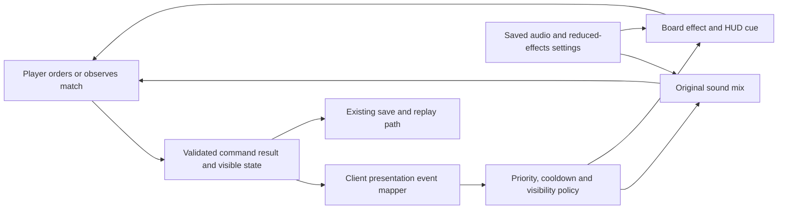

# Pitch — Build the audio and effects identity

Moves: `first_match_completion` · Tests: Value proposition. Immediate evidence is uncoached recognition and real-build readability; a future cohort reading cannot isolate this pack's effect by itself.

## The ask, as given

> Hi codex Refine seed:
> #19
> build-audio-and-effects-identity as per golden frijoles methodology, ensure to follow ways of work, team memory etc to ensure a smooth flight

The raw seed proposes a small original event-to-presentation pack. The owner chose **M — essential match feedback first** on 2026-10-23; music, city ambience and voice are a later wave.

### Claims

1. Refine #19 `build-audio-and-effects-identity` with Golden Frijoles.
2. Follow Ways of Working and project learnings.

**Teach-back:** Partly — the owner confirmed M appetite and the essential-pack boundary; this complete pitch remains for review.

## Problem

The playable match has an original order-confirm sound and several visible HUD notices, but no coherent mapping from important gameplay transitions to sound, animation and restrained effects. A player can miss a contested objective or a threatened unit in a crowded board. Conversely, more effects could hide units, fog or orders, make a repeated event noisy, or leave muted players without the same information. There is no player evidence yet that audio or effects improve completion.

## Appetite

**M — several connected slices with one presentation-contract decision and review.** Produce an essential cue pack for the current native desktop skirmish and a real-build comprehension check. Widen only after that evidence.

quote: $20–120 (M, n=0, wide)

## Outcome & signal

At normal game zoom, a player can tell whether an order was accepted or rejected, when economy/construction progresses, when a unit needs attention, who holds or contests the objective, and why the match ended. Muted and reduced-effects modes convey the same important states through readable, non-color-only UI/board cues. The owner and two uncoached reviewers attempt prewritten recognition tasks in sound-on and muted modes; record recognition, missed cues, masking and confusion, including unfamiliar cultural references. After a real eligible cohort matures, read the existing `first_match_completion` input by version with counts, without claiming attribution or a numeric lift now.

## Stage-2.5 bucket

**Light enhancement for order confirmation; genuinely new event-to-presentation contract.** The current tone, audio controls, reduced motion, HUD notices and view-only animation already work. The consistent cue taxonomy, mix policy, rights record and cross-mode QA do not.

## Bill of materials (What / Why)

| What | Why |
| --- | --- |
| Cue contract and priority table | One state transition produces an understandable cue without replay duplicates, fog leaks or screen clutter. |
| Original sound and restrained effects pack | Orders, economy, combat, objective and result have a coherent, distinct voice at play scale. |
| Accessible mix and visual equivalents | Muted and reduced-effects players can read every consequential state. |
| Provenance and frame/voice budgets | The pack stays reproducible, commercially usable and legible in crowded matches. |
| Real-build comprehension read | Human evidence decides whether the cues help before producing more media. |

The owner may revise the Why column at the Plan gate; any part without a defensible reason moves to a later wave.

## Scope

**In v1:** Native desktop skirmish and Restricted owner build. Map validated order results and presentation-visible state changes to a small cue catalog: accepted/rejected order, gather/delivery milestone, construction completion, attack/damage/destruction warning, objective contest/hold/capture and terminal result. Prioritize local, relevant, visible events; cap repeated sounds and simultaneous voices, with threat/objective/result above routine economy. Use original or rights-cleared sounds and view effects with source/export records. Add settings for gameplay cue volume/mute and reduced effects using the existing menu/reduced-motion path; preserve persistent preferences. Each important sound has a simultaneous text, icon, outline or board/HUD equivalent that works without color alone. Effects remain cosmetic and do not decide simulation outcomes or visibility. Record budgets and crowded-board measurements on the target build.

**Out of v1 (no-gos):** Music, neighborhood ambience, traffic or market recordings, Spanish voice barks and localization/caption production for speech; new factions or combat rules; weather, day/night, vehicles, explosions that cover selection or fog; copying AoE sounds; Web/mobile autoplay and device certification (#22); public release or new invitations. #18 owns interface layout and caption hooks; #19 supplies cue content and checks those hooks without redesigning the whole HUD.

## Rabbit holes

- **Authority and replay:** derive cues from accepted command results and visible transitions, never mutate `game/skirmish.gd` to time an effect. A replay, seek, resume or network correction must not multiply a cue; record when one-shot cues reset or suppress. Sound cannot reveal a fogged attacker or hidden entity.
- **Noise and priorities:** gathering and combat can repeat every tick. Define event keys, cooldowns, priority, voice cap and distance/ownership rules before authoring a large sound set.
- **Controls:** the current `order_audio` and `audio-settings.v1.json` handle one tone. Keep prior mute/volume preferences. Reduced motion already exists; reduced effects must retain essential state cues.
- **Cultural and rights review:** a Mexico City identity can use original timbre and rhythm without treating stereotypes as faction facts. Record composer/generator/source, rights, license and export hash for each asset. The flattened `effects.jpg` board is reference only.
- **Acceptance boundary:** #18's unreadable-label and uncoached tasks remain open; do not claim #19 fixes or closes #18. Test #19 on a recorded build and note any interface blocker separately.

## What already exists (reuse, don't rebuild)

- `game/skirmish.gd` validates commands and owns fixed-tick outcomes; `game/skirmish_main.gd` presents the accepted order cue, state-change HUD notices, terminal result and audio settings. Views and sound remain outside the authoritative simulation.
- `game/ui/battle_hud.gd` exposes mute/volume, notices and reduced-motion controls. `game/tests/skirmish_client_test.gd` checks the current audio controls.
- `scripts/generate-game-audio.mjs` reproducibly generates `game/assets/audio/order-confirm.wav` from original synthesis, without third-party samples. Inventory any other existing faction cues before claiming they are production-ready.
- [Full interfaces #18](../../02-civilizations-and-world/complete-game-interfaces/README.md) owns settings layout and caption hooks; [world expansion #13](../../02-civilizations-and-world/expand-civilizations-and-world/README.md) owns its limited media pilot; [art coverage](../art-world-coverage-2026-10-21.md) and [GDD](../../../docs/design/GDD.md) supply presentation direction, not approved mechanics.

## Visuals



Example presentation mapping, to lock before assets are produced:

| Source and event key | Priority / repetition | Paired non-audio cue |
| --- | --- | --- |
| Accepted local `gather` order: `order.accepted:<command-id>` | Medium; once per accepted command | Order flash and worker activity label |
| Visible friendly unit damaged: `unit.threat:<unit-id>` | High; coalesce within a short cooldown | Attack notice, health and location marker |
| Visible district changes to opponent hold: `objective.enemy_hold:<transition-id>` | High; once per state transition | Objective label and non-color-only contested marker |

```surface
state: match-idle
route: /match
- head "Resources and objective" action "Pause"
- summary "Selected unit, health and current activity"
- card "Order result, recent alerts and objective state"
- note "Audio adds emphasis; the state remains visible when muted"
```

```surface
state: settings-idle
route: /settings
- head "Settings" action "Return to match"
- field "Gameplay cue volume and mute"
- field "Reduced effects"
- note "Important alerts remain visible without sound or motion"
```

## UX heuristics & rails check

- **CI guards:** extend Godot client checks for event mapping, mute/preferences, reduced effects, save/replay and fog. Rendered native captures plus signed downloaded-build owner smoke and human recognition remain separate gates.
- **Audits lens:** no findings are recorded in `Roadmap/00-ideas/audits/`; #18's interface review and open uncoached tasks supply the current readability constraints.
- **Design-language debt:** one generic order tone and ad hoc HUD notices lack a shared priority, mix, style and provenance contract. Check the pack at actual zoom, normal and dense scenes, with and without sound.

## Acceptance criteria

| Slice | Story and risk | Acceptance / QA |
| --- | --- | --- |
| 1 · Contract and first cue | **S1.1, low.** As a player, I see and hear a consistent accepted/rejected order response. **S1.2, low.** As a muted player, I get the same actionable result. | Document event keys, visibility, priority, cooldown and replay rules; wire one end-to-end order example through the view, preserving command legality. Client checks cover accepted/rejected, mute persistence and a replay/resume duplicate case. Numbered owner smoke on the local desktop build. |
| 2 · Match-state pack | **S2.1, low.** As a player, I can notice economy/construction progress without constant noise. **S2.2, low.** As a player, I can identify a visible threat and objective change during combat. | Original, traced assets and cosmetic animation/VFX for the catalog; client checks for transition-only, repetition caps, fog and no simulation/hash changes. Crowded-board rendered capture, sound-on/muted and reduced-effects walkthrough; record simultaneous voices, frame cost and obscured-selection findings. |
| 3 · Outcome and human read | **S3.1, low.** As a player, I recognize why the match ended and can continue from result/replay. **S3.2, low.** As owner, I can decide whether the cue pack improves comprehension. | Terminal cue and readable visual result, no repeated cue on reopen/seek. Signed Restricted desktop download: both victory routes, save/resume, replay, sound-on, muted and reduced-effects checks with build ID. Owner and two uncoached reviewers attempt prewritten order, threat, objective and result tasks; record recognition, misses, masking and confusion. Resolve severe findings or re-scope before epic close. |

Every sprint closes with a numbered smoke walkthrough in its sprint doc: build ID/source, starting state, one action and one observable audio/visual result per step. Local checks are builder evidence; a merge or generated media file is not real-build acceptance.

## Measurement and safety

**Measure:** yes, via the prewritten recognition read and the existing eligible, deduplicated `first_match_completion` input after a mature cohort. No new adoption event or numeric target is invented. **Safety:** no new Golden Frijoles flag is proposed for this low-risk, local presentation pack: mute and reduced effects are player controls; the versioned Restricted owner build is the rollout/revert boundary. Keep existing multiplayer admission and telemetry flags untouched. Revisit a measured rollout flag only if an eligible exposure/identity and comparison plan can be defined without altering the agreed North Star.

## Open risks / research

- **Plan gate:** confirm the M essential-pack scope and that #19 may follow #18 while #18 owner QA and other unfinished epic checks continue. Approving this pitch places the bet; it does not approve code, a public release, or new invitations.
- **Asset review:** verify the actual audio inventory and per-asset rights before setting the final palette. No audio concept board exists; `effects.jpg` is a flattened visual reference.
- **Performance:** set a baseline and an owner-reviewed budget on the current target native build before numerical pass/fail claims. Web/mobile audio activation and sustained device budgets belong to #22.
- **Escalation:** new core rules, cultural portrayal, privacy, spend or release policy return to the owner under [Ways of Working](../../WAYS-OF-WORKING.md#escalate-dont-guess).

## Intent match

_Advisory and uncalibrated (intent-match D1, D3): it can add a step, never block one. Regenerate with `node scripts/intent-match.mjs <this seed> --write`._

```text
Intent match — Roadmap/00-ideas/seeds/build-audio-and-effects-identity.md
  coverage in   0.52  (2 claims)
  coverage out  —     (no acceptance list)
  clarity       —     (no acceptance list)
  teach-back    0.50  (partly)
  agreement     pending  (the optional reader at the architecture lock)
  why story     0.61  (advisory, not in the total)
Total 51 / 100 — uncalibrated · signals: coverage in, teach-back
Band: sketch or spike first (placeholder bands: 80 build · 60 resolve follow-ups · below 60 sketch or spike)
Gaps:
  claim 1 — uncovered (0.15): "Refine #19 `build-audio-and-effects-identity` with Golden Frijoles." → spike
```

<!-- intent-match: {"coverage_in":0.515,"coverage_out":null,"clarity":null,"teach_back":0.5,"total":51} -->

The routed gap quotes the procedural request to refine #19 rather than a missing player outcome. This pitch, its rendered settings/match sketch and the three testable slices supply that artifact; a separate technical spike would not resolve the scorer's wording issue. Keep the advisory score visible for review.
