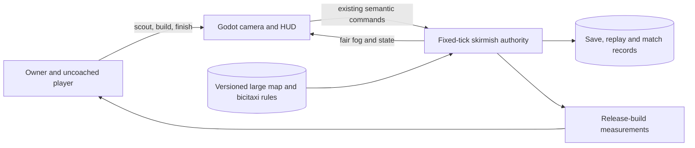

# Pitch — Build a large La Roma battlefield

Moves: `return_to_match` · Tests: value proposition. Immediate evidence is owner play of scouting, resource expansion and a complete match; the 15% later-day target remains provisional, not a measured baseline.

## The ask, as given

> also all the resources are all very close together and in a tight area. do we have any upcoming seeds from the backlog or otherwise to make the map way larger, like aoe definite edition? right now it is miniscule. Let me know please and lets see how we can address my feedback please

> For the larger battlefield, which first milestone matches your intent: - One larger pilot map (recommended) - I think i missed that question when you asked

> and if its larger like aoe 2 large which is what i want, lets add also a starting scout, a bicitaxi (lookup online what those are in mexico city)

> L pilot map (recommended)

### Claims

1. Make one playable battlefield feel as expansive as an AoE II: DE Large match, with room to explore and build.
2. Spread resources beyond one tight cluster so scouting and expansion matter.
3. Give each side a starting bicitaxi scout grounded in a real CDMX transport form.
4. Keep the first milestone to one pilot map with an L appetite.

**Teach-back:** yes on the one-map, L pilot; the exact dimensions and scout balance are proposed below for owner review.

## Problem

The three selectable skirmish maps share a 28×28 base grid. Resource locations and camera fit make the whole fight feel compressed. [#11 warfare](../../01-core-play/expand-warfare-and-world/README.md) originally promised a larger battlefield but locked its implemented performance target to 28×28; its 48×48 headless stress fixture is not a playable map. [#16 geography](../../02-civilizations-and-world/establish-cdmx-geography-and-maps/README.md) preserved the 28×28 La Roma arena. A larger map also exposes the owner's current crowded-movement defect, which remains a separate open #11 acceptance failure. The [owner review](../audits/2026-10-23-owner-interface-movement-map.md) records the evidence and related interface findings.

## Appetite

**L — owner confirmed 2026-10-23.** One authored playable La Roma large-map pilot, a starting bicitaxi scout and full-match proof, reviewed between waves. This is not a promise to resize all three maps or copy AoE II: DE's tile dimensions. Start with a 96×96 playable study and compare up to the current content validator's 128×128 ceiling; choose the final size by owner play, match pacing and a predeclared owner-Mac performance budget. If the budget fails, narrow content/AI load or revise the scope with the owner rather than silently returning to a small map.

quote: $50–300 (L, n=0, wide)

## Outcome and signal

On a signed downloaded Restricted build, the owner starts near a readable home base with a bicitaxi, scouts at least two meaningful routes, finds separated expansion resources, chooses a forward economy/defense position and completes both victory routes against an AI using fair fog information. A second player unfamiliar with CDMX can identify the scout's job and the map objective. Record travel/scouting time, candidate map dimensions, resource and build-site access, complete-match duration, stalled orders, route/tick/frame/memory values and the owner's accept/revise decision. Later, read `return_to_match` only after an eligible cohort exists; do not invent a numeric lift.

## Stage-2.5 bucket

**Genuinely new playable map and unit.** Existing zoom, fog, content loader, minimap and 48×48 benchmark are foundations, not the requested large match. Moving only the camera or relabeling the current map would leave resources and routes compressed. Fixing current congestion belongs to #11 regardless of this new bet.

## Bill of materials

| What | Why |
| --- | --- |
| One large authored La Roma variant | Put meaningful travel, scouting and build space into an actual match. |
| Safe starting and contested expansion resources | Let scouting reveal choices without making the first economy randomly unfair. |
| Starting bicitaxi scout for each side | Give the player an immediate way to explore the added space. |
| Start-focused camera, pan/zoom and useful minimap | Keep units readable without shrinking the whole map into one screen. |
| Fair AI, save/replay and old-map compatibility | Make the larger pilot a complete game, not a disconnected scene. |
| Measured release build and owner play | Decide whether the target feels Large and runs acceptably. |

The owner approved this L plan for a full build on 2026-10-23. Cut an item whose reason cannot be defended within L at its review boundary.

## Scope

**In v1:** One new, versioned La Roma large variant alongside the existing 28×28 maps; two fair start zones; starting resources sufficient to begin; separated expansion sites; multiple traversable scouting and attack routes; a visible central objective with balanced access; one non-combat bicitaxi scout per side from match start with higher sight and movement speed than a worker; existing fog, move and stop rules; legal AI scouting; readable default start camera and minimap navigation; all current factions and both victory routes; deterministic save/replay, old-save handling, content hashes and downloaded-build performance/owner proof. Source the vehicle portrayal from real CDMX mobility references and show it clearly at actual game scale.

**Out of v1:** Resizing Narvarte and Copilco, exact AoE II: DE tile parity, procedural/random maps, map-editor tooling, public release, passenger transport, bicitaxi attacks or gathering, extra scout training, new resources or ages, new victory rules and citywide geospatial simulation. The #18 layout/indicator repair and #11 crowded-route repair are separate acceptance work; they precede the larger pilot's full-match gate.

## Rabbit holes

- **Scale is experiential:** 48×48 is only about 3× the current tile area and cannot be assumed to meet the owner's Large-map intent. 96×96 is about 12×; 128×128 about 21×. Different games' tiles and pace are not directly comparable. Check viewport fraction, scouting journeys, expansion risk and match duration in a playable build before finalizing dimensions.
- **Larger-map performance:** the present declared owner-Mac budget applies to 28×28/80 live units. Set new map, unit, duration and route/tick/frame/memory targets before tuning, then measure a representative release export. Pathing, visibility, art and AI may need bounded content/algorithm work.
- **Movement before distance:** the current `_reroute_occupied()` wait/abort behavior can strand workers; #11's repair must pass a crowded crossing on the old map and the new map before this pilot closes.
- **Content and saves:** new map identity and content version must preserve the old 28×28 match/save path or fail old saves explicitly without data loss. Replay and cross-platform hashes must remain deterministic.
- **Balance:** near resources are safe enough to start, distant sites reward scouting and invite contest. The AI gets no hidden map information; both factions have viable route and resource access. A larger hold distance may require an explicit objective pacing decision.
- **Portrayal:** [SEMOVI's mobility diagnosis](https://www.semovi.cdmx.gob.mx/storage/app/media/uploaded-files/diagnostico-tecnico-de-movilidad-pim.pdf) describes bicitaxis/ciclotaxis as bicycle-based short passenger trips, not combat vehicles or a stereotype of every CDMX neighborhood. Its [street-design manual](https://disenovial.plazapublica.cdmx.gob.mx/assets/files/Consulta%20P%C3%BAblica%20Manual%20de%20Dise%C3%B1o%20Vial.pdf) includes a photographed example on Avenida Chapultepec. Depict a bicycle-powered passenger cabin respectfully; the fictional scout ability is a game choice.

## What already exists (reuse, don't rebuild)

- `game/content/skirmish.v1.json`, `game/content/maps/` and `game/rules_content.gd`: authored 28×28 map, overlays, source validation and a 128×128 validator ceiling.
- `game/skirmish.gd`: fixed-tick rules, existing roles, fair fog, commands, pathing and AI; its congestion failure stays with #11.
- `game/skirmish_main.gd` and `game/ui/minimap_panel.gd`: start camera, zoom/pan, picking, fog-aware rendering and minimap.
- `game/skirmish_persistence.gd`, `game/skirmish_replay.gd`, content/hash checks and `game/tests/skirmish_scale_benchmark.gd`: compatibility and performance foundations.
- [#11 warfare](../../01-core-play/expand-warfare-and-world/README.md), [#16 geography](../../02-civilizations-and-world/establish-cdmx-geography-and-maps/README.md), [#18 interfaces](../../02-civilizations-and-world/complete-game-interfaces/README.md) and the [owner review](../audits/2026-10-23-owner-interface-movement-map.md): current boundaries and owner evidence.

## Visuals

Review the [large-match wireframe](../sketches/build-large-la-roma-battlefield.html) with the map-zone and flow sketches below.




| Map zone | Access at start | Player decision to test |
| --- | --- | --- |
| Home | Visible; safe starter sources | Gather and orient without a blind opening. |
| Side route | Hidden; alternate passage and expansion source | Scout and choose a forward economy or defense. |
| Central approach | Hidden beyond initial sight; contested source/objective | Decide when to commit to a fight or hold. |

```surface
state: large-match-idle
route: /skirmish/la-roma-large
- head "Resources, population, age" action "Pause"
- card "Current objective"
- card "Fog-aware minimap"
- tiles "Readable starting base, bicitaxi and nearby resources" count 3
- note "Scout to reveal routes and expansion resources"
```

## UX heuristics and rails check

- **CI guards:** Godot content/simulation/client, scale benchmark, save/replay and macOS/Linux hash checks; independent high-risk review and rendered Restricted owner smoke.
- **Audit:** [owner scale, movement and map review](../audits/2026-10-23-owner-interface-movement-map.md).
- **Design debt:** large-map camera cannot use fit-whole-map as the default; the new scout and expanded resource sites must not add persistent battlefield badge clutter. #18 fixes the readable HUD baseline first.

## Measure and runtime gate

Use the existing test-tagged `match_started`/`match_completed` contract with map/content identity for a future `return_to_match` read. There is no eligible cohort or baseline yet. **No new runtime flag seam:** match rules, map and scout are version-pinned at match start; a mid-match flag could desynchronize save/replay or private peers. Restricted build and content version are the rollout and rollback boundary. Revisit a measured enablement flag only if a safe pre-match rule-selection seam is designed and the owner wants a controlled rollout.

## Acceptance criteria

1. A signed downloaded Restricted build offers one new large La Roma variant for every current faction; each side begins with one bicitaxi scout, while existing 28×28 maps and old saves retain their documented behavior.
2. At the readable default camera size, the scout reveals at least two useful routes and separated expansion resources under the same fog rules as the AI; both sides have safe starts and viable access to contested ground.
3. No crowded scout, worker or army order remains silently stuck in the pilot; save/resume, replay, content IDs and macOS/Linux hashes reproduce the same movement and visibility outcomes.
4. The owner completes Conquest and La Roma hold as both factions on the downloaded pilot, records an accept/revise decision on its Large-map feel and resource spacing, and the representative release export meets a performance budget declared before tuning.

## Review slices

| Slice | Player story and observable result | Risk and proof |
| --- | --- | --- |
| 1 · Large playable start | **As a** player, **I want** a readable home view and one bicitaxi so that I can scout a genuinely larger authored map. One new map loads for every current faction; old maps remain selectable; each side starts with one visible scout and fair initial sight. Owner compares at least 96×96 and one alternate candidate before locking size. | High: content/roles/fog. Validate routes/spawns/content ID, seeded visibility and selection, save/replay and hashes; rendered owner start-and-scout walkthrough at desktop sizes. |
| 2 · Resource journeys | **As a** player, **I want** safe starting supplies and separated expansion sites so that travel, defense and map control change my plan. Two distinct routes and at least one contested expansion are usable by human and AI; scout sees only legal information; no permanent crowded-route stall. | High: economy, AI and pathing. Seeded access/AI/crowd cases, side-by-side faction starts and complete-match balance notes, benchmark against declared budget. |
| 3 · Complete match proof | **As a** player, **I want** to finish either victory route on the large map so that its scale leads to a full game. Both factions finish Conquest and La Roma hold against AI in a downloaded Restricted build; save/resume/replay and old-map compatibility pass; owner records accept/revise on size, resource spacing and pace. | High: full Godot/Node/CI and independent review, cross-platform hash, ten-minute representative owner-Mac release-build route/tick/frame/memory record, numbered owner smoke and uncoached scout/goal read. |

At each review boundary, record the actual Restricted build ID, one action and one observable result per owner smoke step. A merge to `master` is integration; owner downloaded-build acceptance is a separate result. No public invitation is in scope.

## Open risks and plan decision

The current movement failure and #18 scale overflow are prerequisites for a credible full-match evaluation, tracked in their existing epics. The exact map dimension, resource counts and scout speed/sight/hit points are architecture-lock decisions made after the first playable comparison, within the approved L appetite. The new epic declares its 96×96 performance budget before tuning. The owner approved this plan and a full build on 2026-10-23; it is placed after #19 in the funded queue, while the #11 and #18 repairs go first. Campaign planning waits. The #11 epic must either meet its original larger-map DoD through this work or explicitly transfer that obligation without double-counting completion.

The advisory intent-match pass could not look on 2026-10-23 because Jev's network request failed; its four claims and four acceptance criteria are recorded above for direct owner review. The rendered wireframe passed the pinned kit parser.
