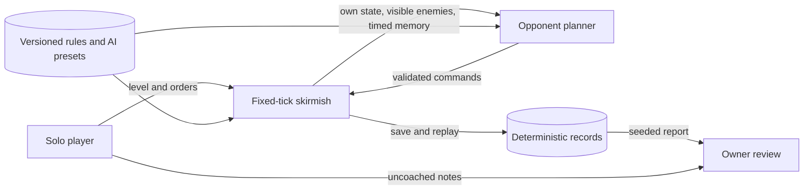

# Pitch — Build a strategic opponent

Moves: `return_to_match` · Tests: Value proposition

## The ask, as given

> Hi codex Refine seed:
> #12
> Build a strategic opponent (Roadmap/00-ideas/seeds/build-strategic-opponent.md) as per golden frijoles methodology, ensure to follow ways of work, team memory etc to ensure a smooth flight

The original idea, preserved as the source of this refinement:

> After the [economy](deepen-strategic-play.md) and [battlefield](expand-warfare-and-world.md) rules are stable, refine an AI epic that uses the same commands and fog rules as a player: economy planning, scouting, expansion, production, army composition, defense and objective choice. Difficulty should be documented and fair, with controlled openings and map seeds that demonstrate counters, comeback paths and no stuck economy. Reuse headless replay and balance reports, then test humans against the opponent. Keep campaign scripting and online bot policy separate until those modes are shaped. See the [full-game build path](../../full-game-build-path.md).

### Claims

1. Refine idea #12 through Golden Frijoles and the project's ways of working.
2. Plan a legal-information opponent covering economy, scouting, production, combat, defense and objectives.
3. Document fair difficulty; the owner chose **a clear difficulty ladder** as the first player outcome on 2026-10-18.
4. Prove behavior through controlled seeds, replay, balance evidence and human matches.
5. Keep campaign scripting and online bot policy separate.

**Teach-back:** pending — You want a fair solo opponent whose visible difficulty steps give players a clear next challenge, with seeded and human evidence.

## Problem

The current computer can finish a match, but its fixed goal sequence and time-gated attack do not provide a deliberate progression of challenges. A returning solo player cannot choose a level whose strategic behavior they can understand and counter. The [warfare epic](../../01-core-play/expand-warfare-and-world/README.md) added scouting and counters; its downloaded-build match and owner checks remain open. This plan does not absorb that closeout.

## Appetite

**L** — chosen by the owner on 2026-10-18: a larger epic reviewed after each coherent wave. It buys one difficulty ladder in the existing two-faction solo skirmish, repeatable scenarios and a small human read. It does not buy a general RTS bot platform.

quote: $50–300 (L, n=0, wide)

## Outcome & signal

As a solo player, I can choose a level before a match and understand why the next level is harder. Each level uses my costs, unit stats, command validation and vision. The opponent scouts, plans its economy, protects itself, chooses an army and pursues either victory route when evidence supports it. Both sides can recover from a bad opening or understand why they cannot.

The owner compares all three levels in a signed Restricted build, checks controlled openings and reads uncoached human notes about challenge ordering and fairness. `return_to_match` is the plausible North Star input, but no eligible cohort or baseline exists. Review the first mature seven-day cohort 30 days after an eligible release under the [agreed definition](../../00-strategy/north-star.md). Private test traffic does not establish retention or a 15% effect.

## Stage-2.5 bucket

**Genuinely new.** The authored computer already gathers, advances, scouts through current sight and memory, makes mixed units and attacks. Tuning its timing or army cap would be lighter, but would not provide a legible ladder of different strategic behavior. Reuse its legal command path and deterministic match machinery.

## Bill of materials (What / Why)

| What | Why |
| --- | --- |
| Three named levels at match setup | A player can choose and understand the next challenge. |
| Shared legal-information planner | Every level plays by the player's rules. |
| Economy, scouting and recovery policies | A match remains contestable after setbacks. |
| Composition, defense and objective policies | Higher levels ask for better decisions, not hidden bonuses. |
| Seeded scenario and balance report | The claimed ladder is reproducible before invitations. |
| Restricted human play read | Players can confirm the steps feel distinct and fair. |

## Scope

**In v1:** the existing two factions and authored map; three preset levels (working names Learner, Standard and Challenger) chosen before a solo match and stored with save/replay; one deterministic planner issuing validated commands; level-specific planning horizon, reaction cadence and plan selection with no resource, damage, sight, population or speed bonuses; economy allocation, reachable resource and drop-off recovery, scouting, expansion through existing buildings/territory, production, composition against observed threats, local defense, and explicit Conquest/La Roma objective choice; brief player-facing level descriptions; controlled openings and at least two deterministic scenario seeds on the authored map; a reproducible legality, visibility, stall, outcome and challenge report; a small uncoached human read after the project's invitation gates allow it. Version new AI parameters in the existing content contract.

**Out of v1 (no-gos):** extra factions, maps or units; random-map generation; new economy or combat rules; hidden-information access, free resources or stat bonuses for difficulty; machine learning, self-play training or adaptive personalization; campaign scripting, multiplayer/ranked bot policy, cloud inference, a new telemetry pipeline, public invitation and AoE2 numerical parity. Do not encode cultural stereotypes as AI traits or level labels.

## Rabbit holes

- **Fair observation:** decisions may use own state, current visible enemy state and explicitly stored last-seen state with a timestamp. A remembered target is a search lead, not a live target. Record observed facts and commands in fixtures; hidden changes alone cannot change a choice.
- **Difficulty design:** all levels share simulation and content stats. Pin exact policy differences before implementation. Challenge ordering needs controlled cases and human notes; a small fixture set does not establish universal win rates.
- **Economy recovery:** depleted or lost sources, destroyed drop-offs, blocked builds, capped population and unaffordable queues need bounded retry or plan revision. Report a clear no-route/no-resource reason when recovery is impossible.
- **Determinism:** planner memory, level and random choice state must round-trip. Saved and replayed matches make the same choices and hashes on declared platforms.
- **Dependencies:** finish the [warfare epic](../../01-core-play/expand-warfare-and-world/README.md) downloaded-build checks and pin its combat/objective contracts before locking this AI architecture. [Strategic economy](../../01-core-play/deepen-strategic-play/README.md) also has downloaded gameplay QA open.
- **Human evidence:** invite only after private-alpha access and participant notice gates are approved. If closed, keep this epic in verification with owner preview results and a ready protocol; do not invent participants or mark it shipped.

## What already exists (reuse, don't rebuild)

- `game/skirmish.gd`: fixed-tick match, legal `issue(...)` path, AI goal/step functions, visibility/last-seen memory, resource routes, counters and both victory routes. Extend its policy seam without another rules engine.
- `game/content/skirmish.v1.json` and `game/rules_content.gd`: versioned map, unit, economy and AI parameters with validation.
- `game/skirmish_persistence.gd` and `game/skirmish_replay.gd`: versioned state, save/resume and deterministic replay.
- `game/skirmish_main.gd` and `game/ui/battle_hud.gd`: pre-match choice and in-match feedback surfaces.
- `game/tests/`, `game/tests/skirmish_scale_benchmark.gd`, `game/warfare_performance_probe.gd` and `npm run skirmish:contract`: headless, performance and client-to-ingest checks. Extend these rather than add a balance service.

## Visuals

Difficulty is a per-match choice made before play and preserved on resume. Changing it starts a new match.

Working setup copy: **Learner** “Build at a measured pace and practice counters.” **Standard** “Scouts and changes plans when you show a threat.” **Challenger** “Reacts sooner and presses an advantage.” These promise behavior, never hidden combat bonuses; test with players unfamiliar with the setting.

## UX heuristics & rails check

- **CI guards:** Godot simulation, content, persistence, replay, client, cross-platform hash and Node skirmish contract; add AI scenario and setup coverage.
- **Audits lens:** no `Roadmap/00-ideas/audits/` finding for match setup was found.
- **Design language:** keep the existing faction choice and HUD. Avoid a new settings system or unexplained stat table. Plain functions remain understandable without cultural context.

## Kill-switch / runtime gate

**Measure:** existing eligible solo `match_started`/`match_completed` and later-day return readings, with test traffic excluded. No feature-specific Golden Frijoles flag is proposed: a local offline opponent cannot reliably receive a live server-side flag, and a flag read key must not enter the client. **Safety:** versioned Restricted-build rollback is the applicable seam; keep `flag_key: null`. Reconsider exposure measurement when a server-authoritative client and eligible cohort exist.

## Slices and QA

| Sprint / story | Player outcome and acceptance | Risk / QA stage |
| --- | --- | --- |
| 1 · S1.1 Fair planner and level choice | Choose one of three explained levels; every AI action uses `issue` and allowed observation, and is saved/replayed. Hidden enemy movement alone cannot change its plan. | High · headless command/vision, save/replay and UI checks; rendered setup smoke. |
| 1 · S1.2 Economy and recovery | Each level builds workers, routes four resources, advances, replaces a lost source/drop-off, and escapes or reports an impossible economy; no silent loop after blocked placement or population cap. | High · seeded depletion/loss/congestion cases, replay hashes and owner recovery smoke. |
| 2 · S2.1 Scout and compose | Scouting can reveal an enemy plan; only observed evidence changes production and army mix. Controlled melee/ranged/armored/siege cases show counters and defense. | High · fog/counter cases and command trace; rendered counterplay smoke. |
| 2 · S2.2 Choose an objective | The opponent defends post or district, pursues Conquest or La Roma when reachable, and can switch after a countered opening. | High · seeded defense/comeback and both routes; replay and full-match smoke. |
| 3 · S3.1 Ladder and report | Preset differences are documented. A fixed matrix for both factions, levels, openings and at least two scenario seeds reports legal commands, stalls, outcomes, duration and resource/army trajectories; no hidden bonuses. | High · headless batch, independent simulation review, performance comparison and downloaded-build checks. |
| 3 · S3.2 Human clarity read | Four uncoached players (two familiar with Mexican references, two unfamiliar) try all three levels. At least three rank the intended challenge order and can name one counter; record exact fairness objections and defects. | Low · approved private-alpha protocol/notice, then human play record; owner signs off or re-scopes. |

Each sprint ends with numbered owner smoke steps using a real build ID, one action and one visible result per step. Before implementation, record scenario seeds, exact level deltas, completion criteria and owner Mac performance budget in the epic architecture lock. Retain headless/rendered checks and signed Restricted download, save/resume and test-event checks. A PR merge is integration, not a release.

## Acceptance criteria

1. In a downloaded Restricted build, a player can choose and recognize three levels. Save/resume preserves the level; a new match can choose another.
2. For both factions, controlled seeded cases show legal economy, scouting before threat response, recovery, counter choice and defense or pursuit of both routes.
3. Seeded command history reproduces AI choices and state hashes after save/resume and replay on declared macOS/Linux headless checks. Every irrecoverable stall has a classified reason.
4. The scenario report states its matrix, build/content versions, seeds, outcomes, command rejections, stalls, durations and performance cost. It supports the intended steps without claiming statistical balance or AoE2 parity.
5. Owner full-match checks cover both factions, three levels, both routes, save/resume and an excluded test-tagged sync receipt on the signed downloaded app. Human testing records actual comprehension and fairness, only after invitation approval.
6. The predecessor epics and private-alpha gates remain authoritative for their results. This epic closes only after its own Definition of Done and real build/play evidence.

## Open risks / research

- Predecessor owner downloaded-build checks remain open. Confirm contracts and preview state at architecture lock; the docs-only board cannot prove live PR or released-build state.
- AI lives in `game/skirmish.gd` and save validation stores AI state. Extracting policy may require a content/save version bump and explicit old-save handling; decide from source and fixtures at lock.
- No eligible cohort exists. Human clarity and scenario results are early evidence, not a North Star read.
- The pinned Golden Frijoles CLI 1.5.1 and kit 1.9.2 are locally available. CLI status could not reach the service; live extraction could not resolve GitHub. Preflight passed with a snapshot warning. Recheck before roadmap push; no remote sync is claimed.

## Intent match

The advisory Jev check asked 18 questions but could not look because its network fetch failed. No score is claimed. The original request and source idea are preserved above; the teach-back is pending owner confirmation at the Plan gate.
