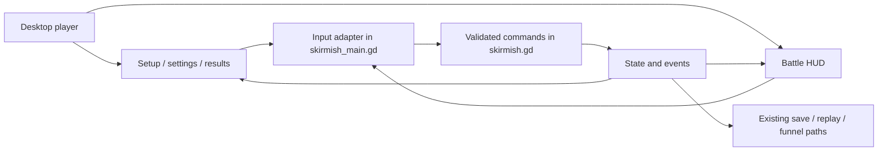
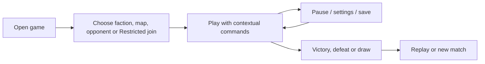

# Pitch — Complete the game interfaces

Moves: `first_match_completion` · Tests: value proposition — can a player understand and finish a classic RTS match without knowing local references?

## The ask, as given

> #18
> complete-game-interfaces as per golden frijoles methodology, ensure to follow ways of work, team memory etc to ensure a smooth flight

> btw, the hud and its overall text, butons, select etc is very small and hard to read for humans, lets improve that and polish up to top heuristics

### Claims
1. Refine #18 with Golden Frijoles.
2. Follow Ways of Working and team learnings.
3. Stop for owner review before scaffolding and building.
4. Make HUD text, buttons and selection feedback comfortably readable for humans, and polish the interface against strong usability heuristics.

**Teach-back:** pending — you want the small, hard-to-read HUD fixed first, then a coherent setup, battle and result interface that a new player can use without developer guidance.

## Problem

The owner reports that the HUD's text, buttons and selection are too small and hard to read. The [funded HUD](../../02-civilizations-and-world/readable-battlefield-hud/README.md) already offers selection, orders, minimap, objectives and a queue view, but its owner and blind-task checks remain open. Current code also has four resources/ages, faction/map setup, save/replay, audio controls and Restricted join/support paths. Those are not yet one legible, uncoached flow from starting a match through recovery and result. The `full-hud.jpg` and `menus.jpg` boards are visual references, not approval for new mechanics.

## Appetite

**L:** a larger interface epic with review boundaries after frontend, in-match decisions and real-build accessibility proof; re-evaluate between waves and cut feature expansion to fit.

quote: $50–300 (L, n=0, wide)

## Outcome & signal

In a signed downloaded desktop build, a new player can read the match at normal viewing distance, reliably select units and press commands, choose an available match, understand blocked actions, save/resume or open a supported replay, and understand the terminal result. A private multiplayer player can find the existing Restricted path when admission is enabled and a clear disabled state when it is off. Record uncoached task completion, missed targets, reading difficulty and confusion. Read mature `first_match_completion` later under the agreed North Star; there is no observed baseline or numeric lift target.

## Stage-2.5 bucket

**Light enhancement plus genuinely new connected flows.** The urgent readability defect belongs partly to the existing HUD acceptance work; record it there as owner feedback and avoid double credit. This proposal uses the current HUD, setup, queue, minimap, save/replay and support paths as its base, then fixes scale and feedback across the whole interface and adds connected navigation/recovery/results. The old HUD remains in progress until its own checks close or are explicitly re-scoped.

## Bill of materials (What / Why)

| What | Why |
| --- | --- |
| Setup and frontend flow | Existing factions, maps, solo/private modes, saves and replays become findable. |
| Human-scale HUD and selection | Players can read values, hit controls and tell exactly what is selected at a normal viewing distance. |
| In-match information and orders | Four resources, age/population, selection, commands, queues and objectives are readable without hiding the board. |
| Recovery and result flow | Players understand disabled actions, resume/cancel, victory/defeat/draw and what comes next. |
| Accessible state and QA | Keyboard, scalable type, non-color-only cues and uncoached tasks test use beyond developer operation. |

## Scope

**In v1:** Native desktop keyboard/mouse first. Fix the current HUD's small text, buttons, selection cues and cramped hierarchy before adding panels. Give players a visible UI-scale setting, with readable default and enlarged layouts. Functional start/setup, current factions and maps, solo difficulty, existing Restricted join/replay entry, settings/support/credits, save/resume and clear terminal result. In match, show four current resources, age, population/cap, selected entity/stats, contextual legal commands/block reasons, actual production/research progress, objective and fog-aware minimap, alerts and pause. Provide keyboard focus/shortcuts, non-color-only state, reduced-motion presentation where supported and caption hooks for gameplay audio. Keep explanatory copy understandable without Mexican cultural context. Design a touch layout/gesture spec using the same semantic commands.

**Out of v1 (no-gos):** new game rules/resources, diplomacy/culture/tourism controls from concept art, campaign chapters/dialogue, achievements, public matchmaking, new telemetry schema, mobile native/Web device certification and tutorial campaign. [Campaigns](create-campaigns-and-scenarios.md) own mission UI; [cross-platform play](prove-cross-platform-play.md) owns device/performance proof; [audio/effects](build-audio-and-effects-identity.md) owns new sound and VFX. Existing invitation gates remain separate.

## Rabbit holes

- The old [UI component spec](../../../docs/art/ui-component-spec.md) describes one-resource rules; current code has four. Project actual versioned simulation state, not stale prose.
- Disabled commands can depend on cost, prerequisite, fog, selection, queue or mode. The UI explains, while `game/skirmish.gd` remains authority.
- The minimap must use the same visible/remembered information as the battlefield, with no enemy leak.
- Scaled text, narrow windows and panels can steal pointer input from the board. Check 1024×700 and 1280×800, normal/enlarged type, resize and zoom.
- Enlarging the interface may crowd the permanent HUD. Prioritize resource, objective, selection and current commands; let secondary detail open on demand and preserve board selection/panning.
- Restricted multiplayer admission must reflect the live flag and invitation state, not imply public availability.

## What already exists (reuse, don't rebuild)

- `game/ui/battle_hud.gd`, `command_button.gd`, `minimap_panel.gd`, `hud_skin.gd`: responsive HUD, command states, queue, objective, minimap and skin.
- `game/skirmish_main.gd`: setup, input translation, audio settings, save/resume, replay and Restricted join. `game/skirmish.gd` and `game/rules_content.gd` own gameplay.
- `game/tests/skirmish_client_test.gd`, `hud_capture.gd`, save and multiplayer/replay client tests already cover important paths.
- [HUD epic](../../02-civilizations-and-world/readable-battlefield-hud/README.md), [run guide](../../../game/README.md) and [art coverage](../art-world-coverage-2026-10-21.md) record current controls and concept boundaries.
- [North Star](../../00-strategy/north-star.md) and [launch funnel](../../09-platform-and-measurement/track-launch-play-funnel/README.md) already define measurement.

## Visuals

Review the [rendered interface sketch](../sketches/complete-game-interfaces.html) alongside these source blocks.





```surface
state: setup-idle
route: /setup
- head "Battle for La Roma" action "Start solo match"
- tiles "Choose faction, map and opponent" count 3
- toolbar "Resume save | Watch replay | Private match | Settings"
- note "Private match availability follows the Restricted channel"
```

```surface
state: match-idle
route: /match
- head "Resources, age and population" action "Pause"
- summary "Selected unit, health and activity"
- tiles "Legal orders and research" count 2
- card "Production queue and prerequisite reasons"
- card "Objective, fog-aware minimap and alerts"
```

```surface
state: selection-focus
route: /match
- head "3 workers selected" action "Cancel selection"
- summary "Portraits, health and current activity"
- tiles "Gather | Build | Repair | Move" count 4
- note "Selection ring, count and command feedback remain visible without color alone"
```

```surface
state: order-disabled
route: /match
- head "Build unavailable"
- answer "Needs more Materiales or a valid site"
- note "The simulation gives the final legal-order result"
```

```surface
state: result-success
route: /result
- head "Victory" action "New match"
- summary "How the match ended"
- toolbar "Watch replay | Return to setup"
```

```surface
state: settings-idle
route: /settings
- head "Settings" action "Return to match"
- field "Interface size: 100% | 125% | 150% | 200%"
- field "Reduced motion"
- card "Audio and captions"
- card "Invite, support ID and sync diagnostics"
```

## UX heuristics & rails check

- **CI guards:** Godot client, save/replay and multiplayer/replay checks; viewport captures and downloaded-build walkthrough required.
- **Audits lens:** no `Roadmap/00-ideas/audits/` findings found; the HUD epic's open uncoached QA is the relevant check.
- **Design-language debt:** current `battle_hud.gd` assigns several desktop labels 11–14 Godot font-size units and mobile labels 10–12, and the owner finds the result too small. Refresh the outdated one-resource UI spec after current-state inventory and approved screens agree.

### Heuristic and readability review

Use [Nielsen Norman Group's ten heuristics](https://www.nngroup.com/articles/ten-usability-heuristics/) as an inspection rubric: status visibility (selection, queue, objective and sync); match between words and game rules; control/cancel/recovery; consistency of the same command across inputs; error prevention and useful block reasons; visible choices instead of remembered hotkeys; expert shortcuts alongside novice controls; a focused visual hierarchy; plain-language error recovery; and help where needed. Record each finding and its resolution, with owner judgment on any remaining exception.

Use [WCAG 2.2](https://www.w3.org/TR/wcag/) as a reference for contrast, scalable text, focus and target size, adapted to this native game rather than claiming web conformance. Proposed game targets for owner review: critical HUD text at least 18 Godot UI units and secondary text at least 16 at 100% scale; essential interactive targets at least 44×44 logical units; normal-text contrast at least 4.5:1 and large-text/non-text state contrast at least 3:1; user-selectable UI scale through 200% without clipping essential actions. Verify rendered pixels on the signed build, since Godot units and OS scaling can change apparent size.

## Acceptance criteria

The three interface slices are the proposed review boundaries:

| Slice | Story and risk | Acceptance / QA |
| --- | --- | --- |
| 1 · Choose and recover | **S1.1, low.** As a new player, I can start an available solo match with clear faction/map/difficulty descriptions. **S1.2, low.** As a returning player, I can find a save/replay and see why private join is unavailable. | Offer only implemented choices, preserve save compatibility, explain missing/bad files and admission-off. Godot client checks plus numbered downloaded-build owner smoke cover selection, resume, replay and disabled private join. |
| 2 · Read, select and command | **S2.1, low.** As a player, I can read four resources, age/population and objective without losing board access. **S2.2, low.** I can reliably select one or several units, see their count/identity, press legible commands and get visible accepted/rejected feedback. **S2.3, low.** I can see queue/research progress, block reasons, fog-aware minimap and alerts. | Same seeded state yields the same outcome via button, shortcut and board. Client tests cover selection, targeting/cancel, queue, prerequisites and fog. Native captures and click checks at 1024×700 and 1280×800, 100% and 150%/200% UI scale, resize/zoom show readable values, no clipped essential controls, comfortable targets and selectable board. Contrast and measured rendered control/text sizes are recorded. |
| 3 · Finish and verify | **S3.1, low.** As a player, I understand the terminal result and can replay/start again. **S3.2, low.** As a keyboard or low-vision player, I can understand essential states without color/audio alone. **S3.3, low.** As owner, I can see whether uncoached players can read and operate the interface. | Client tests cover result, focus and recovery. A signed downloaded desktop build passes both victory routes and save/resume, with build ID recorded. Owner and two uncoached reviewers attempt prewritten setup, select, gather/build, age/research, attack/objective, save/replay and result tasks at normal viewing distance; record passes, misclicks, unreadable labels, hesitation and failures. Complete the ten-heuristic inspection and resolve severe findings before close. Touch spec maps gestures to semantic commands; device proof stays in #22. |

## Measurement and safety

**Measure:** use existing test-tagged `match_started`/`match_completed` and later the mature `first_match_completion` reading exactly as the [North Star](../../00-strategy/north-star.md) defines it. Record uncoached observations separately. **Safety:** no new Golden Frijoles flag for this low-risk native UI revision; the existing versioned Restricted channel supports rollback. Keep private admission behind its current flag.

## Open risks / research

- **Plan-gate decisions:** confirm L appetite and whether this scope is worth delaying #19 audio/effects and later campaign UI. A numerical target can remain unknown until an eligible cohort exists.
- **Prerequisite:** finish or explicitly transfer the [HUD epic's](../../02-civilizations-and-world/readable-battlefield-hud/README.md) owner/blind-task failures; avoid double credit.
- **Owner boundary:** any new game rule, public multiplayer flow, privacy change or localization policy returns to the owner under [Ways of Working](../../WAYS-OF-WORKING.md#escalate-dont-guess).

## Intent match

_Advisory and uncalibrated (intent-match D1, D3): it can add a step, never block one. Regenerate with `node scripts/intent-match.mjs <this seed> --write`._

```text
Intent match — Roadmap/00-ideas/seeds/complete-game-interfaces.md
  coverage in   0.73  (4 claims)
  coverage out  —     (no acceptance list)
  clarity       —     (no acceptance list)
  teach-back    —     (not recorded)
  agreement     pending  (the optional reader at the architecture lock)
  why story     0.58  (advisory, not in the total)
Total 73 / 100 — uncalibrated · signals: coverage in
Band: resolve the follow-ups first (placeholder bands: 80 build · 60 resolve follow-ups · below 60 sketch or spike)
Gaps:
  claim 1 — uncovered (0.23): "Refine #18 with Golden Frijoles." → spike
```

<!-- intent-match: {"coverage_in":0.73,"coverage_out":null,"clarity":null,"teach_back":null,"total":73} -->
