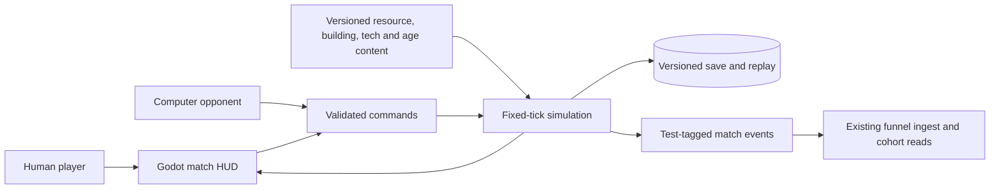
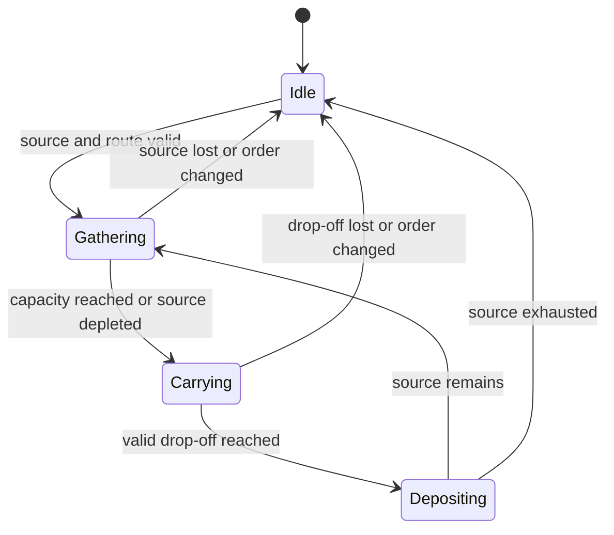

# Pitch — Deepen strategic play

Moves: `return_to_match` · Tests: Value proposition

## The ask, as given

The source idea is a proxy for the owner's ask; its wording is preserved here:

> The [v0.3 GDD](../../../docs/design/GDD.md) sets the full four-resource, four-age target. After [simulation foundation](harden-rts-simulation.md), refine this as one durable economic/progression epic: physical carry/drop-off/depletion and renewables for Comida, Materiales, Varos and Terrenos; generalized building placement, multi-builder construction/repair and population; queue/research prerequisites and effects; all four age transitions; matching AI, UI, save/replay and headless scenarios. Finish with a playable two-faction first-to-fourth-age skirmish, not a series of isolated one-resource demos. Final Terrenos fiction, economy numbers, tech tree and AoE2 reference patch need decisions. Fog, siege and other battlefield systems belong to the [warfare/world idea](expand-warfare-and-world.md), preserving a coherent scope. See the [full-game build path](../../full-game-build-path.md).

### Claims

1. Deliver one durable four-resource, four-age economy and progression epic after the simulation foundation.
2. Give all four resources physical carry, drop-off, depletion and renewable flows.
3. Generalize building placement, multi-builder construction and repair, population, queues, research prerequisites and effects.
4. Make the two-faction match playable from the first through fourth age, with matching AI, UI, save/replay and headless evidence.
5. Settle Terrenos logistics and a small mechanics-first tech graph; use AoE2 as inspiration only and keep fog, siege and other battlefield depth in the next idea.

**Teach-back:** yes — The owner confirmed one L-sized bet for a full four-resource, four-age skirmish; survey packets from vacant lots for Terrenos; a small mechanics-first tech tree with thematic names deferred; and AoE2: Definitive Edition as inspiration only. The remaining Terrenos logistics and minimum rule graph are Plan gate decisions.

## Problem

The current skirmish has one gold stockpile, one source per side, a recruitment post and a short unit queue. It has no age or research state. Once a player learns that loop, another match offers few economic or progression decisions. The full-game direction requires a durable system that can support later warfare, AI and faction content without hardcoding each new rule into the view.

## Appetite

**L** — one substantial epic, re-evaluated at the boundaries below. The owner confirmed this size on 2026-10-17. It buys a complete two-faction economy/progression match, not numerical parity with another game or production balance.

quote: $50–300 (L, n=0, wide)

## Outcome & signal

As a classic RTS player, I can choose how to allocate workers and four resources, expand and repair my settlement, decide between army and research, advance through all four ages, and finish a two-faction match. A repeat match should offer a different viable economic plan. The owner can verify this in a downloaded build by playing both factions to the fourth age and completing both victory routes; seeded headless scenarios verify the rules, AI, save and replay.

The later-day match completion rate, `return_to_match`, is the North Star input this could move. Its baseline and target remain unknown until an eligible cohort exists. Use the existing test-account exclusion and accepted-event contract; a private preview cannot establish a player-retention result. Read the first eligible cohort after its seven-day window and compare with the separately recorded baseline, then review the bet 30 days after a release with enough mature players.

## Stage-2.5 bucket

**Genuinely new.** The existing match proves gathering, construction, training and victory in a one-resource prototype. Expanding constants or adding decorative age labels would not deliver four coupled economic choices and a replayable progression system.

## Bill of materials (What / Why)

| What                                                       | Why                                                               |
| ---------------------------------------------------------- | ----------------------------------------------------------------- |
| Four-resource worker loop, finite and renewable sources    | Route choice, depletion and recovery create economic tradeoffs.   |
| General construction, repair and population                | Expansion and housing compete with army and research spending.    |
| Versioned queues, research effects and all age transitions | Advancement changes available actions and costs real opportunity. |
| Two-faction AI, HUD and persistence on the same rules      | The full match stays understandable, finishable and replayable.   |
| Seeded scenarios and owner match walkthroughs              | Rule correctness and actual playability are both visible.         |

## Scope

**In v1:** Comida, Materiales, Varos and Terrenos each have an approved source, carrying capacity, valid drop-off, finite supply and at least one renewable or replenishable route; workers retask when a source or drop-off disappears. A small coherent building roster covers drop-off, housing, production and research, with valid placement, shared construction progress, cancellation/refund and repair. Population constrains unit production. Research and the three transitions from Foránea to Universitaria to Godín to Gentrificación have versioned IDs, prerequisites, costs, duration and inspectable effects. Both existing factions and the computer opponent use the same resources, prerequisites and legal commands. The HUD explains stockpiles, carry, source state, population, queues, age, costs and disabled reasons. Save/load and replay preserve progression and reject incompatible versions clearly. The current two victory routes remain finishable.

**Out of v1 (no-gos):** fog/LOS, siege, formations, garrison, expanded combat counters, larger/generated maps, strategic scouting AI, new factions, trade/market exchange, wonder mode, multiplayer, campaigns, public invitations and a parity claim. Those remain with their later ideas or existing alpha gates. No fifth resource and no concept-art label becomes a game rule without a design decision.

## Rabbit holes

- **Terrenos fiction:** the owner chose survey packets collected from vacant lots. Proposed rule: workers carry packets to the command post at the start and to a registry after it is built. Each lot has finite packets before a capped, timed survey refresh representing new leads on that site; a match cannot rely on an unlimited instantaneous loop. Fix node counts, travel distances and refresh timing with the economy table before coding. Terrenos is a resource abstraction, not literal property ownership.
- **Tech tree and economy numbers:** the owner chose a small mechanics-first tree with final names deferred. Lock stable IDs, minimum building/unit/tech roles and explicit per-age prerequisites before coding. Every tech must alter a measurable rule; record cost, time, refund, effect and AI use. Tune from controlled scenarios and rendered matches, not invented parity values.
- **AoE2 reference:** the owner chose inspiration-only for this epic. Do not claim numerical parity; if a later comparison needs one, pin the Definitive Edition build/patch, scenario and deviation policy first.
- **Save and replay:** a new content version must identify incompatible old saves without deleting them. A replay or loaded state must apply the same resource, queue and age effects in the same order.
- **Appetite pressure:** stop at a playable four-age match with a small roster. If later balance/content work threatens the L budget, record evidence and re-evaluate at a boundary; do not add warfare or faction production to finish the economy.

## What already exists (reuse, don't rebuild)

- `game/skirmish.gd` has fixed-tick command validation, worker carry/drop-off, build/production, AI and both victory routes; its hardcoded single-resource assumptions are the seam to replace.
- `game/rules_content.gd` and `game/content/skirmish.v1.json` validate stable content IDs and the current map, faction, unit and building definitions. Extend that contract for resources, tech and ages.
- `game/skirmish_persistence.gd` and `game/skirmish_replay.gd` already provide versioned local save and command replay. Preserve the match ID and test-event lifecycle.
- `game/skirmish_main.gd` is the current rendered selection, command and HUD surface; `game/art_catalog.gd` keeps art outside simulation rules.
- `game/tests/` contains simulation, faction, district, save, replay, content, cross-platform hash and scale checks. Extend representative scenarios through the existing runner.
- `Roadmap/00-strategy/north-star.md` and the staged funnel contract define eligible return; do not create a second measurement path.

## Visuals





```surface
state: progression-idle
route: /skirmish
- head "Age: Foránea" action "View research"
- summary "Comida | Materiales | Varos | Terrenos | Population" count 5
- card "Selected worker: carrying and destination"
- list columns "Queue | Cost | Time | Cancel"
- note "Next age: prerequisites and effect"
```

```surface
state: progression-disabled
route: /skirmish
- head "Age: Foránea" action "View research"
- summary "Comida | Materiales | Varos | Terrenos | Population" count 5
- card "Next age unavailable"
- note "Needs: named prerequisite or resource amount"
```

## UX heuristics & rails check

- **CI guards:** existing Godot simulation/content, persistence/replay, cross-platform hash and skirmish contract checks; add seeded resource, queue, tech, age and AI scenarios. Run a real downloaded-build match at each substantial boundary.
- **Audit lens:** the [architecture review](../../../docs/architecture-review-2026-10-16.md) names hardcoded costs, one-resource state and the missing tech/age model; the [full-game build path](../../full-game-build-path.md) separates economy from warfare.
- **Design-language debt:** four counters and a tech tree can crowd the current HUD. At 1024×700 and normal/enlarged zoom, keep selection and commands readable; explain unavailable actions in words, not color alone. Cultural names must not hide the rule.

## Measurement and safety decision

No separate gameplay enablement or kill flag is proposed. Offline rules, saves and replays require one explicit content version; switching core rules mid-match would split outcomes. Stage the new content in a Restricted preview, keep the existing `telemetry.play_funnel_enabled` gate and test-account exclusions, and roll back by build version if QA fails. If the owner wants a measured rollout flag, it needs a version-bound activation design before the Plan gate, not a live mid-match toggle. Reuse `match_started`, `match_completed` and later-day completion for the outcome. A diagnostic age-advance event is optional and cannot count as a public completion.

## Slices, risk and QA

| Sprint                           | Player story and acceptance                                                                                                                                                                                                       | Risk · QA                                                                                                                                                                                              |
| -------------------------------- | --------------------------------------------------------------------------------------------------------------------------------------------------------------------------------------------------------------------------------- | ------------------------------------------------------------------------------------------------------------------------------------------------------------------------------------------------------ |
| 1 · Complete worker economy      | As a player, I can gather, carry and deposit all four resources, recover from depleted sources, construct and repair with multiple workers, and grow population. Each resource affects a legal choice in the same playable match. | **High** — shared simulation/content and saves. Seeded income, depletion, missing drop-off, multi-builder, repair, cancellation, cap and save/replay cases; rendered two-faction economy smoke.        |
| 2 · Four-age progression         | As a player, I can choose army or research spending, see why an action is unavailable, finish a legal prerequisite chain and advance through all four ages; each age changes available actions.                                   | **High** — versioned rules and persistence. Invalid graph, prerequisites, queue/cancel/refund, effects, age transitions and resumed replay hash cases; owner HUD/readability smoke.                    |
| 3 · Integrated two-faction match | As a player, I can reach the fourth age and finish by either existing victory route against an AI that pays the same costs and obeys the same prerequisites. A different economic plan remains viable on repeat.                  | **High** — AI and shared match rules. Seeded AI legality and terminal cases, save/replay and test-event contract; owner downloaded-build walkthrough for both factions and routes, including a resume. |

## Acceptance criteria

1. A headless scenario gathers, carries and deposits each of the four resources, depletes a source, uses a replenishable route and records exact stockpile and worker state after interruption or lost drop-off.
2. A match builds housing, drop-off, production and research buildings with placement rejection, multiple builders and repair; population blocks and then permits recruitment, and cancellation has a recorded refund rule.
3. A declared tech graph rejects unknown IDs, cycles and unmet prerequisites. Research and all three age transitions charge resources and time, apply visible effects once, and preserve their state through save/load and replay.
4. Regios, Poblanos and the AI obey the same economy and progression rules. A seeded scenario and a rendered match demonstrate first-to-fourth-age play and both existing victory routes without changing their terminal semantics.
5. The owner can identify resource, population, queue, research and age state and tell why a disabled action is disabled at supported desktop sizes. Normal and enlarged zoom leave the board selectable.
6. A downloaded Restricted build completes the owner walkthrough as both factions and both victory routes, including save/quit/resume and test-tagged event checks. Record build ID, results and any limitation; no public cohort or numerical parity claim follows from private QA.

## Open risks / research and owner decisions

The simulation foundation shipped in a Restricted preview; its validated content, save/replay and hash seams are available. The architecture review's pre-foundation gap table is historical, so the source files above were checked on 2026-10-17. The owned-art epic remains in progress until its downloaded-build match acceptance is recorded; this plan does not count that evidence as complete.

The owner approved these minimum rules at the Plan gate on 2026-10-17:

| Decision           | Mechanics-first baseline                                                                                                                                                                                                                                                                                       |
| ------------------ | -------------------------------------------------------------------------------------------------------------------------------------------------------------------------------------------------------------------------------------------------------------------------------------------------------------- |
| Terrenos logistics | Vacant-lot survey packets go to the starting command post or a later registry. Lots exhaust, then refresh on a capped timer; no infinite stockpile source.                                                                                                                                                     |
| Building roles     | Existing command post and recruitment post, plus a general drop-off depot, housing for population, and a registry for research and Terrenos delivery. These are roles, not final art or thematic names.                                                                                                        |
| Unit roles         | Keep workers and the existing melee and ranged fighters. Add no new combat role in this epic.                                                                                                                                                                                                                  |
| Research graph     | Three effect nodes: `carry_capacity_i` (Universitaria) increases worker carry, `construction_rate_i` (Godín) increases build/repair speed, and `combat_training_i` (Gentrificación) improves an existing fighter stat. Each requires the registry. Stable IDs stay mechanical; final display names can follow. |
| Age gates          | Foránea → Universitaria requires housing and depot; Universitaria → Godín requires the registry and `carry_capacity_i`; Godín → Gentrificación requires the recruitment post and `construction_rate_i`. Each transition has a resource cost, queue time and visible unlock.                                    |

The exact starting costs, durations, replenishment intervals and effect sizes are initial test values locked in the versioned content before coding, then tuned from scenarios and play evidence. The owner chose AoE2: Definitive Edition as inspiration only for this epic, with no numerical parity claim or patch gate. This L-sized bet pushes the [warfare/world idea](expand-warfare-and-world.md) and later full-game work back while this match is made whole.

## Intent match

The advisory intent check could not look because `TYPESAFE_API_KEY` is unavailable. The claims, acceptance checks and owner decisions above remain reviewable without a score.
