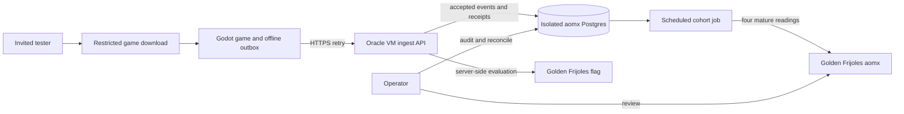
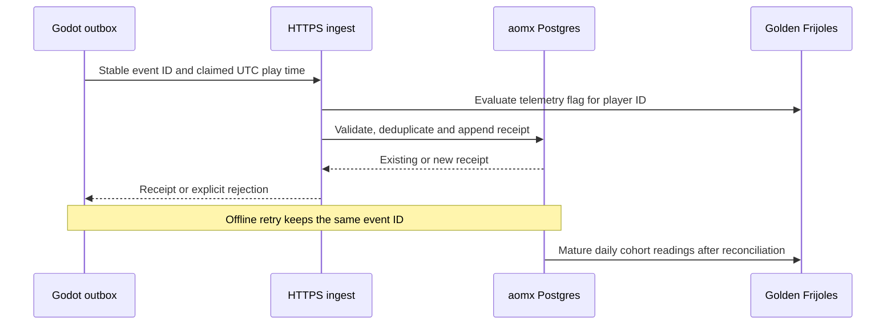

# Pitch — Enable a measured private alpha

Moves: `return_to_match` measurement · Tests: whether a finishable solo match can produce an auditable first cohort. The provisional 15% goal has no observed baseline.

## The ask, as given

> Then im not sure if we should refine that as per the methodology, or actually start from there, let me know
>
> sounds good except for render, specially for postgres, cant we use supabase? i also have a free tier oracle vm we can use at will.
>
> The suggested refinement is approved.
>
> cant we use supabase free for real cohort data? yes they do suspend it, but do we anticipate lots of traffic? and we can always keep it alive through other means no? thats my only challenge to it all. But open to your suggestions. Other than that is approved across the board.

### Claims

1. Shape a measured private alpha before starting release infrastructure.
2. Originally choose Supabase Free for the first real cohort, then use isolated VM Postgres after the provider refused a third active Free project.
3. Keep Golden Frijoles as the flag, measurement and roadmap provider.

**Teach-back:** a narrow, installable invited alpha should turn offline solo matches into an auditable first cohort using the infrastructure the owner already has. On 2026-10-14 the owner chose isolated Postgres on the Oracle VM after Supabase's active Free project limit blocked a dedicated project.

## Problem

The Godot skirmish and local funnel exist on draft PRs. The client uploads only to loopback with `test_account: true`; the Node ingest writes local JSONL; the publisher has no verified aomx-scoped live path. No tester can install a measured release or contribute an eligible cohort yet.

## Appetite

M — several connected slices. Cut optional release polish and wide platform support to preserve this budget.

quote: $20–120 (M, n=0, wide) — an approximate agent API spend band, not a hosting quote.

## Outcome & signal

An invited tester downloads a release build, finishes a solo match offline or online, syncs its accepted result exactly once, and can return on a later UTC date. The operator can trace the accepted and excluded events through durable storage, a mature cohort report and the four Golden Frijoles readings. A first cohort count and observed baseline are reported only when the agreed windows mature; until then they remain pending.

## Stage-2.5 bucket

**Genuinely new release path**, using an already working local skirmish, event contract, offline outbox, ingest rules, cohort report and Golden Frijoles flag. Hosting and release wiring are missing.

## Bill of materials (What / Why)

| What | Why |
| --- | --- |
| Reproducible Godot export and restricted download | Give invited testers a known build to install and revisit. |
| HTTPS ingest on the existing Oracle VM, subject to capacity and isolation checks | Reuse the owner's VM and existing Caddy/Docker operating pattern. |
| Isolated Postgres container and volume on that VM | Persist accepted events, receipts, flag decisions and report history without sharing panfleto's database, network or credentials. |
| Independent daily backup and availability check | Make VM loss and database failure visible and recoverable through a private OCI bucket. |
| Server-side Golden Frijoles flag and scheduled cohort publisher | Keep client secrets out of the game and publish only reconciled mature readings. |
| Release and reconciliation walkthrough | Prove one real, excluded, duplicate, delayed and later-day path before widening invitations. |

## Scope

**In v1:** macOS first for invited classic RTS players; a restricted invited build; versioned endpoint configuration; a durable append-only audit and idempotent receipts in isolated VM Postgres; a server-only flag evaluation; a verified aomx-scoped publisher; a small invited cohort and operator runbook; daily off-project backup with a tested restore; availability and storage checks; CI/export checks and a second security/data-integrity review.

**Out of v1 (no-gos):** Public storefront launch, payments, multiplayer, new faction or district mechanics, analytics SDK embedded in the client, Supabase Auth or direct browser/client database access, migrating unrelated projects, and claiming the 15% goal was met before a mature cohort exists. The broader [release-candidate idea](prepare-release-candidate.md) retains localization, settings, crash reporting and community polish.

## Rabbit holes

- The Oracle VM already hosts panfleto on a single Arm instance. Check live CPU, memory, storage, backup and Caddy routing before colocating aomx. Give the game its own service, credentials and resource limits; do not borrow the newspaper's database or change its backup retention by accident. A capacity failure sends the API-host choice back to the owner.
- Supabase refused a dedicated Free project because the owner's account already has two active Free projects across organizations. The owner chose isolated Postgres on the Oracle VM instead; the empty aomx Supabase organization contains no project or credential. The 500 MB threshold is now an alpha planning quota, not a Supabase enforcement limit. Preserve the client outbox through an outage and alert on missed ingest/backup or VM disk pressure.
- Before any real invitation, prove a daily logical export to an aomx-specific OCI Object Storage bucket and a restore to a disposable database. Keep aomx in its own database, role, network and volume; do not alter panfleto's database or backup retention.
- Offline integrity still needs the approved accepted-result policy, clock checks and correction/backfill path. The current publisher is deliberately dry-run only because its write credential cannot yet be verified as aomx-scoped.
- Apple signing and notarization affect the first macOS download. Pick the first tester platform and installation support expectation before implementing export automation.

## What already exists (reuse, don't rebuild)

- [`game/skirmish_main.gd`](../../../game/skirmish_main.gd) and [`game/funnel_outbox.gd`](../../../game/funnel_outbox.gd): finishable local solo game and ordered offline event persistence.
- [`src/funnel/ingest.mjs`](../../../src/funnel/ingest.mjs), [`src/funnel/http.mjs`](../../../src/funnel/http.mjs), [`scripts/funnel-report.mjs`](../../../scripts/funnel-report.mjs): validation, local receipts and cohort derivation.
- [`docs/launch-funnel-contract.md`](../../../docs/launch-funnel-contract.md) and the [agreed North Star](../../00-strategy/north-star.md): event and eligibility definitions.
- Golden Frijoles `aomx` already has `telemetry.play_funnel_enabled`. The original plan kept it off until live reconciliation; the owner enabled it in all three environments on 2026-10-15. Reuse this flag, check its served state before invitations, and keep internal builds test-tagged.
- The owner's sibling `fluxonline/deploy/` contains an Oracle VM/Caddy/Docker/OCI-backup pattern. It is a reference implementation, not a shared aomx datastore.

## Visuals

## UX heuristics & rails check

- **CI guards covering this surface:** Local Node tests and Godot headless checks exist; release export, hosted integration and deployment gates still need implementation.
- **Audits-lens findings that apply:** No relevant audit file found in this repo.
- **Design-language debt:** The local game uses geometric placeholders; the alpha needs clear install, sync-pending, rejected-event and result copy, not a new visual system.

## Kill-switch / runtime gate

Reuse `telemetry.play_funnel_enabled` as the server-side eligibility gate, evaluated for the same pseudonymous player ID used by events. Keep each environment's served switch off until the accepted-result and cohort walkthrough passes. The operator must be able to stop accepting eligible cohort traffic without invalidating already stored audit records. This bet creates no new client-side flag or secret.

## Proposed slices and acceptance criteria

| Slice | Risk | Acceptance and QA stage |
| --- | --- | --- |
| 1. Package the first desktop build | Low for export code; high for external release | A fresh checkout runs the existing tests, exports a versioned build and can install/play it on the chosen target machine. Review the restricted download and signing path before invitations. |
| 2. Host accepted ingest and durable audit | High: shared VM, player data and database migration | A separate aomx API accepts ordered offline uploads over HTTPS, returns stable receipts on retry, persists records across restart and restore, and rejects test, duplicate, malformed and unresolved-clock paths correctly. A daily off-project export and disposable restore pass; alerts cover missed backups, write failures, VM disk and 50%/80% of the 500 MB alpha planning quota. Node integration tests plus a live staging smoke prove this. |
| 3. Reconcile and invite a small cohort | High: privacy, flag, reporting and external release | The aomx key identity is verified; mature readings match raw accepted records for the documented test paths; the served flag state is checked per environment; the owner-approved notice and invitation are used; the first real cohort remains pending until its window closes. Second reviewer checks data and security, then the operator records a real-build smoke and later cohort read. |

## Approved plan decisions

1. Start with macOS invited classic RTS players; add other desktop targets after the first export path works.
2. Use isolated Postgres on the existing Oracle VM for real invited data, backed up independently and monitored. This supersedes the earlier Supabase Free choice after a dedicated Free project was refused. No paid upgrade is authorized by this bet.
3. Build this next after the current draft stack is reviewed and merged, ahead of the distinctive La Roma playtest. Invite real players only after that playtest build demonstrates its objective and the funnel passes; the broader release candidate waits.

## Open risks / research

- [Supabase active Free project limit](https://supabase.com/docs/guides/platform/billing-on-supabase) explains why the original database choice was unavailable to this account.
- [Oracle Always Free Arm allowance](https://www.oracle.com/cloud/free/) and the owner's existing `fluxonline/deploy/README.md` deployment notes; live capacity is still unmeasured.
- [Godot macOS export and notarization](https://docs.godotengine.org/en/4.7/tutorials/export/exporting_for_macos.html); [itch.io restricted access](https://itch.io/docs/creators/access-control).

## Intent match

Could not score: `jev.egress` is unset, so the advisory TypeSafe check sent no pitch text. The claims and acceptance checks are written above for the owner's direct review.
