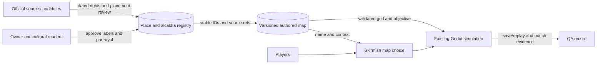

# Pitch — Establish CDMX geography and map data

Moves: `first_match_completion` · Tests: Value proposition. Immediate tests are source accuracy, fair play and uncoached comprehension; a later cohort reading cannot by itself attribute change to the map.

## The ask, as given

> Hi codex Refine seed: #16 establish-cdmx-geography-and-maps as per golden frijoles methodology, ensure to follow ways of work, team memory etc to ensure a smooth flight.

The original raw seed calls for a data and playability foundation for the 16 alcaldías, featured colonias and places, with a Roma Norte/Cibeles vertical slice. The owner chose **M — one verified playable map** and **standalone skirmish first** on 2026-10-22; campaign missions remain with #20.

### Claims

1. Refine seed #16 into a CDMX geography and maps plan.
2. Follow Golden Frijoles, Ways of Working and project learnings.

**Teach-back:** Partly — the owner confirmed appetite and the skirmish boundary; the full pitch remains for review.

## Problem

The game offers playable `la_roma`, Narvarte and Copilco maps. Their streets, blockers, objective and labels were authored for play, but there is no reviewed source-to-place record, distinction between real geography and fictional arena geometry, or reusable territory/place metadata for future scenarios. A concept atlas could be mistaken for GIS; a map revision could break pathing, balance or recordings. No eligible cohort has tested whether a more recognizable setting improves completion.

## Appetite

**M — several connected slices with an architecture and source review.** This buys a compact 16-alcaldía reference registry, a focused place catalog, a versioned map metadata contract and one verified Roma Norte/Cibeles skirmish under the existing `la_roma` identity. It does not buy citywide playable maps, full official polygons or a campaign. Revisit the next geography wave after owner play and source review.

quote: $20–120 (M, n=0, wide)

## Outcome & signal

The owner can trace each player-visible Roma Norte/Cibeles claim to a dated source, see which geometry is fictionalized, select the map with any faction and finish both victory routes. Stable IDs connect names, administrative placement, sources and rights decisions while the playable grid remains authored. An uncoached familiar/unfamiliar read tests place and objective recognition. Later, read existing `first_match_completion` by map and version from an eligible mature cohort, with counts and uncertainty; leave a numeric target unset now.

## Stage-2.5 bucket

**Light enhancement for choosing La Roma; genuinely new verification and reuse contract.** The `la_roma` selection, map loader, Cibeles objective, four factions and two victory routes already work. Copy alone would expose the map but would not establish provenance, stable references or tested fairness. Keep Narvarte/Copilco available.

## Bill of materials (What / Why)

| What | Why |
| --- | --- |
| Dated source and rights log | Prevent unsupported claims or unreviewed redistribution in a commercial build. |
| Compact alcaldía/place registry | Give later scenarios stable IDs and accurate labels without importing citywide geometry. |
| Versioned authored-map metadata | Separate real place references from blocked, traversable and decorative game tiles. |
| Roma Norte/Cibeles map revision and selection copy | Let players recognize the location and choose it independent of faction or campaign. |
| Fairness and compatibility checks | Keep routes, AI, fog, selection, wins, saves and replays working. |
| Owner and uncoached play record | Test comprehension and playability before widening scope. |

The owner may edit the Why column at the Plan gate. A part without a defensible reason moves to a later wave.

## Scope

**In v1:** Record the 16 alcaldías with stable, source-traceable IDs and names; curate only featured colonias/places needed for this map and later scenario handoff, marking uncertain placements unresolved. For any source record publisher, URL, version, retrieval date, license/attribution decision and any coordinate-to-grid transform **before import**. Distinguish administrative boundary, named place, fictional playable territory and grid tile. Extend validated map content with place references, traversable/blocked/decorative semantics, spawn/objective metadata and localization keys. Revise the existing `la_roma` selection and 28×28 skirmish; any of four factions can play it. Preserve the current functional map until a candidate passes staged checks, then version content and document old save/replay behavior.

**Out of v1 (no-gos):** Full colonia polygons or citywide GIS import; exact street-scale reconstruction; treating `full-map.jpg` as geospatial evidence; conquest/progression rules, mission scripting or a campaign; new victory, economy or faction restrictions; generated maps, rooftop or water movement; replacing Narvarte/Copilco; public release or invitations. #15 owns art, #17 rules fidelity, #20 missions and #21 alternate modes.

## Rabbit holes

- **Administrative versus authored space:** official boundaries and the ADIP colonia catalog are source candidates, not game territory polygons. Record provenance for every derived shape and label; identify stylized boundaries as such.
- **Rights before import:** the CDMX portal currently labels the alcaldía and colonia datasets CC-BY-4.0-ESP and warns that datasets may change retroactively. Confirm exact resource terms, attribution and upstream INEGI conditions for commercial redistribution before copying coordinates. If unresolved, keep source geometry out of runtime content.
- **Content compatibility:** `RulesContent.load_map` permits known IDs and content hashes guard saves/replays. Pin old and candidate versions, preserve files on incompatibility and show explicit errors instead of silently loading changed geometry.
- **Fairness versus recognition:** a recognizable Cibeles plaza must support both spawns, resources, AI, fog and victory routes. Record access and counterplay criteria before tuning.
- **Portrayal:** the owner reviews visible labels and depiction under Ways of Working. Keep objectives clear to players unfamiliar with CDMX; do not imply factions belong to particular neighborhoods.

## What already exists (reuse, don't rebuild)

- `game/rules_content.gd`, `game/content/skirmish.v1.json` and `game/content/maps/{narvarte,copilco}.json`: versioned, validated map content and 28×28 `la_roma` grid.
- `game/skirmish.gd` and `game/skirmish_main.gd`: map choice, four factions, pathing, AI, fog, district hold, two wins and current setup. The #15 Cibeles art is a view asset, not a geography source.
- `game/skirmish_persistence.gd`, `game/skirmish_replay.gd`, `game/participant_replay.gd` and multiplayer replay validation: content hashes and safe failure paths to retain.
- `game/tests/world_expansion_test.gd`, `scripts/skirmish-contract-check.mjs` and `game/README.md`: current contract and run instructions to extend.
- [World expansion](../../02-civilizations-and-world/expand-civilizations-and-world/README.md), [La Roma promise](../../02-civilizations-and-world/prove-la-roma-promise/README.md), [art #15](../../02-civilizations-and-world/produce-cohesive-cdmx-art/README.md), [coverage review](../art-world-coverage-2026-10-21.md) and [full-game path](../../full-game-build-path.md): scope and QA boundaries.

## Visuals



| ID example | Kind | Label | Relationship and status |
| --- | --- | --- | --- |
| `alc_cuauhtemoc` | administrative reference | Cuauhtémoc | One of 16; source and license review before geometry import. |
| `col_roma_norte` | colonia reference | Roma Norte | Parent: Cuauhtémoc; exact source record to verify. |
| `place_fuente_cibeles` | named place | Fuente de Cibeles | Roma Norte; coordinate and grid transform to review. |

```surface
state: skirmish-map-idle
route: /skirmish/setup
- head "Choose a map" action "Select La Roma"
- card "La Roma · Roma Norte / Cibeles"
- note "A stylized battlefield inspired by a real CDMX neighborhood. Any faction can play here."
- note "Win by destroying the opposing command post or holding Cibeles."
```

The surface describes words on the existing native setup, not a new route or full UI redesign. Review the [grey sketch](../establish-cdmx-geography-and-maps-sketch.html).

## UX heuristics & rails check

- **CI guards:** current Godot world-expansion, replay/persistence and simulation checks plus `npm run skirmish:contract`; add source/ID validation and fairness fixtures, then run rendered downloaded-build QA.
- **Audits lens:** no `Roadmap/00-ideas/audits/` finding for this surface; the [coverage review](../art-world-coverage-2026-10-21.md) identifies the geography gap.
- **Design-language debt:** map choice is a native option list rather than a descriptive card. Keep context concise at existing scales; #18 owns the broad interface.

## Measurement and runtime gate

**Measure — proposed yes, using the existing event path:** Accepted `match_started` and `match_completed` carry `map_id` and build/content identity. Record a map-specific eligible funnel read after a cohort exists, plus owner completion and comprehension now. No new adoption event or remote enablement flag is proposed for this offline selectable map. The existing `telemetry.play_funnel_enabled` flag is not a map switch.

**Safety — proposed no new runtime flag:** High risk is source rights and geographic assertion, controlled by pre-import review and a Restricted build gate. Keep the current map version recoverable; a failed candidate never replaces it. A later live experiment needs its own flag/evaluation decision.

## Proposed slices, risk and QA

| Sprint / story | Player or operator result | Risk | QA stage and owner smoke |
| --- | --- | --- | --- |
| 1 · Source and contract · S1.1 | The owner sees 16 reference alcaldías and focused Roma Norte/Cibeles source, rights and uncertainty records. | high · rights/portrayal | Review resource terms, dated citations, IDs, attribution and unresolved placements before import. |
| 1 · Source and contract · S1.2 | A map author defines a place-linked grid without confusing decoration and blockers. | high · shared content/save contract | Validate references, tile roles, objective/spawns and malformed fixtures; old map still loads. |
| 2 · Playable map · S2.1 | A player selects a described La Roma skirmish with any faction. | low · setup UI | Render setup at supported sizes; load each faction without campaign dependency. |
| 2 · Playable map · S2.2 | The owner plays a fair Roma Norte/Cibeles map through both victory routes. | high · simulation/map behavior | Deterministic access, AI, fog, selection and resource checks; full owner matches and faction coverage. |
| 3 · Compatibility and acceptance · S3.1 | Old save/replay and new map recording have explicit, safe version behavior. | high · player data/replay | Save/resume and replay hashes, retained file on incompatibility, multiplayer replay where applicable. |
| 3 · Compatibility and acceptance · S3.2 | Familiar and unfamiliar readers identify place and objective without coaching. | low · research | After separate invitation approval, record task results; story stays open if unrun. |

Each sprint closes with a numbered owner smoke walkthrough for an actual build, one action and one visible result per step. Rights and shared save/replay stories need independent review. Follow the single escalation list in Ways of Working for new geography, rule or portrayal decisions.

## Acceptance criteria

1. The registry records all 16 alcaldías with stable IDs and traceable names. Roma Norte/Cibeles records distinguish administrative membership, named place and authored territory; uncertain items remain unresolved.
2. Every imported source has publisher, URL/version, retrieval date, license, attribution decision, original coordinate reference and documented transform. No unreviewed geometry/image enters content; `full-map.jpg` stays art direction.
3. `la_roma` remains selectable with any faction; Narvarte and Copilco still load. Setup calls the arena stylized and explains both wins without requiring CDMX knowledge.
4. Validated metadata separates traversable, blocked and decorative tiles, spawn/resources, objective and stable references. Invalid IDs, inaccessible starts/objectives and contradictory tile roles fail deterministic validation.
5. Before promotion, run matched seeds and both sides through access, resource distance, AI, fog/LOS, selection and both terminal checks. Record criteria/results, then play full matches in a downloaded Restricted build; a merge alone is insufficient.
6. Save/resume, solo/participant replay and multiplayer replay where available reproduce a new-content hash or reject incompatible old content clearly while preserving the file. Record content/build IDs.
7. Owner-authorized familiar and unfamiliar readers each locate Cibeles, distinguish real place from stylized arena and explain both wins. Record counts and exact confusion. Read `first_match_completion` later only from mature eligible cohorts under the agreed North Star.

## Open risks / research and Plan gate

- **Official candidates checked 2026-10-22:** the [CDMX alcaldía boundaries dataset](https://www.datos.cdmx.gob.mx/es_AR/dataset/alcaldias) describes 16 boundaries from INEGI's 2020 Marco Geoestadístico and displays CC-BY-4.0-ESP; the [ADIP colonia catalog](https://www.datos.cdmx.gob.mx/es_AR/dataset/catalogo-de-colonias-datos-abiertos) offers SHP/GeoJSON and displays the same license. Both pages warn of retroactive updates. These are resource-level audit candidates, not import clearance.
- **Placement evidence:** the [Cuauhtémoc alcaldía notice](https://cuauhtemoc.cdmx.gob.mx/2024/12/15/corren-la-carrera-del-pavo-en-cuauhtemoc/) places Fuente de Cibeles in Roma Norte. Precise coordinate, footprint and relation to the grid remain unverified.
- **Owner decisions recorded 2026-10-22:** approved the M plan and one orchestrated build, with merges and releases authorized; owner QA remains owed. Skirmish comes first and #20 owns campaign missions. The bet is placed after #15; #17 and later new bets wait. Public invitations and any disputed portrayal still use the project escalation rules.
- **Overlap:** #15 owner art QA remains open. This bet pays for verifiable identity, map semantics and safe reuse, not another broad art pass.

## Intent match

The pinned kit attempted the advisory 17-question check on 2026-10-22 but could not look: Jev's network fetch failed. No score or gap verdict is claimed. The owner can review the verbatim ask, claims, surface sketch and seven acceptance checks directly at the Plan gate.
