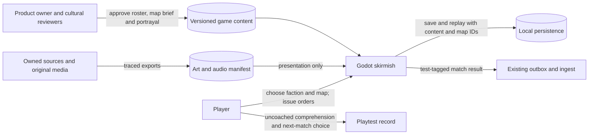

# Pitch — Expand civilizations and world

Moves: return_to_match · Tests: Value proposition. A later-day effect remains a hypothesis until eligible play data exists.

## The ask, as given

> Hi codex Refine seed:
> #13
> Expand civilizations and world (Roadmap/00-ideas/seeds/expand-civilizations-and-world.md) as per golden frijoles methodology, ensure to follow ways of work, team memory etc to ensure a smooth flight

The original seed's request, retained as input:

> After the [two-faction and district playtest](prove-la-roma-promise.md) and the [simulation, economy, warfare and AI waves](../../full-game-build-path.md), refine a production-content epic: approved faction roster and tech trees, distinct map templates, art/animation/audio exports and cultural/accessibility review. The current match's visual replacement is scoped separately in [La Roma battlefield art pack v0.1](la-roma-battlefield-art-pack.md). The owner confirmed rights to `references/newArtWork`, `references/critters` and `references/isometric tileset`; the [asset inventory](../../../docs/art/reference-inventory.md) distinguishes flattened concept boards from candidate tiles/sprites. Integrate only selected, traced exports at tested game scale, with readable roles and counterplay. GDD candidate names, landmark bonuses and map routes are not final mechanics.

The owner approved an expanded **L appetite** on 2026-10-19: both proposed new factions (Oaxaqueños and Veracruzanos), both proposed new authored maps (Narvarte and Copilco), roster/content specifications, and an art/animation/audio path. The L bet is reviewed between waves; it is not a blanket approval of numerical bonuses or cultural claims.

### Claims

1. Refine backlog item #13 through the Golden Frijoles method and project ways of working.
2. Preserve the seed's faction roster, tech-tree, map, media and cultural/accessibility aims.
3. Deliver both additional factions, both additional maps and the content/media path within an L appetite, in reviewable waves.

**Teach-back:** Yes for scope — the owner explicitly expanded the playable proof to both proposed factions and maps and approved an L appetite.

## Problem

The local solo match has Regios, Poblanos and one authored La Roma map. A player considering a second battle cannot choose a different strategic setting. The GDD offers faction and map candidates, but their names, mechanics and art are not approved content. The existing two-faction comprehension test, downloaded-build checks and first real cohort remain open, so expanded content cannot yet claim validated demand or a retention lift.

## Appetite

**L — a larger epic re-evaluated between waves.** This buys a four-faction candidate roster, two additional authored maps, faction technology choices, reusable content/media contracts and a limited production media set. Random maps, a complete launch soundtrack and every GDD faction remain outside this bet.

quote: $50–300 (L, n=0, wide)

## Outcome & signal

Players can choose among four clearly described factions and three distinct, fair authored maps. Oaxaqueños and Veracruzanos each have a viable opening, visible strength and weakness, at least one counter, and a faction technology choice that changes play. Narvarte and Copilco each change route and resource decisions while supporting both win routes and all three AI levels. A limited original animation/audio set reads at game zoom and has source rights and export records.

The immediate read is an owner-recorded, uncoached second-match choice and comprehension check across people familiar and unfamiliar with Mexican references, after the private-alpha invitation gates. Record exact counts, reasons and failures. The agreed `return_to_match` rate can be read only from a mature eligible cohort; its baseline and numeric improvement target remain unknown. Test-tagged preview matches never enter that rate.

## Stage-2.5 bucket

**Genuinely new:** faction parameters and one map exist, but the game exposes only two hard-coded faction choices and one content map. **Already possible today:** author, version and validate the current map and two factions, and export selected owned art through the existing manifest. **Light enhancement already in flight:** current-match visual replacement, a view-only art pilot and HUD readability belong to their existing epics; close their owner QA there.

## Bill of materials (What / Why)

| What | Why |
| --- | --- |
| Owner-approved four-faction candidate roster and technology/role sheet | Gives each choice a strategy, weakness and counter without treating regional identity as a gameplay fact. |
| Versioned Oaxaqueño and Veracruzano rules and selection | Makes both new choices playable through the same validated simulation, AI, save and replay path. |
| Narvarte and Copilco authored maps | Makes repeat matches tactically different and tests fairness before generation. |
| Directional animation and original audio cues through the traced media catalog | Proves scale, legibility, rights and audio behavior without committing to a full media library. |
| Owner and uncoached match read | Checks strategy and cultural clarity in a real downloaded build before broad production. |

The owner can revise the Why column at the Plan gate.

## Scope

**In v1:** approve a candidate four-faction roster and roles; implement Oaxaqueños and Veracruzanos with distinct, counterable technology choices; add Narvarte and Copilco with map selection and versioned IDs; extend content validation, AI, save/replay and test-tagged event version handling; export a limited original animation/audio set with provenance; verify full matches, clarity and accessibility cues. Keep existing Regio/Poblano choices and La Roma map usable.

**Out of v1 (no-gos):** final launch roster or numerical AoE2 parity; every GDD candidate faction or unique unit; random-map generation; new victory modes, campaign, multiplayer, wildlife mechanics or balance claims from a tiny sample; a flattened concept board as a playable map; production-wide replacement art, soundtrack or voice localization; a public release, participant invitation or altered North Star definition. Those remain separate bets or owner gates.

## Rabbit holes

- **Roster and portrayal:** The owner approved Oaxaqueños and Veracruzanos as playable names, Oaxaqueños as fictional resource efficiency/support, and Veracruzanos as fictional mobility/trade on 2026-10-19. Exact abilities, writing and media still need an explicit design record and review. Local cultural reviewers identify ambiguity or caricature; no observed group trait becomes a stat.
- **Content architecture:** `game/rules_content.gd` fixes faction IDs and validates a single map; `game/skirmish.gd`, setup, persistence and replay also assume exactly two named factions. Pin content and map IDs at match start and preserve old save/replay behavior or reject incompatible versions without data loss. Do not build a general mod/editor system.
- **Map fairness:** Declare starts, access to four resources, routes and La Roma before art placement. Run path, AI and both-victory cases for each selected map. Reject a map that requires hidden AI privileges or blocks readable counterplay.
- **Media scope:** Reuse the owned art export/manifest contracts. Local boards are direction, not sprites or licensed music. Check rights and readability before widening production after the first pilot.
- **Evidence timing:** Existing two-faction and downloaded-build QA is still open. Use failures to revise this scope before implementation. A preview or PR merge is not a release or eligible cohort.

## What already exists (reuse, don't rebuild)

- `game/content/skirmish.v1.json`, `game/rules_content.gd`: versioned content and validation for current factions, technologies, one map and objectives.
- `game/skirmish.gd`, `game/skirmish_main.gd`: fixed-tick rules, AI, faction setup, map presentation and both victory routes.
- `game/skirmish_persistence.gd`, `game/skirmish_replay.gd`: content-aware save/replay and explicit version failure.
- `game/art_catalog.gd`, `game/assets/manifest.v0.1.json`, `scripts/export-art.sh`, `docs/art/owned-art-pipeline.md`: traced export and runtime visual catalog to extend for the pilot.
- `game/funnel_outbox.gd`, `docs/launch-funnel-contract.md`: existing versioned, test-tagged match result path. The server decides public eligibility.
- [La Roma proof](../../02-civilizations-and-world/prove-la-roma-promise/README.md), [owned art](../../02-civilizations-and-world/integrate-owned-art-library/README.md) and [battlefield art](../../02-civilizations-and-world/la-roma-battlefield-art-pack/README.md): prior comprehension and art QA boundaries.
- `docs/design/GDD.md` and `docs/design-prework/`: candidate world direction, not approval for final rules.

## Visuals



| Content ID | Kind | Player-visible decision | Validation example |
| --- | --- | --- | --- |
| `regios` | Existing faction | Faster delivery; costlier combat | Existing save and matchup still work. |
| `oaxaquenos` | Approved playable name | Fictional efficiency/support choice | Mirror and cross-faction openings work. |
| `veracruzanos` | Approved playable name | Fictional mobility/trade choice | Mirror and cross-faction openings work. |
| `narvarte` | Approved map name | Balanced street grid and expansion choices | Both starts can reach resources, center and each other. |
| `copilco` | Approved map name | Readable chokepoints and alternative routes | Both starts can reach resources, center and each other. |

The IDs are proposed stable content IDs; exact bonuses and terrain layouts require the sprint contract and verification.

[Rendered match-setup sketch](../expand-civilizations-and-world-sketch.html)

```surface
state: match-setup-idle
route: /skirmish/setup
- head "Choose a faction and map"
- card "Regios · faster delivery, costlier combat"
- card "Poblanos · stronger buildings, standard economy"
- card "Oaxaqueños · fictional strategy and counter"
- card "Veracruzanos · fictional strategy and counter"
- card "La Roma · current center contest"
- card "Narvarte · balanced street grid"
- card "Copilco · chokepoints with alternative routes"
- note "Win by destroying the opposing command post or holding La Roma."
```

```surface
state: match-setup-disabled
route: /skirmish/setup
- head "Choose a faction and map"
- note "This map is unavailable in this build. Choose La Roma to start."
```

## UX heuristics & rails check

- **CI guards covering this surface:** Godot content, simulation, AI, save/replay, cross-platform hash and client checks; art manifest validation; Node game-to-ingest contract. The builder checks exact current commands in `game/README.md`.
- **Audits-lens findings that apply:** No `Roadmap/00-ideas/audits/` finding for this wave was found.
- **Design-language debt:** Faction and map names, silhouettes and audio cues must remain distinguishable without color or local cultural knowledge. Reuse the responsive HUD.

## Measurement and runtime gate

**Measure:** Yes. The immediate measure is the uncoached second-match choice/comprehension record; the later quantitative read is the agreed eligible `return_to_match` input from existing accepted match events, after a real cohort matures. No new event name or numeric target is invented.

**Safety:** No live gameplay flag for this offline fixed-tick match. Match-start content and map IDs, save/replay version checks and the Restricted build channel are rollback boundaries. Changing rules mid-match would break canonical results. No parallel flag or telemetry service; `flag_key` remains null. A future per-player experiment needs a separate match-start assignment design and owner approval.

## Proposed sprints, risk and QA

| Sprint / story | Player or operator result | Risk | QA stage and owner smoke |
| --- | --- | --- | --- |
| 1 · Content contract · S1.1 | Owner-approved four-faction roster, technology roles and two map briefs define strengths, weaknesses and counters. | high — core rules | Review fiction and exact rule proposal, content IDs and matchups before implementation. |
| 1 · Content contract · S1.2 | Validated faction/map/tech definitions pin content and map IDs through save and replay. | high — shared content/save contract | Malformed-content and old-save compatibility checks; owner smoke of content selection. |
| 2 · Playable factions · S2.1 | Oaxaqueños have a real strength, weakness and counter against same-rule AI. | high — simulation and replay | Mirror and cross-faction scenarios, save/replay hashes and rendered setup; owner full match. |
| 2 · Playable factions · S2.2 | Veracruzanos have a different viable strategic choice and counter against same-rule AI. | high — simulation and replay | Mirror and cross-faction scenarios, save/replay hashes and rendered setup; owner full match. |
| 3 · Authored maps · S3.1 | Narvarte changes routes and expansion without removing either win path. | high — map and AI | Spawn/resource/path/visibility checks across all factions and AI levels; owner both victories. |
| 3 · Authored maps · S3.2 | Copilco adds readable chokepoints and alternate routes without unfair starts. | high — map and AI | Same map matrix plus release-build performance; owner both victories. |
| 4 · Production read · S4.1 | Directional animation and original audio cues are traceable, controllable and readable in match. | low — presentation | Manifest/provenance, mute/volume and scale checks; crowded-board owner smoke. |
| 4 · Production read · S4.2 | Owner reviews signed download and authorized uncoached strategic/cultural clarity read. | low — QA record | Four factions × three maps, save/resume, both victories, test-event exclusion and observations. Invitations follow alpha gate. |

Every sprint ends with numbered steps, one action and one observable result each, for a product-owner smoke. Review high-risk contract and gameplay stories independently under Ways of Working. Do not mark human comprehension passed until participants actually complete the authorized read.

## Acceptance criteria

1. The owner-approved four-faction candidate roster and two map briefs define fictional doctrines and legible geography; each faction sheet names a viable opening, counter, weakness and language/visual cues. Exact GDD bonuses are never adopted by implication.
2. Both Oaxaqueños and Veracruzanos change at least one economy or combat decision, have visible counters, and can both win and lose against the other factions without AI-only rules.
3. Three selectable, versioned authored maps retain fair access to opening resources, attack routes and objectives. Four factions and all three AI levels reach terminal results on each map; both victory routes remain available.
4. Content validation rejects unknown IDs, impossible technology prerequisites and invalid starts. Old supported saves/replays load or fail explicitly without being overwritten; new saves/replays reproduce the same state and result across tested platforms.
5. The media pilot has rights/source/export records, working animation and audio controls, and readable silhouettes, ownership and objective cues at 100% and 125% zoom. Media does not alter collision, selection or simulation hashes.
6. A signed Restricted owner download passes a documented full-match and save/resume walkthrough with test-tagged event exclusion. In an owner-authorized directional read, four familiar and four unfamiliar reviewers each explain both win routes, identify the selected faction's strength, weakness and counter, and choose whether to start another faction/map match without coaching. Predeclared marks: at least three of four in each group explain both routes; at least six of eight name the tradeoff and counter; at least four of eight choose and start another match. Record raw counts, choices and failure examples. These are comprehension marks, not a retention estimate.
7. Report `return_to_match` only from a mature eligible cohort under the existing North Star definition. A local or Restricted preview result is never called a public retention baseline or a deployed game release.

## Open risks / research

- **Owner decision recorded:** both Oaxaqueños and Veracruzanos and both Narvarte and Copilco are in the approved L scope. The owner chose the GDD's fictional efficiency/support and mobility/trade directions. Precise mechanics and portrayal are recorded in Sprint 1 before implementation; no GDD numbers are adopted by implication.
- **Evidence gate:** The [La Roma comprehension test](../../02-civilizations-and-world/prove-la-roma-promise/README.md), [owned-art QA](../../02-civilizations-and-world/integrate-owned-art-library/README.md) and [warfare/opponent downloaded-build QA](../../01-core-play/expand-warfare-and-world/README.md) remain open. Read their results before locking the first implementation sprint.
- **Build target:** The [full-game path](../../full-game-build-path.md) places this wave after the opponent and warfare waves. Their code is merged, but epic Definition-of-Done checks remain open. Plan approval does not waive them.
- **Art and rights:** The owner confirmed commercial rights to three local sets in [the art inventory](../../../docs/art/reference-inventory.md). Selected exports still need source hashes, per-asset approval and runtime scale checks. Original audio source and rights must be recorded before inclusion.
