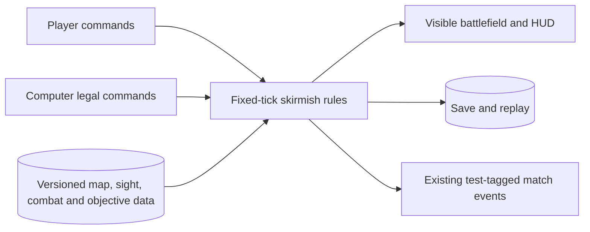
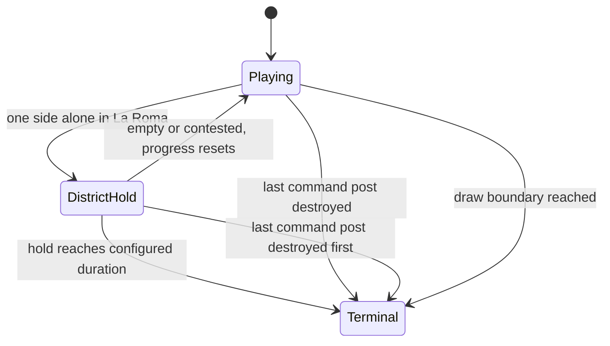

# Pitch — Expand warfare and world

Moves: `return_to_match` · Tests: Value proposition

## The ask, as given

The source idea is a proxy for the owner's ask; its wording is preserved here:

> After [simulation foundation](harden-rts-simulation.md) and [full economy/ages](deepen-strategic-play.md), refine a durable battlefield epic around a larger readable match: fog/line of sight, terrain/elevation policy, scalable route/crowd movement, armor classes and counter roles, projectiles/siege, tactical orders and garrison where justified. Formalize conquest and the existing La Roma objective with the owner. The outcome is a complete rendered match where scouting, composition, positioning and siege create counterplay, with seeded headless scenarios and large-map performance evidence. The [GDD](../../../docs/design/GDD.md) holds the full inventory; precise mechanics await a selected AoE2 reference edition and deviation policy. Do not add a combat feature solely because it appears on a concept board.

### Claims

1. Expand the match into a larger readable battlefield with fog/line of sight, a terrain/elevation policy and scalable movement under congestion.
2. Make armor classes, counter roles, projectiles and siege create deliberate composition and positioning choices.
3. Add only tactical orders and garrisoning that earn their place in the match.
4. Set explicit Conquest and La Roma victory rules with the owner, then prove both in complete rendered matches.
5. Use seeded headless cases and representative large-map performance evidence; treat the GDD as an inventory, not approval to copy every mechanic or claim AoE2 parity.

**Teach-back:** yes — The owner approved a larger, legible skirmish where scouting, composition, positioning and siege create repeatable counterplay, with both victory routes and performance proved in a real build (2026-10-18).

## Problem

The current two-faction skirmish is finishable, but the playable board remains a fully visible 20×20 map with melee and ranged fighters and a short route to either command-post destruction or a 3×3 district hold. A 48×48 stress fixture exists, but it is not an authored larger match. A player has little reason to scout or protect siege, and crowded fighters can overlap. More art or another unit name would not create tactical depth.

## Appetite

**L** — confirmed by the owner on 2026-10-18: one larger epic, re-evaluated after battlefield, combat and victory slices. It buys one authored larger two-faction solo match with clear counterplay and two complete victory routes. It does not buy the entire GDD war inventory or numerical parity with another game.

quote: $50–300 (L, n=0, wide)

## Outcome & signal

As a classic RTS player, I can scout a larger map, choose an army for the opposition, maneuver through terrain and congestion, protect or attack siege, and finish by Conquest or by holding La Roma. A second match can call for a different plan without requiring knowledge of the setting's jokes. The owner can check this in a downloaded Restricted build by finishing both routes with each faction and explaining why a counter worked. Seeded headless cases verify visibility, pathing, combat and terminal results; replay/save and a representative performance matrix guard the simulation.

The plausible North Star input is later-day match completion, `return_to_match`. There is no eligible cohort or baseline. The first result read is a mature seven-day cohort after real invitations and accepted telemetry exist; review this bet 30 days after release with enough mature players, using the [agreed North Star definition](../../00-strategy/north-star.md). Private preview/test-account matches show playability, not retention. The 15% launch goal is not this epic's invented target.

## Stage-2.5 bucket

**Genuinely new.** The current fixed-tick game, district objective, save/replay and 48×48 benchmark are reusable foundations. None provides playable fog, counter classes, projectile/siege decisions or an authored large-map match. A lighter path is to tune the present 20×20 fight and use the existing district test; that would not test the stated larger-battlefield value proposition.

## Bill of materials (What / Why)

| What | Why |
| --- | --- |
| One authored larger map, fog and sight rules | Scouting and terrain make information and position choices matter. |
| Congestion-aware movement with a scale budget | An army must reach a fight without overlapping or trapping itself. |
| Small counter roster, armor and visible projectiles | A player can predict why one composition beats another. |
| One costly siege role and minimal tactical orders | Structure assault needs protection and deliberate commands. |
| Two explicit victory routes, AI and HUD feedback | The richer battle remains understandable and finishable. |
| Seeded scenarios, save/replay and owner match checks | Determinism and real playability are both visible. |

## Scope

**In v1:** one authored, symmetric-enough large map with starting areas, resource access, traversable lanes, a central La Roma district and at least one meaningful sight/route choice; explored/visible/hidden states shared by human and AI under explicit fair-information rules; static terrain and elevation affecting passability and sight but not damage or range; movement that resolves representative congestion without permanent overlap or stuck units; a small versioned combat table covering existing melee/ranged fighters, one armored counter role and one structure-focused siege role; visible projectile travel with deterministic hit/miss/target-loss policy; attack-move, stop and hold-position only if they solve the approved match cases; AI that uses legal scouting, combat, siege and objective commands; readable sight, target, counter, siege and objective feedback; and save/replay plus both victory routes in a downloaded Restricted build. Keep existing faction identities and economy/age rules.

**Out of v1 (no-gos):** formations, patrol/guard/follow, garrison/ungarrison, transports, healing/conversion, friendly fire, random maps, destructible terrain, rooftop paths, weather/disasters, new factions, broader technology trees, smart strategic AI, multiplayer, campaigns/editor, wonder mode, touch redesign, public invitation, and AoE2 numerical parity. Garrison is deferred because no approved encounter requires it; revisit if a rendered match shows a specific counterplay gap. No unit acquires a cultural stereotype as a stat.

## Rabbit holes

- **Visibility and AI fairness:** decide whether the computer may remember last-seen positions, what orders do when a target disappears, and how projectiles behave after the shooter or target dies. Neither side reads hidden enemy state to decide a command. Seeded scenarios include scouting, lost target, obstacle and save/resume cases.
- **Terrain/elevation:** use two authored elevation levels for movement and sight only, with no implicit damage/range bonus, approved with the plan on 2026-10-18. Map art must not silently change collision or sight. The map validator should reject disconnected starts or an inaccessible district.
- **Congestion:** reuse the deterministic tile/command model and benchmark before replacing routing. Define occupancy, yielding and no-route feedback; preserve routes after construction, destruction and restore. A change must not improve a benchmark by weakening collision or hiding stalled units.
- **Combat economy and siege:** make armor/bonus values and projectile timing versioned data with controlled outcomes. Limit the roster to mechanically distinct jobs; siege should beat an undefended post and lose when unsupported against a suitable counter. Use temporary mechanical names until cultural portrayal is reviewed.
- **Victory precedence:** the owner confirmed Conquest as loss of the last non-rebuildable command post, even if other units/buildings remain, on 2026-10-18. The owner confirmed the La Roma uncontested hold with contest resetting progress, scaled for the larger map. Preserve explicit precedence, draw and terminal-event rules; choose the final district footprint and hold duration from rendered play, then pin them in versioned content before implementation.
- **Appetite pressure:** finish one map and two victory routes before adding optional orders or art variants. At each sprint boundary, compare the promised encounter with the L appetite; move an unproved optional mechanic back to the backlog rather than enlarging this epic.

## What already exists (reuse, don't rebuild)

- `game/skirmish.gd`: validated fixed-tick commands, route search, building occupancy, combat, AI, district hold and command-post terminal behavior. Extend the one simulation, not a scene-only combat model.
- `game/content/skirmish.v1.json` and `game/rules_content.gd`: versioned definitions and validation for factions, units, map and objectives. Add sight, terrain and combat rules here, with stable IDs.
- `game/skirmish_persistence.gd` and `game/skirmish_replay.gd`: save and command replay. New state must round-trip and reject incompatible content without deleting an old save.
- `game/skirmish_main.gd`, the HUD and `game/art_catalog.gd`: one rendered command/feedback surface; art is presentation, not authority for footprints or damage.
- `game/tests/district_test.gd`, `game/tests/skirmish_scale_benchmark.gd` and the cross-platform hash cases: terminal and representative stress baselines. The [foundation report](../../../docs/simulation-benchmark-2026-10-16.md) records debug headless 48×48/163-entity results, not a release-build minimum-device result.
- Existing launch-funnel/outbox contract: preserve match IDs, deduplication and test-account exclusion; do not add a second telemetry path.

## Visuals



The proposed Conquest and confirmed La Roma paths remain separate terminal reasons:



Example encounters the owner should recognize in the rendered build:

| Encounter | Information and counterplay | Visible result |
| --- | --- | --- |
| Scout reaches an elevated crossing | Previously hidden lane and enemy approach become visible; elevation changes sight, not damage. | Fog clears locally and last-seen information is distinct from current sight. |
| Armored defender intercepts ranged group | Armor absorbs the declared attack class while an appropriate counter can break it. | Unit detail and hit feedback explain the outcome. |
| Siege approaches a command post | Unsupported siege is vulnerable; screened siege destroys the post. | Projectile travel, damage and Conquest terminal reason are legible. |

```surface
state: battlefield-idle
route: /game/skirmish
- head "Battle for La Roma"
- summary "Visible area · explored area · hidden area"
- toolbar "Move · Attack-move · Stop · Hold position"
- card "Selected unit: role, armor, attack, sight and current order"
- note "La Roma: neutral · contested · holding, with time remaining"
```

```surface
state: battlefield-disabled
route: /game/skirmish
- head "Battle for La Roma"
- card "Target hidden"
- note "Scout the area before ordering an attack on that unit."
```

## UX heuristics & rails check

- **CI guards:** existing Godot simulation/content/save/replay/client suites, Node game-to-ingest contract and Linux hash/benchmark checks; add focused visibility, counter, projectile, route and terminal cases before a full match claim.
- **Audit lens:** no applicable `Roadmap/00-ideas/audits/` finding was found in this project. The [GDD](../../../docs/design/GDD.md) requires at-a-glance silhouettes, terrain contrast and informative HUD; the earlier [HUD epic](../../02-civilizations-and-world/readable-battlefield-hud/README.md) still owes uncoached/downloaded-build checks.
- **Design debt:** a larger map can make unit silhouettes, explored versus visible fog, and the district timer harder to read at 1024×700 and 120% zoom. Check those states in a rendered build; do not treat a passing headless test as visual proof.

## Flag / rollout decision

**Approved: no gameplay flag.** The offline fixed-tick match pins one content version for save/replay, and the Restricted download channel can stage and replace the whole build. A live flag changing combat rules mid-match would split canonical outcomes. The existing accepted `match_completed` events, with stable player and match IDs, are the later-day result signal once a real cohort exists; private test events remain excluded. If an experiment is desired later, design a match-start assignment and versioned snapshot as its own bet. No new telemetry pipeline or parallel flag store.

## Slices, acceptance and QA

| Sprint / story | Player outcome and acceptance | Risk · QA stage |
| --- | --- | --- |
| 1.1 · Scout a readable larger map | As a player, I want to reveal routes and threats so that exploration changes my plan. One authored larger map loads for both factions; hidden, explored and visible states are distinct; terrain/elevation, obstacle and lost-target cases behave as approved. | High · content/visibility/LOS headless cases, hash and save/replay round trip, rendered fog and zoom smoke. |
| 1.2 · Move an army through it | As a player, I want my group to reach a lane or receive a clear no-route result so that orders are trustworthy. Dense opposing groups do not permanently overlap/stall; building loss opens a route; restore repeats the outcome. | High · seeded crowd/reroute and cross-platform hash cases, benchmark matrix including 48×48/163 entities, rendered crowd smoke. |
| 2.1 · Choose a counter | As a player, I want armor and role differences to be predictable so that composition matters. A controlled armored/ranged/counter encounter has declared outcomes; the HUD explains damage and target eligibility. | High · deterministic combat/content cases and rendered two-composition smoke. |
| 2.2 · Assault or defend with siege | As a player, I want a costly siege unit, projectile travel and the minimal tactical orders so that a defended post takes planning to breach. Screened/unsupported siege scenarios diverge as designed; target death, shooter death and hidden target have explicit outcomes. | High · projectile/order/AI/replay cases, rendered assault and defense smoke. |
| 3.1 · Win by either rule | As a player, I want Conquest and La Roma to end clearly so that I know what to defend. The last command post ends Conquest even with survivors; the district hold resets on contest/empty, scales with the map, and has declared precedence over a simultaneous post loss; each reason yields one terminal result/event. | High · seeded terminal/precedence cases, save/restore and game-to-ingest contract. |
| 3.2 · Finish the whole larger match | As a player, I want both factions and the computer to complete a match by either route so that the new battlefield is a game, not isolated mechanics. Owner completes four faction×victory combinations in a downloaded Restricted build, including one save/resume and one test-event sync; no stuck army or unreadable objective is left unreported. | High · full Godot/Node/CI gate, release-build performance record, independent review and owner downloaded-build smoke. |

Every sprint ends with a numbered owner smoke walkthrough in its sprint doc, using the actual Restricted build ID and one observable result per step. No public invitation follows from this epic. The story's performance case must declare device, build type, duration, map, unit count, commands, p95 route/tick, frame and memory budgets **before** tuning. The prior 48×48 headless budget is a comparison floor, not an invented supported-device target.

## Acceptance criteria

1. In a downloaded Restricted build, both factions can scout the authored larger map; the owner can distinguish current sight, explored ground and hidden ground at normal and enlarged zoom.
2. Seeded crowd and changing-obstacle scenarios end with troops arriving or a clear no-route result, and save/resume plus replay reproduce the same state hash. The declared large-map route, tick, frame and memory budgets are met on the chosen target device and recorded with build details.
3. Controlled melee, ranged, armored and siege encounters produce the declared counters; projectile/target-loss outcomes are deterministic and readable in the HUD. Screened siege can destroy a defended post while unsupported siege has a counter.
4. Conquest ends on final command-post loss despite surviving units/buildings. La Roma ends after an uncontested configured hold, resets on contest/empty, and resolves simultaneous terminal conditions with documented precedence. One match ID produces one terminal event.
5. The owner completes both victory routes as both factions against the legal-command computer in the downloaded build, including one save/resume and one test-tagged sync receipt. Private test play is excluded from public retention readings.

## Open risks / research and owner decisions

- **Owner decisions recorded 2026-10-18:** L appetite; Conquest ends when the final command post is lost and it cannot be rebuilt; La Roma remains an uncontested fixed hold with contest resetting progress, adapted to the larger map. These are rules for the proposed plan, not evidence that its full scope was approved or funded.
- **Plan approved 2026-10-18:** elevation affects passability/sight only, no gameplay flag, and the owner Mac Restricted build is the first performance target. The builder declares route/tick/frame/memory budgets before tuning the representative large-map scenario. Final district footprint/duration and armor values are playtest parameters to pin in versioned content, not arbitrary copy of the 20×20 prototype.
- **Dependencies:** the [strategic-play epic](../../01-core-play/deepen-strategic-play/README.md) is merged but still verifying downloaded gameplay and ingest acceptance; the [owned-art epic](../../02-civilizations-and-world/integrate-owned-art-library/README.md) still owes both-faction/both-route downloaded matches. This plan must not claim those checks are complete. The first eligible cohort and baseline also remain open.
- **Reference and scope:** the owner selected Age of Empires II: Definitive Edition as a reference, but no patch, comparison scenario or deviation tolerance is locked for this epic. Treat it as inspiration and make no numerical parity claim. GDD roster, formations, garrison, generated maps and concept-board features remain future candidates.

## Intent match

The advisory intent check could not look because Jev network fetch failed. No score is claimed. The source ask is a proxy and the teach-back has not been confirmed; claims and acceptance checks are preserved for owner review.
