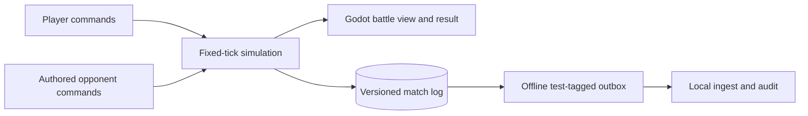
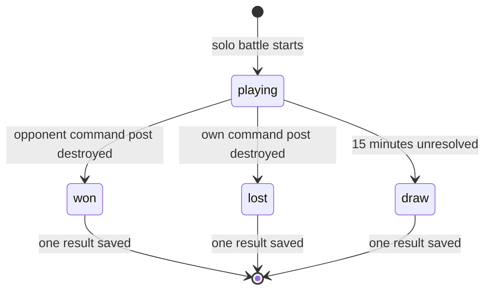

# Pitch — Finish a solo skirmish

Moves: `first_match_completion` · Tests: whether classic RTS players can understand and finish a small conquest battle. There is no credible completion-rate target before an invited cohort.

## The ask, as given

> A traditional play-against-the-computer experience, using authored rules rather than a generative model. The first match may use fewer resources and ages than the full design. (Proxy from the earlier approved RTS-core scope and this backlog idea; the owner's exact E2 wording was not captured here.)

### Claims

1. A human can complete a battle against a rule-based computer opponent.
2. The first match can use a subset of the larger economy and age design.
3. The launch funnel later needs a genuine terminal result from this match.

**Teach-back:** unanswered — You want a small, complete solo RTS battle so players can judge economy and combat, and the launch funnel can measure real finishes. Right?

**Intent check:** Could not look: `jev.egress` is unset, so no pitch text was sent to TypeSafe for an advisory score.

## Problem

The Godot core proves one worker can move, gather and build, but there is no army, opponent or terminal outcome. The funnel has a tested event contract and test-only client outbox, yet no eligible match start or completion can be sent. A full four-resource, multi-age game would delay the first battle.

## Appetite

**M — three connected slices.** Use one original map, one resource, no age advancement, a command post, a recruitment building, one worker and two combat roles per side. The earlier owner chose L for the entire first-playable goal across waves; this is the next bounded wave.

quote: $20–120 (M, n=0, wide)

## Outcome & signal

A tester can gather, construct, recruit, attack, win or lose against an authored opponent, see why the match ended and restart. A bounded stalemate becomes a draw. The same commands replay to one terminal result on the pinned development build. Local match events use the approved funnel IDs and remain test-tagged until release and authenticated ingest exist.

## Stage-2.5 bucket

**Genuinely new.** The Godot project supplies movement, gathering, construction, replay metadata and a client outbox. It has no production queue, combat, opposing side or terminal state.

## Bill of materials (What / Why)

| What | Why |
|---|---|
| One-resource production with worker, melee and ranged roles | The player can trade economy for a small army and see a combat choice. |
| Command post and recruitment building for each side | A visible production path and a legible conquest objective. |
| Deterministic damage, targeting, death and building destruction | The match ends from explicit rules and repeats from the same commands. |
| Authored opponent using the human command interface | Solo play works without a second rule system or generative model. |
| Terminal result, restart and test-tagged funnel records | The player understands the outcome and the measurement path gains a real game event. |

The owner may edit the Why column before approving this scope.

## Scope

**In v1:** One original symmetric map and one resource. Each side begins with a command post and worker. The worker gathers and constructs a recruitment building. That building produces light melee and ranged units for a resource cost. Combat uses fixed-tick health, range, cooldown and targeting rules; units and structures can be destroyed. The opponent follows one authored opening: gather, construct, recruit a mixed group, attack the opposing command post, then replace losses when affordable. The player selects and orders units with visible feedback. Destroying the opposing command post wins; losing one's own loses. A 15-minute unresolved match is a draw. One terminal result and restart control close the run. Local events remain test-tagged until the funnel's authenticated acceptance path and release gate pass.

**Out of v1 (no-gos):** Four-resource economy, ages, faction bonuses, district objective, siege, multiplayer, procedural opponent strategy, final art, balance claims, public cohort counting and public release. The proposed command-post and 15-minute rules are owner decisions at this plan gate, not established canon.

## Rabbit holes

- Use versioned combat stats and controlled melee/ranged scenarios; do not claim a balanced metagame from one map.
- Record frame and route latency with both armies and a destroyed obstacle; E1 measured only one worker.
- Keep fixed-tick game rules and compare final state hashes from identical commands. Cross-device authority remains unproven.
- A local completion is not a counted cohort event. The funnel service must accept it under the agreed client-reported policy first.
- The proposed draw prevents an endless internal run. The owner can replace it before implementation.

## What already exists (reuse, don't rebuild)

- [`game/simulation.gd`](../../../game/simulation.gd) owns integer tile rules, command log, movement, gathering and construction; [`game/main.gd`](../../../game/main.gd) draws the map and handles player input.
- [`game/funnel_outbox.gd`](../../../game/funnel_outbox.gd) stores test-tagged first-open and prototype-start events and syncs to local ingest.
- [Funnel contract](../../../docs/launch-funnel-contract.md) specifies IDs, results, receipts and exclusions; [North Star](../../00-strategy/north-star.md) specifies eligibility.
- [Combat canon](../../../docs/design-prework/systems/03-combat-units.md) confirms literal, stylized unit and structure destruction. [Economy design](../../../docs/design-prework/systems/02-economy-progression.md) describes the larger four-resource vision, which this slice samples.
- [Engine ADR](../../../docs/architecture-decisions/001-engine-selection.md) recommends continuing Godot provisionally until representative multi-unit evidence exists.

## Visuals

## Slices and QA

| Sprint | Observable result | Checks |
|---|---|---|
| B1 · Recruit an army | Player economy produces workers, melee and ranged units. | Headless cost/queue/conservation tests and rendered production walkthrough. |
| B2 · Fight for the command post | Units attack and destroy units or buildings with visible health and order feedback. | Controlled outcomes, unreachable target and destroyed-obstacle path checks; rendered combat walkthrough. |
| B3 · Finish against the computer | Authored opponent follows the same rules; win, loss, draw and restart work. | Repeatable match and one-result checks; rendered three-outcome walkthrough; multi-unit frame/path numbers. |

## UX heuristics & rails check

- **CI guards covering this surface:** Godot headless simulation/outbox and Node funnel checks run locally. Add B1–B3 rule checks; no hosted game CI exists.
- **Audits-lens findings that apply:** No project UX audit is recorded.
- **Design-language debt:** The prototype uses shapes and text. Add readable selection, health, production and result states without requiring knowledge of Mexican references.

## Measurement and runtime gate

This is an internal test build with no release rail or real player segment. Reuse the existing server-side `telemetry.play_funnel_enabled` gate for later cohort admission; no new client credential or parallel flag store is proposed. The match result is the feature-use signal in local review. The agreed `first_match_completion` input becomes measurable only after a real invited cohort. Revisit a separate game rollout flag when distribution exists.

## Acceptance criteria

1. A fresh checkout runs a solo battle with one resource and two combat roles. A worker constructs the recruitment building, units consume resources once, and unaffordable production is visibly rejected.
2. Controlled combat resolves identically from the same commands; units and structures show damage and destruction, and paths update when a structure disappears.
3. The authored opponent uses the validated player command interface and opening plan. A tester can win, lose and reach a bounded draw, then restart without stale state.
4. Exactly one test-tagged `match_started` and one terminal `match_completed` are saved for each internal run with stable match/event IDs, version and result. Restart/offline sync does not duplicate them. This does not count as a public cohort.
5. Headless checks, a rendered walkthrough and declared multi-unit frame/path measurements pass on pinned Godot. The owner reviews the engine and battle rules before public playtest scope advances.

## Decisions for the owner

1. Continue with Godot 4.7.2 for this bounded multi-unit match, subject to measured review? The builder recommends yes from E1's evidence.
2. Approve the proposed first conquest rule: destroy the opposing command post to win, lose if yours falls, draw after 15 unresolved minutes? This is a game rule, not a technical default.
3. Approve one resource, no ages, light melee and ranged roles, and the authored gather/build/recruit/attack opening as the M-sized v1? Balance values remain adjustable inside the approved rule shape.

## Open risks / research

E1 measured route orders at one-worker scale only; no representative army frame baseline exists. The authored opening may expose congestion or stalemates that need a bounded revision. Godot's official [command-line documentation](https://docs.godotengine.org/en/stable/tutorials/editor/command_line_tutorial.html) supports the headless workflow; the version and measured client behavior are in [the core prototype](../../../game/README.md). No real player outcome is available yet.
