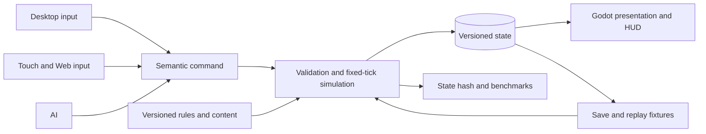

# Pitch — Harden the RTS simulation

Moves: `match_completion` · Tests: value proposition and technical ability to deliver it. The metric has no observed baseline; engineering evidence below is the immediate readout.

## The ask, as given

> Both are to be reviewed at length and integrated into our project. This includes laying it all out as per golden frijoles methodology, amending what currently exists, create new work and leave everything ready to be built progressively in order. Consider the speed of our builds when suggesting the slices as we are using codex progress is extremely fast and its not worth having very basic versions that wont survive much. This shouldnt compromise attention to foundational principles and architecture strategy at high level.

The supplied `roadmap-alignment.md` specifically asks for simulation authority, fixed logical time, data-driven content, save/load, replay, headless tests, scale profiling and a multiplayer-readiness decision. The [tracked GDD](../../../docs/design/GDD.md) defines their intended end state.

### Claims

1. Integrate the GDD as global alignment and correct the existing roadmap.
2. Create substantial progressive work rather than disposable basic versions.
3. Protect foundational architecture for full RTS depth and future platforms.

## Problem

The current playable match proves a small rules loop, but `game/skirmish.gd` combines constants, map assumptions, AI and outcomes. New four-age, four-resource and multiplayer work built straight into it would be hard to validate or save compatibly.

## Appetite

**L** — a larger epic with a deliberate architecture review boundary between connected outcomes. This buys a migration of the existing playable match onto durable contracts and representative evidence, not an entire multiplayer implementation.

quote: $50–300 (L, n=0, wide)

## Outcome & signal

A player can resume a saved current match and reach the same terminal outcome. A builder can add a data-defined unit/technology without changing view code or duplicating platform rules. Headless replay, schema validation and performance reports expose regressions before later waves. Later `match_completion` remains the product signal once eligible cohorts exist.

## Stage-2.5 bucket

**Light enhancement of a real prototype plus genuinely new persistence/content contracts.** Reuse the existing fixed tick, command validation, snapshots, hash, asset manifest, skirmish and outbox. The missing load, versioned schema, scale matrix and cross-platform repeatability require new work.

## Bill of materials (What / Why)

| What | Why |
| --- | --- |
| Versioned command/state/content schema and stable IDs | One rules language survives new factions, ages, saves and interfaces. |
| Deterministic update/RNG and headless replay fixtures | Same input sequence exposes divergent outcomes before multiplayer design. |
| Save/load and content migration policy | Existing matches do not become disposable as rules grow. |
| Representative routing/crowd benchmark and platform probe | Performance and sync choices can use evidence rather than the 12-unit prototype. |
| Existing-match migration and rendered QA | The architecture lands as a working game, not an isolated framework. |

## Scope

**In v1:** preserve current two-faction 20×20 match behavior while extracting semantic commands, state lifecycle, validated content definitions and save/replay; seed RNG and specify update order; record performance at increasing maps/unit counts; compare headless hashes on at least two target environments if available; write a sync-model decision with evidence and unknowns.

**Out of v1:** full four-resource economy, all ages, new factions, production wildlife, network transport, matchmaking, final AoE2 parity and public release. None of these are silently approved by this architecture pitch.

## Rabbit holes

- Do not rewrite the whole prototype before the same-command fixture and visible skirmish pass. Migrate through a stable adapter.
- Keep rendering and touch input out of state authority. Godot physics behavior is not proof of deterministic cross-device simulation.
- Do not promise lockstep from same-machine hashes. Decide after cross-environment, long-duration and ordering tests.
- Versioned save compatibility requires an explicit migration or rejection policy; never silently load incompatible data.
- State size and pathing costs may push the synchronization model or representation choice; document evidence before broad content work.

## What already exists (reuse, don't rebuild)

`game/skirmish.gd` has `issue`, `tick`, `snapshot`, `state_hash`, command IDs, sorted update order and a fixed tick. `game/skirmish_main.gd` is the rendered/input adapter. `game/tests/` has rule and benchmark scenarios. `game/assets/manifest.v0.1.json` shows a render-only manifest. `docs/architecture-decisions/001-engine-selection.md` records why Godot remains selected. Existing outbox and North Star aggregation stay separate from save/replay.

## Visuals

## UX heuristics & rails check

- **CI guards:** current Node/Godot headless contract checks and rendered skirmish walkthrough; extend them to save/replay and content validation.
- **Audit findings:** [architecture review](../../../docs/architecture-review-2026-10-16.md) finds hardcoded rules, scale and persistence gaps.
- **Design-language debt:** save/resume feedback and version errors need readable HUD copy; preserve current selection and command language.

## Kill-switch / measurement decision

No new runtime flag: this internal migration preserves current match behavior and is verified with side-by-side fixtures and an owner preview. The existing `telemetry.play_funnel_enabled` gate and test-account exclusions remain the measurement seam. No new public event is justified before a real cohort.

## Slices, risk and QA

| Sprint | Player/builder story and acceptance | Risk · QA |
| --- | --- | --- |
| 1 · Contract and migration seam | As a builder, I can run the current match through semantic commands, stable content IDs and canonical state while its visible orders, costs, faction differences and terminal results stay the same. Invalid content and commands explain failure. | **High**, shared core. Headless golden scenarios plus rendered two-faction match. |
| 2 · Save, replay and versioning | As a player, I can save/resume mid-match; as a builder, I can replay the same command/seed stream and get the same terminal state. An incompatible save has a clear, tested result. | **High**, player data. Save round-trip, replay hash, malformed/version fixtures and owner resume walkthrough. |
| 3 · Scale and sync decision | As the team, we can choose the next routing and network approach from reproducible large-map/crowd/device evidence. One representative stress match remains playable, and the cross-platform equality result is recorded. | **High**, architecture. Headless benchmark matrix, two-environment comparison where available, rendered crowded-state smoke and an ADR. |

## Acceptance and review

- Current match and test-tagged outbox behavior do not regress; a player finishes the same two win routes on a fresh and resumed build.
- Rules/content are versioned and validated; view assets do not determine collision or outcome.
- Command replay and save/load match expected canonical state hashes on declared environments; any mismatch is explained and gated before network choice.
- Benchmark report includes map/unit counts, command pressure, tick/frame cost, memory, device/build and target thresholds chosen before the run.
- Second reviewer checks shared simulation and save migration. Owner performs a downloaded-build smoke walkthrough: start as each faction, save, quit, resume, finish by command-post and district, and verify local telemetry remains test-tagged.
- A sprint closes only with the linked spec, headless check, real-build smoke and recorded remaining limitation. No game release is implied.
