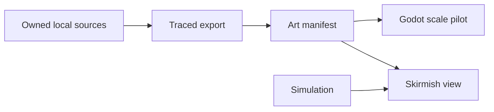

# Idea — Integrate the owned art library

Moves: first_match_completion · Tests: Value proposition

**Appetite:** M, several connected slices. **Quote:** $20–120 (M, n=0, wide).
quote: $20–120 (M, n=0, wide)

## Outcome & signal

Selected owned tiles, a critter animation and an isolated building derived from the new concept direction pass a repeatable export, manifest validation and actual-scale Godot pilot. The current match keeps its rules, selection and save contract. There is no cohort baseline; this epic records visual and technical evidence, then first-match completion can be read after a real release.

## Stage-2.5 bucket

Genuinely new. The existing v0.1 generated art manifest and renderer are reusable, but none of these three owned sources has a production export or scale test.

## Bill of materials (What / Why)

| What | Why |
| --- | --- |
| Rights and frame audit | Trace each export and keep flattened concept boards out of runtime. |
| Deterministic asset export and manifest checks | Make chosen source assets reproducible and guard geometry, memory and alpha. |
| Godot scale pilot | Judge tiles, a critter and a derived building against the 48×24 board at normal zoom. |
| Match integration and regression QA | Confirm selected visuals do not change simulation, picking or objectives. |

## Scope

**In v1:** a small selected terrain set, one complete directional critter idle animation in an art pilot, one isolated command-post candidate from the concept direction, source and rights metadata, render tests, and a full-match technical smoke. The critter is an ambient candidate in the pilot only; no unapproved wildlife enters a live match.

**Out of v1:** every source asset, flattened map art, concept-board rules, new collision, wildlife mechanics, public invitation and a claim of improved retention.

## Rabbit holes

32×32 separated tiles do not share the current 48×24 footprint. Compare seam and pivot at actual scale before choosing any terrain replacement. The JPEG board cannot be keyed cleanly; author an isolated transparent sprite. Preserve the current bitmap picking path for actors.

## What already exists (reuse, don't rebuild)

`game/art_catalog.gd`, `game/assets/manifest.v0.1.json`, `game/skirmish_main.gd`, `scripts/export-art.sh`, existing skirmish contract tests, and the fixed projection and simulation in `game/skirmish.gd`.

## Visuals

## UX heuristics & rails check

- Existing skirmish client, contract and headless tests cover picking, save and rules.
- Normal and enlarged zoom, faction contrast and district text require rendered checks.
- The existing HUD remains the readable command surface.

## Acceptance criteria

- Audit source rights, geometry, frames and pivots for the chosen tile, critter and concept-derived building.
- Reproduce selected transparent exports and validate manifest IDs, canvas, anchors, source hashes and texture budget.
- Render a Godot pilot at 100% and 125% zoom with the chosen tile, animated critter and building.
- Integrate selected safe visuals through the art catalog without changing simulation geometry or selection.
- Pass match, save, event and rendered checks; record owner visual review and full-match observations honestly.

## Open risks / research

Source rights were confirmed by the owner on 2026-10-16. The owner reviewed the 100%/125% scale comparison and kept the boar, raised tiles and concept command post as pilot candidates. There is no observed first-match cohort or blind comprehension result. A full walkthrough of this downloadable build remains open.

> Theres also new art work to use in references/newArtWork
> Remember that we also have the whole references/critters and references/isometric tileset to use as they are very high quality.

The owner confirmed commercial rights to all three sets on 2026-10-16. After the existing [battlefield art v0.1](../../02-civilizations-and-world/la-roma-battlefield-art-pack/README.md) and [HUD](../../02-civilizations-and-world/readable-battlefield-hud/README.md) owner QA, refine a follow-on art production epic. Inventory provenance, frame/anchor conventions and the current 48×24 projection; build a rendered scale pilot using selected `isometric tileset` tiles and one animated critter; derive or author isolated transparent sprites from the `newArtWork` direction, not a flattened map image; then integrate selected production assets through the manifest with palette, readability and memory checks. The critters need an approved gameplay or ambient role before they enter matches. Preserve simulation footprints, picking, collision and objectives. Record per-asset source/export metadata and owner visual review, then play a complete match at normal zoom. The [inventory](../../../docs/art/reference-inventory.md) describes the files and the [GDD](../../../docs/design/GDD.md) sets the visual target. This can run beside the early simulation foundation if it stays view-only; it does not replace that dependency for broader gameplay systems.
