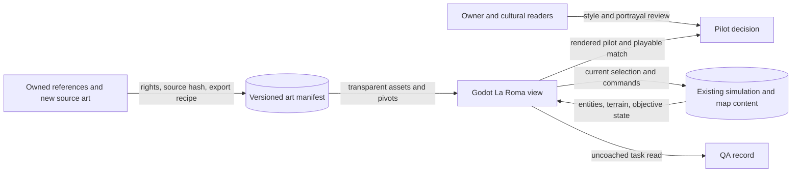

# Pitch — Produce cohesive CDMX game art

Moves: `first_match_completion` · Tests: Value proposition. The effect is a hypothesis until eligible players finish matches; this bet first tests visual recognition and playability.

## The ask, as given

> Hi codex Refine seed:
> #15 Produce cohesive CDMX game art
> as per golden frijoles methodology, ensure to follow ways of work, team memory etc to ensure a smooth flight

The prior raw seed proposed a playable Roma Norte/Cibeles wave, an L appetite and a four-asset pilot. This pitch preserves that direction. The owner's new message does not yet approve its budget or detailed scope.

### Claims

1. Refine seed #15 into a cohesive CDMX game art bet.
2. Follow Golden Frijoles, Ways of Working and project memory.

**Teach-back:** Yes — the owner approved the one-run plan on 2026-10-22, with merges and Restricted releases authorized; owner visual and play QA remain owed.

## Problem

The playable match has functional art and HUD, but its local concept boards are flattened illustrations, while the owned tiles and critters are mostly scale pilots. The selected flower prop works; raised tiles have seam risk, and the boar reads too dark at game scale. Current sources do not yet form a consistent Roma Norte/Cibeles battlefield across terrain, landmark, structures, resources, units and states. More detail could also hide units, picking, objectives or cultural meaning. There is no eligible player cohort with which to attribute a completion effect.

## Appetite

**L — a production wave reviewed after a small pilot and again before downloaded-build QA.** This is the proposed amount the visual problem is worth, consistent with the original seed. It buys one coherent **La Roma map** presentation for the current four factions and current playable roster, with reuse where a candidate passes an in-engine test. It does not buy every district, age variant or concept-board mechanic. Re-evaluate the remaining work at each wave boundary; narrow the pack if the L appetite cannot cover it.

quote: $50–300 (L, n=0, wide)

## Outcome & signal

The owner can start the current La Roma match and recognize a Cibeles-inspired objective, connected streets and architecture, the four resources, current unit roles and the selected faction without relying on color or local jokes. Art remains readable in dense fights and the actual camera range. A source/rights record and deterministic exports reproduce every shipped visual.

The immediate read is a captured owner scale review and an uncoached task read by players familiar and unfamiliar with Mexico: find the objective, distinguish friendly/enemy and worker/fighter roles, identify a resource, select a partly obscured unit and explain both win routes. Record exact answers and failures. After a separately authorized eligible release and a mature cohort, inspect the existing `first_match_completion` input by content/build version; report counts and uncertainty, without attributing change to art alone. The current 15% later-day goal remains provisional and unchanged.

## Stage-2.5 bucket

**Genuinely new production coverage on top of working foundations.** The current art pack already draws a complete match, and the owned-art epic established provenance, export, a Godot pilot and a selected flower prop. Finishing their outstanding owner QA is already possible and remains their own work. A style/scale pilot is a light enhancement; a complete, coherent La Roma production pass is new.

## Bill of materials (What / Why)

| What | Why |
| --- | --- |
| Current-scene audit and compact style/asset contract | Fix projection, palette, light, pivots, states and budget before making a large pack. |
| One ground tile, one building, one unit and Cibeles pilot | Let the owner reject seams, scale or identity in the actual match before volume production. |
| La Roma terrain, landmark, structures, resource sites and view-only props | Make one playable battlefield feel like one place while leaving map data and collision alone. |
| Role-first unit silhouettes with four faction identity treatments | Make the current roster and each faction identifiable without using color alone. |
| Construction/damage and limited animation states | Show existing actions and health clearly at match scale. |
| Rendered, gameplay and human QA record | Prove the art stays playable and say what remains untested. |

The owner can edit the Why column at the Plan gate. A part without a defensible reason is removed or moved to a later wave.

## Scope

**In v1:** Audit the twelve local boards and reconcile the older five-board inventory; produce original or traced transparent assets for the **existing** La Roma skirmish at the current 48×24 ground projection. Cover terrain and seam-safe transitions, a Cibeles-inspired central landmark and its existing neutral/contested/held cues, current buildings and four resource-site types, current worker/melee/ranged/armored/siege roles, four readable faction treatments, a small set of street props, and existing construction/damage/action feedback. Record source, rights, hash, export recipe, canvas, pivot, footprint, depth, directions, state and frame timing for each integrated asset. The pilot is one tile, one building, one unit and the landmark at 100%/125% zoom; production acceptance also checks the actual fit-to-window and crowded-board views. Keep the current match and HUD working throughout.

**Out of v1 (no-gos):** New gameplay roles or wildlife behavior; changes to collision, resource amounts, unit stats, age rules, faction powers, routes, victory conditions or map geography; new maps or official-looking administrative boundaries; exhaustive four-age visual variants; full UI, audio/VFX library, campaign atlas, vehicles, rooftop or water play; converting a flattened JPEG board to a map or claiming numerical AoE2 parity; public release or new participant invitation. #16 owns verified place/map data; #18 owns full interfaces; #19 owns audiovisual feedback beyond the small animation states here.

## Rabbit holes

- **Current geometry changed since the v0.1 art spec.** The live game has a 28×28 match, 48×24 ground tile, fit-to-window zoom and a 0.7–2.1 manual zoom range. Re-measure anchors, resource placement and crowded depth from current code; do not copy the old 20×20 or 1.0–1.25 assumptions as current limits.
- **Cibeles accuracy and portrayal.** The landmark must be recognizable in its own silhouette and read as an objective, but #16 must verify location/placement claims. The owner reviews any public-facing cultural or landmark depiction under Ways of Working. El Ángel is a different Reforma concept.
- **Volume versus consistency.** Reuse or redraw the owned 32×32 raised tiles only if seams work on the flat board; keep the boar as a pilot until contrast and role pass review. A coherent role grammar beats separate bespoke sprites for every faction/age. Every visible fallback or placeholder in the La Roma pack is listed for owner decision before acceptance.
- **Occlusion and selection.** Tall roofs, street props, banners and dense combat must not conceal selection rings, target feedback, resource labels or the hold timer. The current alpha-hit/picking path remains authoritative; visual layers cannot create blockers.
- **Cost and device evidence.** Keep source/export sizes and decoded/GPU memory, frame time and texture-load costs visible against a captured pre-change baseline on the available owner Mac; record target-device gaps rather than claiming mobile or Web parity.
- **Prior QA.** The funded art pack, owned-art and HUD epics still have human or downloaded-build checks open. Their outcomes inform this wave; a new bet does not declare them complete.

## What already exists (reuse, don't rebuild)

- `game/skirmish.gd`, `game/content/skirmish.v1.json` and `game/skirmish_main.gd`: current map, four factions, five unit roles, five buildings, four resources, objective and visual drawing/picking. Simulation and content own mechanics.
- `game/art_catalog.gd`, `game/assets/manifest.v0.1.json`, `scripts/export-art.sh`, `scripts/export-owned-art.sh`, `scripts/validate-art-manifest.mjs`: catalog, traceable assets and deterministic export/validation seams.
- `docs/art/isometric-geometry.md`, `docs/art/owned-art-pipeline.md`, `docs/art/visual-qa-v0.1.md`: useful baseline and prior failures; recheck dated geometry against current code.
- `game/art_pilot.tscn`, `game/tests/art_pipeline_test.gd`, `game/tests/art_render_probe.gd` and `game/README.md`: actual-scale pilot, headless checks, rendered probe and run instructions.
- The [battlefield art pack](../../02-civilizations-and-world/la-roma-battlefield-art-pack/README.md), [owned-art pilot](../../02-civilizations-and-world/integrate-owned-art-library/README.md), [world expansion](../../02-civilizations-and-world/expand-civilizations-and-world/README.md) and [HUD](../../02-civilizations-and-world/readable-battlefield-hud/README.md): existing scope and open QA boundaries.
- `references/newArtWork/`, `references/isometric tileset/`, `references/critters/`: ignored, owner-rights-confirmed direction/candidates, never runtime build dependencies. See the [coverage review](../art-world-coverage-2026-10-21.md) and [inventory](../../../docs/art/reference-inventory.md).

## Visuals



| Pilot element | Game-scale question | Stop or revise if |
| --- | --- | --- |
| Ground tile and transition | Do flat streets/sidewalks join without raised seams? | Checkerboarding, gaps or false elevation obscure pathing. |
| Current building | Does its 2×2 footprint, ownership and construction state read? | Roof/anchor hides units or selection. |
| Current worker or fighter | Does role, faction and friend/enemy read without color? | Silhouette merges into terrain or nearby units. |
| Cibeles-inspired landmark | Is the existing central objective recognizable in all current control states? | It is mistaken for El Ángel, decoration or a new rule. |

## UX heuristics & rails check

- **CI guards covering this surface:** art manifest validation, deterministic export check, Godot art pipeline and client/simulation tests, `npm run skirmish:contract`; use the current commands in `game/README.md`.
- **Audits-lens findings that apply:** no `Roadmap/00-ideas/audits/` finding exists for this surface; the [coverage review](../art-world-coverage-2026-10-21.md) supplies the present crosswalk.
- **Design-language debt:** current visual resources and some structures use text/letter markers; older geometry and inventory docs lag the expanded match. Resolve current-match visual placeholders without hiding the responsive HUD or non-color cues.

## Measurement and runtime gate

**Measure — proposed yes:** Use the existing accepted `match_started`/`match_completed` path and content/build identity for the eventual eligible `first_match_completion` read. Immediate evidence is the recorded pilot decision and uncoached comprehension task, not a new telemetry event. No eligible baseline exists, so there is no credible numeric lift target. The owner can change this decision at the Plan gate.

**Safety — proposed no new runtime flag:** This is an asset-only client pack with a reviewable pilot, manifest/version boundary and Restricted build rollback path. `flag_key` stays null; the existing `telemetry.play_funnel_enabled` flag is not an art switch. Any proposal for an online art experiment or new remotely controlled asset seam needs a separate decision.

## Proposed slices, risk and QA

| Sprint / story | Player or operator result | Risk | QA stage and owner smoke |
| --- | --- | --- | --- |
| 1 · Contract and pilot · S1.1 | The owner sees an audited source/coverage list and current-scale style contract. | low · docs/assets | Verify all twelve boards, rights, current roster and geometry; inspect four proposed pilot sources. |
| 1 · Contract and pilot · S1.2 | The owner plays a one-tile, one-building, one-unit, one-landmark match pilot. | low · presentation | Godot render at 100%/125%, fit view and crowded center; owner records accept/revise/reject before volume export. |
| 2 · Place and economy · S2.1 | A La Roma match has seam-safe ground, Cibeles, structures, four resource sites and restrained props. | low · presentation | Manifest/export checks; rendered depth, fog, objective/control, construction and alpha-picking smoke. |
| 3 · Units and state · S3.1 | All current unit roles and four faction treatments remain distinguishable during gathering and combat. | low · presentation | Role/faction matrix, non-color cues, direction/action/damage states, dense-fight and selection checks. |
| 4 · Playable art acceptance · S4.1 | The owner can finish the art-complete La Roma match in a downloaded Restricted build. | low · QA | Both victory routes, four faction choices, save/resume, replay, online presentation if available, event exclusion and frame/memory comparison; record build ID. |
| 4 · Playable art acceptance · S4.2 | Familiar and unfamiliar players can explain the scene and objectives without coaching. | low · research | After existing invitation approval, run the predeclared task read, capture raw counts and examples; keep status open if unrun. |

Each sprint closes with numbered owner smoke steps using a real build, one action and one observable result per step. The builder should use headless checks for invariant rules and rendered Godot/downloaded-build checks for the visual outcome. Art-only stories remain low risk; any change to shared simulation, rights position or cultural portrayal goes through the project escalation and review rules.

## Acceptance criteria

1. The pilot review records an owner accept/revise/reject decision on the tile, building, unit and Cibeles together at 100% and 125% zoom, fit view and a crowded center. A failed pilot narrows or changes the art direction before S2.
2. The playable La Roma map uses a coherent ground, landmark, structure, resource, role and prop language for all currently selectable factions and current unit/building kinds. Any retained placeholder is named and justified in the acceptance record. Cibeles is distinct from El Ángel and the hold/control state remains obvious.
3. Every integrated source has rights/provenance, source and export hashes, reproducible recipe, dimensions, pivot/footprint, runtime role, direction/state/FPS where applicable, and an actual-scale Godot capture. The old five-board inventory is reconciled against twelve local concept boards. Ignored `references/` is not a build dependency.
4. Unit role, side and faction cues work without color alone; at 100%/125%, fit zoom and dense combat, players can select partly obscured units, see resources and read the objective/HUD. Construction, damage and action feedback reflect existing state without implying a new ability.
5. Existing match rules, pathing, collision, content/save/replay hashes, commands, both victory routes and test-event exclusion remain unchanged by art. A signed Restricted downloaded build passes the owner full-match and restart smoke; a merge alone does not satisfy this check.
6. In an owner-authorized uncoached read, four players familiar and four unfamiliar with Mexican references each attempt the same five tasks: find the objective, distinguish friend/enemy and worker/fighter, identify a resource, select a partly obscured unit, and explain both win routes. Directional marks: at least 3/4 in each group complete the objective/role and win-route tasks; at least 6/8 complete the resource and selection tasks. Record counts, exact confusion and accessibility needs. An unrun read stays open.
7. Record before/after rendered frame and memory evidence on the available owner Mac with identical match/zoom conditions and list unmeasured platforms. Report any later `first_match_completion` reading only from a mature eligible cohort under the agreed North Star contract, with no art-only causal claim.

## Open risks / research and Plan gate

- **Owner decision recorded, 2026-10-22:** the L one-map La Roma plan is approved and funded for one orchestrated build. #14 Restricted feasibility QA is complete; raw #16 geography and #17 fidelity remain next to shape, with #18 and later behind this art wave. Merges and Restricted releases are authorized. Owner pilot/style, downloaded-build and human comprehension QA remain owed; no public invitation was authorized.
- **Current evidence:** [coverage review](../art-world-coverage-2026-10-21.md), [owned-art pilot](../../../docs/art/owned-art-pipeline.md), [visual QA](../../../docs/art/visual-qa-v0.1.md), [GDD](../../../docs/design/GDD.md), current `game/skirmish_main.gd` and `game/README.md`. The older [art inventory](../../../docs/art/reference-inventory.md) lists five boards and must be updated during S1.
- **Intent match:** The pinned kit's advisory check scored this pitch 78/100, with no routed gaps. The score is uncalibrated; the owner's approved scope controls the build.
- **Queue and release:** #14 is shipped to the Restricted owner alpha. Several earlier epics still have owner QA open. This bet does not change their status, approve invitations, or claim a public release. The Golden Frijoles board can show workflow state before the game's own Definition of Done is met.

## Intent match

_Advisory and uncalibrated (intent-match D1, D3): it can add a step, never block one. Regenerate with `node scripts/intent-match.mjs <this seed> --write`._

```text
Intent match — Roadmap/00-ideas/seeds/produce-cohesive-cdmx-art.md
  coverage in   0.88  (2 claims)
  coverage out  0.71  (7 criteria)
  clarity       0.75  (7 criteria)
  teach-back    —     (not recorded)
  agreement     pending  (the optional reader at the architecture lock)
  why story     0.55  (advisory, not in the total)
Total 78 / 100 — uncalibrated · signals: coverage in, coverage out, clarity
Band: resolve the follow-ups first (placeholder bands: 80 build · 60 resolve follow-ups · below 60 sketch or spike)
Gaps: none
```

<!-- intent-match: {"coverage_in":0.88,"coverage_out":0.714,"clarity":0.747,"teach_back":null,"total":78} -->
