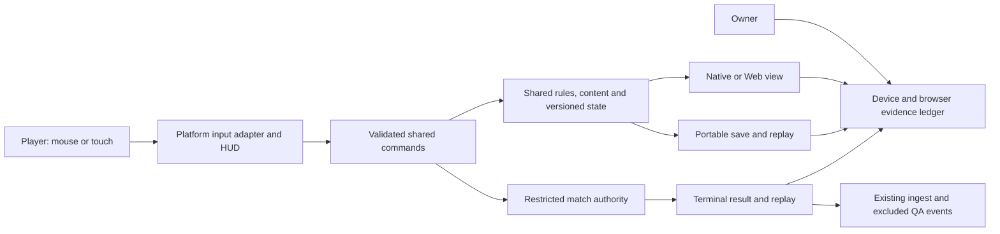
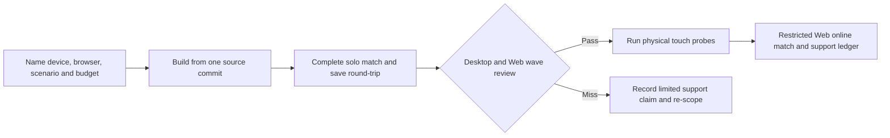

# Pitch — Prove cross-platform play

Moves: `match_completion` · Tests: value proposition. Platform-specific completion is a hypothesis; the first eligible cohort has not begun.

## The ask, as given

The owner's request, verbatim:

> Hi codex Refine seed:
> #22 prove-cross-platform-play as per golden frijoles methodology, ensure to follow ways of work, team memory etc to ensure a smooth flight

The existing raw seed is the product-ask proxy: one shared ruleset across native Windows/macOS/Linux, desktop Web, native Android/iOS and supported mobile Web; designed mouse/keyboard and touch controls; responsive HUD, quality profiles, save transfer, versioned builds and real-device evidence before support claims. On 2026-10-28 the owner set an **L** appetite and chose **desktop Web alongside native desktop** for the first support claim.

### Claims to check with the owner

1. Refine #22 by the Golden Frijoles method into reviewable work, without treating the raw idea as approval to build.
2. Preserve the one-game ambition across native desktop, desktop Web, native mobile and mobile Web where feasible.
3. Base platform claims on real controls, full matches, persistence, performance and online behavior on named devices and browsers.
4. Follow this project's working agreement and evidence rather than calling a merge or an export a release.

**Teach-back:** unanswered — “You want a first credible desktop and Web support claim, then a measured touch-device decision for the same game, so players can finish matches on their chosen device.”

## Problem

The Restricted owner build proves macOS play, and the repo can export a local Web compatibility build. A Web origin failed multiplayer preflight, mobile layouts still rely on mouse-from-touch emulation, and no real mobile device, browser persistence or long-session matrix has passed. A player choosing another platform cannot yet rely on finishing or resuming the same game. The full-game GDD names all of these targets, but it does not approve a support claim by itself.

## Appetite

**L** — a larger epic reviewed between proof waves. The budget pays for representative compatibility and a support decision, with the mobile wave re-evaluated after the desktop/Web read. It does not buy every device, store release or broad hardware optimization.

**Approval, 2026-10-28:** The owner approved this plan, option B's candidate device matrix, the proposed 28×28 / 24-population / 30 FPS proof budget, and placing #22 ahead of release candidate #23. The owner authorized one orchestrated build through completion, including its merges and releases. Actual device models and iOS signing access remain to be recorded before claiming those targets.

quote: $50–300 (L, n=0, wide)

## Outcome & signal

First, an owner can launch source-traceable native macOS, Windows and Linux builds and a desktop Web build, finish the same declared solo scenario, resume or export/import a save, and read a per-target evidence ledger. Then native Android, native iOS and mobile Web probes test a designed touch command path and record pass, bounded failure or unsupported for each named device. Online Web play has its own server-origin and result-integrity check; a Web export alone never satisfies it. The resulting support statement names only combinations that passed. The candidate North Star input is `match_completion`; its numeric target waits for an eligible platform cohort.

## Classification and Stage-2.5 bucket

**Feature; shaped bet. Genuinely new.** Local native macOS, macOS/Linux simulation-hash fixtures and a Web export are already possible. A Web compatibility demo is a smaller enhancement, but it would not prove persistence, full-match controls or network access. This pitch builds a bounded proof using the existing game.

## Bill of materials (What / Why)

| What | Why |
| --- | --- |
| Named platform and workload matrix | A support claim needs a reproducible device, browser, battle and budget. |
| Native desktop and desktop Web full-match path | This is the owner's first support priority and the thinnest player outcome. |
| Portable save/replay boundary | Browser eviction or a device change must not silently lose a match. |
| Designed touch command path and mobile probes | Mouse emulation and responsive screenshots do not establish mobile play. |
| Restricted Web online path | The existing origin failure makes multiplayer a separate claim. |
| Evidence ledger and support decision | Release candidate #23 needs exact, limited platform claims. |

The owner may edit the **Why** column at the plan gate; any part without a defensible Why is cut.

## Scope

**In v1:** Pin one game/content version and one comparable 28×28 La Roma Standard solo scenario with the playable 24-population-per-side ceiling; export and test native macOS/Windows/Linux and desktop Web on named hardware. Record load time, sustained frame p95, process/browser memory, command acceptance, audio activation, save round-trip, long full match and terminal result. Prefer the current single-threaded Compatibility Web export as the starting candidate. Add portable save export/import with incompatible-version and corrupt-file errors. Design touch select, group/order, pan/zoom, cancel, minimap and menu paths; probe native Android/iOS and mobile Web on physical devices. Check a Restricted desktop Web online match with an explicit allowed origin, revocable access, reconnect and replay. Compare canonical rules/state outcomes on the same fixtures; authoritative server results remain the online source of truth. Write the support decision from observed results.

**Out of v1 (no-gos):** Public invitations, store submission, every browser or handset, arbitrary cross-version save migration, cloud sync or cross-device account identity, competitive latency claims, a new simulation or online authority, a second telemetry system, and blanket mobile or Web support before a physical-device full match. Release packaging and broad onboarding remain #23.

## Rabbit holes and decisions before build

- **Device floor and budget:** before the first build wave, the owner names available Windows/Linux machines, browser versions and later Android/iPhone models. Proposed pass budget for the representative 28×28 scenario is a 30 FPS sustained frame target (p95 frame time ≤33.3 ms), no crash or lost terminal state through a full 15-minute match, and a per-target memory ceiling set from device capacity before optimization. Record actual peak memory and loading time even if a target fails. The 96×96 pilot is a stretch probe, never an implied minimum.

**Approved starter matrix (option B, subject to actual device access):** use the existing owner Mac; one ordinary Windows 11 x64 machine and one Ubuntu 24.04 x64 machine, preferably each with integrated graphics and 8 GB or more RAM. On desktop Web, test current Chrome and Firefox on Windows and Safari on macOS; this covers three browser engines, while Edge can be a follow-up Chromium check. In the later mobile wave, test one physical Android 11+ phone with Chrome and one physical iPhone 12-class or newer device with Safari, using both native and mobile Web builds on each. Record the exact model, OS, GPU, RAM and browser build before work starts. These are test candidates, not published minimum specifications. If a machine or phone is unavailable, mark that target unverified and narrow the support statement; a CI runner or emulator can supplement, but cannot replace its rendered physical-device full match. The alternative smaller matrix is the Mac plus Chrome, Firefox and Safari on that Mac, yielding only a macOS and Mac-browser claim. A broad matrix with several devices per OS belongs after this proof unless the owner explicitly reallocates the L appetite.
- **Web storage:** browser storage can be evicted. The player needs a versioned export/import path; document private-window and cleared-site-data behavior. An unsupported browser is an explicit result.
- **Touch:** simulated mouse clicks are not touch QA. Validate accidental orders, target size, gesture conflict, focus, audio and OS interruption on physical devices.
- **Networking:** the deployed join route rejected a locally served Web origin. Restrict CORS to an approved preview origin and test preflight plus actual authenticated join; do not loosen the native route or ship credentials to the client. Reuse server authority and the existing admission switch.
- **Scope brake:** if the desktop/Web proof misses the L appetite, pause at the wave review and record a narrowed support decision before starting mobile work. A missing device or signing capability is an open dependency, not a pass.

## What already exists (reuse, don't rebuild)

- [Simulation](../../../game/skirmish.gd), [persistence](../../../game/skirmish_persistence.gd), [replay](../../../game/skirmish_replay.gd) and cross-platform hash fixtures own rules, state and saves.
- [Match view](../../../game/skirmish_main.gd), [HUD](../../../game/ui/battle_hud.gd) and the [interface contract](../../../docs/art/ui-component-spec.md) supply the desktop and responsive touch baseline; [#18 interfaces](complete-game-interfaces.md) owns broader interface work.
- [Export presets](../../../game/export_presets.cfg), [game runbook](../../../game/README.md) and [alpha export](../../../scripts/alpha-export.mjs) supply the current Web export and source-traceable macOS path.
- The [server-authority decision](../../../docs/architecture-decisions/004-synchronization-model.md), [multiplayer epic](../../03-multiplayer-and-retention/prove-multiplayer/README.md) and [remote QA](../../../docs/multiplayer-remote-qa-2026-10-20.md) supply protocol, replay, admission and the known Web-origin failure.
- The [outbox](../../../game/funnel_outbox.gd), [ingest](../../../src/funnel/ingest.mjs) and [North Star](../../00-strategy/north-star.md) define accepted and test-tagged results. Platform labels may segment later readings; they do not change eligibility or the metric.

## Visuals





The touch match reuses #18's HUD; these blocks specify interaction states that #22 must make real.

[Review the rendered touch sketch](../sketches/prove-cross-platform-play.html).

```surface
state: touch-match-idle
route: /match
- head "La Roma" action "Menu"
- summary "Objective and match time"
- tiles count 4
- toolbar "Select · Orders · Cancel · Map"
- note "Drag with two fingers to pan; pinch to zoom"
```

```surface
state: touch-order-focus
route: /match
- head "Choose a target" action "Cancel"
- summary "Selected group and current order"
- toolbar "Move · Gather · Build · Attack"
- note "Tap a board target to give this order"
```

```surface
state: touch-save-error
route: /match/menu
- head "Save could not open" action "Close"
- note "The file is damaged or belongs to another game version. Your existing save was kept."
```

## UX heuristics & rails check

- **CI guards:** Godot headless command/state/save/replay and cross-platform fixtures, Node funnel contracts, native export checks and rendered smoke. Add platform-specific export and input checks to these rails; run full matches on actual target devices.
- **Audits lens:** [owner interface and movement audit](../audits/2026-10-23-owner-interface-movement-map.md) requires visible command outcomes over long crowded cases and calls out save/resume and macOS/Linux hashes.
- **Design debt:** the current touch path is mouse emulation; #18's responsive layout is a starting surface, not a validated gesture design.

## Measurement and safety decision

**Measure:** yes, use existing `match_started` and accepted `match_completed` with platform/build metadata and test exclusions. Once eligible cohorts exist, inspect `match_completion` by platform without changing its agreed denominator. No event name or numeric target is invented here. **Flag carve-out:** offline native packages and browser hosting have no single runtime feature seam, so this proof adds no new Golden Frijoles flag. **Safety:** keep preview access Restricted, reuse `multiplayer.private_match_enabled` for online admission, and revoke a bad Web build at the distribution/origin layer. Check the served admission switch per environment before and after online QA. Public eligibility remains an owner release decision.

## Acceptance criteria

### Sprint 1 — Desktop and browser solo proof

1. **S1.1 · Named matrix and reproducible builds (low).** As an operator, I can link every macOS, Windows, Linux and desktop Web artifact to one source commit, game/content version, export template and named device/browser. QA: export/launch checks plus a fresh downloaded or served build on each target. Owner smoke: launch each and read its version in the game and ledger.
2. **S1.2 · Complete desktop/Web match (low).** As a player, I can select, order, pan/zoom, hear permitted audio, finish the same 28×28 scenario and see its terminal reason on each claimed target. QA: shared command/hash fixtures, browser rendered smoke and one full real-device match per target; record load, frame p95, memory and failure traces. Owner smoke: start, issue gather/build/attack, finish and inspect the result.
3. **S1.3 · Portable persistence (high: player data).** As a player, I can save, leave, resume and export/import the same-version solo state across a native build and desktop Web without duplicate completion; corrupt/old files show an error and keep the original file. QA: schema/round-trip/dedup specs, browser storage-clear test and downloaded-build walkthrough. Owner smoke: save, clear browser storage, import, resume and finish once.

**Wave review:** publish pass/fail for every desktop target and one limited support statement before spending the mobile wave.

### Sprint 2 — Designed touch and mobile proof

4. **S2.1 · Touch command adapter (low).** As a touch player, I can select a unit/group, give and cancel orders, pan/zoom and use the minimap and menu without accidental board orders. QA: input adapter tests, gesture conflict cases and uncoached physical-device tasks; do not substitute mouse emulation. Owner smoke: perform each command on a named phone or tablet.
5. **S2.2 · Mobile target decisions (high: distribution/signing).** As an operator, I can run a full solo match and save/restart on named Android and iOS native devices and in named mobile browsers, or mark a target unsupported with the exact blocking evidence. QA: physical-device full match, load/frame/memory/audio/interruption/storage matrix, signed-install or local developer-install provenance. Owner smoke: launch each available target, finish, interrupt/resume and inspect its evidence row. iOS device and signing access are dependencies to confirm before this sprint.

### Sprint 3 — Restricted shared play and support decision

6. **S3.1 · Desktop Web online access (high: auth/shared infra).** As an invited player, I can join a Restricted match from the approved desktop Web origin, issue commands, reconnect and view the same server terminal record/replay as a native peer. QA: exact-origin CORS preflight, bad-origin/code rejection, version mismatch, real Web/native full match, reconnect and test-tagged receipt; independent security/data review. Owner smoke: join with two scoped codes, finish, replay, disable admission and confirm a new join is refused.
7. **S3.2 · Support ledger and handoff (low).** As the owner, I can see a pass/fail/unsupported row for every proposed OS/browser/device, its commit/build, scenario, budgets, full-match/save/online evidence and a support claim limited to passing rows. QA: compare artifacts and results with the ledger, review unresolved failures and hand the exact supported matrix to #23. Owner smoke: follow one numbered walkthrough per claimed target from a fresh install or browser session.

**Epic close:** a real build and actual target devices pass their own checks, the owner accepts the support wording, and learnings are recorded. A merged PR or successful export alone cannot close it.

## Open risks / research

- The initial platform matrix, minimum devices and final memory ceilings require the owner's decision before build; a missing Windows, Linux or iOS device blocks that target's support claim.
- Godot's [Web export guidance](https://docs.godotengine.org/en/4.5/tutorials/export/exporting_for_web.html) describes the single-threaded default, Compatibility/WebGL 2 rendering and Safari/mobile caveats; this informs test design, not a claim that this game's Web build works.
- Godot's [iOS export guidance](https://docs.godotengine.org/en/4.7/tutorials/export/exporting_for_ios.html) requires macOS/Xcode and an App Store Team ID and bundle identifier. The [Android export guidance](https://docs.godotengine.org/en/stable/tutorials/export/exporting_for_android.html) specifies Android SDK/JDK setup. Local tooling and physical devices remain unverified.
- The existing [online QA](../../../docs/multiplayer-remote-qa-2026-10-20.md) records a Web-origin preflight failure and native macOS/Linux success. No eligible player cohort or platform comparison exists yet.

## Intent match

The pinned kit parsed four claims and seven acceptance criteria. Jev could not look from the sandbox, and automatic approval review rejected the external run because it would disclose this draft to an unspecified intent-matching service. There is no advisory score; do not retry by an indirect route. The owner's plan approval remains the decision gate.
