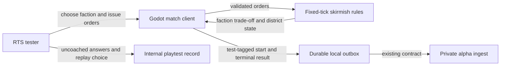

# Pitch — Prove the La Roma promise

Moves: `first_match_completion` · Tests: Value proposition

## The ask, as given

> Hi codex help me refine Refine and scaffold as per golden-frijoles process “Prove the La Roma promise” from Roadmap/00-ideas/seeds/prove-la-roma-promise.md

The linked raw idea calls for two meaningfully different, counterable faction prototypes, a contested district that changes where and when players fight, clear rules for players unfamiliar with Mexican references, and a small playtest. The owner selected M appetite, Regios versus Poblanos, and a district hold as an optional second win route on 2026-10-15.

### Claims

1. Refine the existing “Prove the La Roma promise” idea through the Golden Frijoles process.
2. Prepare an epic and sprint plan once its scope is approved.
3. Preserve the linked idea's two contrasting factions, contested district, and culture-independent comprehension test.

**Teach-back:** unanswered — “You want the first distinctive La Roma match to prove faction choice and district contest matter, while keeping the goal readable to players who miss the references.”

## Problem

The current complete skirmish proves the basic economy, combat and terminal result, but its two sides share the same rules and win only by destroying a command post. It cannot yet test the setting and faction promise in the agreed [PMF narrative](../../00-strategy/pmf-narrative.md) or the [highest-domino validation plan](../../00-strategy/risk-validation.md).

## Appetite

**M:** several connected, locally playable slices with an architecture and rules review. Hold the existing 20×20 solo skirmish, one resource, two combat roles and authored opponent as the boundaries.

quote: $20–120 (M, n=0, wide)

## Outcome & signal

A player chooses either faction, sees its stated strength and cost, and can win by command post destruction or by holding the central La Roma district. The computer can contest either route. In a moderated closed test, recruit eight classic RTS players, four familiar with the cultural references and four unfamiliar. Before coaching, ask each to state both win routes and one counterplay choice. Pass marks: at least three of four in each group state both routes correctly, at least six of eight name a faction trade-off and counter, and at least four of eight voluntarily start a second match. Record exact counts, paraphrased observations, match outcomes and failures; this is directional prototype evidence, not the North Star baseline or proof of 15% later-day retention.

## Stage-2.5 bucket

**Feature · shaped bet · genuinely new.** The finishable match, combat roles, headless tests and test-only outbox already exist. Faction rules, a central objective and understandable objective feedback do not.

## Bill of materials (What / Why)

| What | Why |
|---|---|
| Two selectable faction rule sets | Test whether a choice changes opening and counterplay, rather than only the name and art. |
| Central district hold | Make La Roma an objective that changes army movement and timing without removing conquest. |
| Objective and faction feedback | Let a player understand both win routes and the active trade-off without knowing a joke. |
| Countering computer opponent | Let the solo match challenge and reveal both strategies. |
| Eight-person comprehension test | Find out whether both cultural-context groups understand the goal and want another match. |

## Scope

**In v1:** Regios and Poblanos as fictional prototype doctrines; choose one before a solo match and face the other; one visible economic or defensive advantage and one cost or weakness per side; one central La Roma zone on a fair version of the current map; sole combat-unit presence starts a visible hold timer; a full hold wins, while command post destruction and the 15-minute draw remain; matched result and content-version handling in the existing test-only funnel; a short neutral-language opening explanation and internal playtest record.

**Out of v1 (no-gos):** more factions, unique units or technologies, extra resources or ages, wonders, multiplayer, campaign, random city events, a full geography recreation, public cohort measurement, unapproved participant invitations, or jokes as rules. No demographic claim that people from a named region actually behave like these prototypes.

## Rabbit holes

- **Approved prototype faction rules:** Regios deliver five resource per worker trip instead of four, but each combat unit costs one extra resource. Poblanos use baseline economy and costs, while their command post and recruitment post each start with 20% more health. Names describe fictional play styles, not regional traits. Verify both can win with either route and have a clear counter. Return any core-rule change to the owner rather than tuning silently.
- **Approved district rule:** Mark a central 3×3 zone that cannot contain a new building. Only living melee or ranged units count. A side progresses while it alone has a unit inside; enemy presence resets progress and shows “Contested”; an empty zone also resets progress. Sixty uninterrupted seconds of sole presence wins. Show each side's progress, the contest state, and a visible warning to the opponent. Resolve simultaneous post destruction as a draw, then other command-post defeat, then district completion. The AI must travel to and contest the zone instead of handing the human a free timer.
- **Map fairness:** Keep mirrored spawn resources and reachable routes into the center. Headless checks should cover blocked tiles, entry, contest, reset, simultaneous end conditions, and AI paths. Do not enlarge the map or rebuild pathfinding in this bet.
- **Measurement boundary:** Preserve the accepted `win`/`loss`/`draw` result contract and versioned content context. Keep local prototype events test-tagged; the existing alpha server and eligibility flag decide later cohort admission. A new public telemetry event, flag or retention target would exceed this prototype's evidence and release scope.

## What already exists (reuse, don't rebuild)

- [`game/skirmish.gd`](../../../game/skirmish.gd) has the fixed-tick match, validated orders, mirrored resource sources, two combat roles, command-post terminal rule, authored AI, stable command log and state hash. Add faction parameters and district state here.
- [`game/skirmish_main.gd`](../../../game/skirmish_main.gd) owns match start, selection, board and HUD feedback; use it for faction choice and district presentation.
- [`game/funnel_outbox.gd`](../../../game/funnel_outbox.gd) persists test-tagged start/result events with `faction`, `mode`, game and content versions. Coordinate any new content version with the [event contract](../../../docs/launch-funnel-contract.md); do not bypass server acceptance.
- The [civilization bible](../../../docs/design-prework/civilizations/04-factions.md) proposes Regio economy and Poblano fortification but approves no numeric bonus. The [map and mode notes](../../../docs/design-prework/maps/05-maps-modes.md) propose a contested center while preserving conquest. Both are design inputs, not signed-off rules.
- Existing Godot checks under `game/tests/` and the [run commands](../../../game/README.md) provide headless and rendered verification. The [private alpha plan](../../09-platform-and-measurement/enable-measured-private-alpha/README.md) controls external invitations.

## Visuals

[Rendered screen sketches](../prove-la-roma-promise-sketch.html) for the setup, active hold and contested state.

```mermaid
stateDiagram-v2
  [*] --> Neutral
  Neutral --> Holding: one side's combat unit enters
  Holding --> Contested: both sides present; reset
  Holding --> Neutral: zone empty; reset
  Contested --> Holding: only one side remains; start at zero
  Contested --> Neutral: zone empty; reset
  Holding --> Victory: uncontested hold reaches 60 seconds
```





```surface
state: match-setup-idle
route: /skirmish/setup
- head "Choose a faction"
- card "Regios: faster resource delivery; combat units cost more"
- card "Poblanos: stronger buildings; standard resource delivery"
- note "Win by destroying the enemy command post or holding La Roma."
```

```surface
state: district-success
route: /skirmish/match
- head "La Roma"
- summary "Your hold: 0–60 seconds"
- note "Keep a combat unit inside. Enemy units or an empty district reset the timer."
```

```surface
state: district-disabled
route: /skirmish/match
- head "La Roma contested"
- summary "Hold reset"
- note "Remove enemy combat units to begin a new hold."
```

## UX heuristics & rails check

- **CI guards covering this surface:** Godot headless simulation and client checks plus Node skirmish contract check exist; no screenshot comparison gate exists.
- **Audits-lens findings that apply:** None recorded in `Roadmap/00-ideas/audits/`.
- **Design-language debt:** The geometric board, small HUD and controls need readable text and shape cues. The owner reported board and instruction scale as issues in the preceding skirmish QA; verify setup and district status at normal and zoomed view.

## Measure and safety decision

No new Golden Frijoles feature flag for this internal prototype: the local offline rule set has no server-side runtime seam, and external invitations remain closed. The existing `telemetry.play_funnel_enabled` gate controls later public eligibility. Prototype use and comprehension are recorded manually; a release candidate must decide how to gate or compare a wider rollout before inviting players.

## Acceptance criteria

- **S1.1 · Choose two counterable factions · risk low.** As a solo RTS player, I choose Regios or Poblanos and see a plain-language trade-off before play, so my opening decision has a consequence. A headless spec proves both selected rules apply to human and AI sides, costs and health are correct, and deterministic replay remains stable; rendered smoke checks both choices and readable copy. **QA:** builder owns headless and rendered smoke; owner reviews the faction portrayal and one match with each side.
- **S2.1 · Contest La Roma · risk low.** As a player, I can send combat units to the center, see neutral/holding/contested/reset states, and win after the specified uncontested hold, so the district changes where I fight. A headless spec covers entry, enemy contest, empty reset, both victory routes, the draw boundary and simultaneous endings; rendered smoke follows a district victory and a command-post victory. **QA:** builder owns headless and rendered smoke; owner checks objective clarity.
- **S2.2 · Face a countering opponent · risk low.** As a solo player, I face a computer that can pursue or deny the center while still protecting its post, so the new route is a genuine contest. Deterministic headless scenarios prove the AI enters and contests the zone on reachable paths for each faction, and no faction has an automatic uncontested win; rendered smoke checks visible warning and response. **QA:** builder owns deterministic scenarios and rendered smoke; owner plays a full match.
- **S3.1 · Test the promise with players · risk low.** As the product owner, I can read a closed playtest record for four culturally familiar and four unfamiliar classic RTS players, with uncoached answers, faction/counter explanation, observed second-match starts, outcomes and problems, so I can decide whether to continue toward a wider alpha or reshape the slice. Run this only after the owner authorizes participant invitations and the private alpha delivery checks pass. Verify preview test events remain excluded, record the predeclared thresholds and exact counts, and write a short verdict even if the targets fail. **QA:** owner runs the moderated playtest; builder prepares a blind numbered smoke walkthrough and checks event receipts/versions.

## Open risks / research

- The eight-person thresholds are a proposed decision rule for this small test, not a statistically reliable retention estimate. No real cohort or observed North Star baseline exists. The agreed 15% later-day target stays provisional.
- Balance cannot be signed off from design prework. Check both faction openings and both win routes with actual play before calling the promise proven.
- Any change to district victory rules or cultural portrayal beyond this pitch returns to the owner under [Ways of Working](../../WAYS-OF-WORKING.md#escalate-dont-guess).
