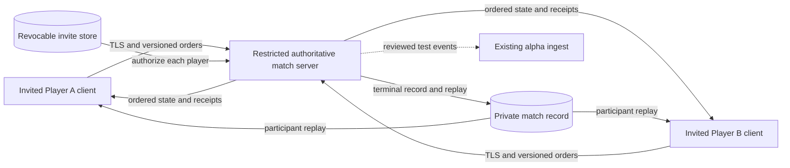
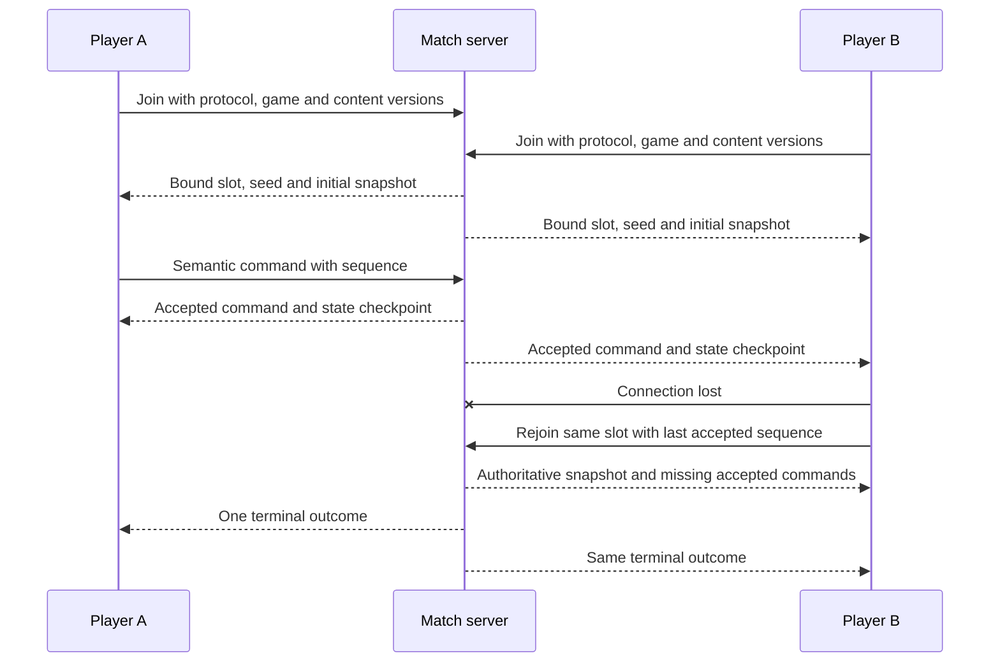
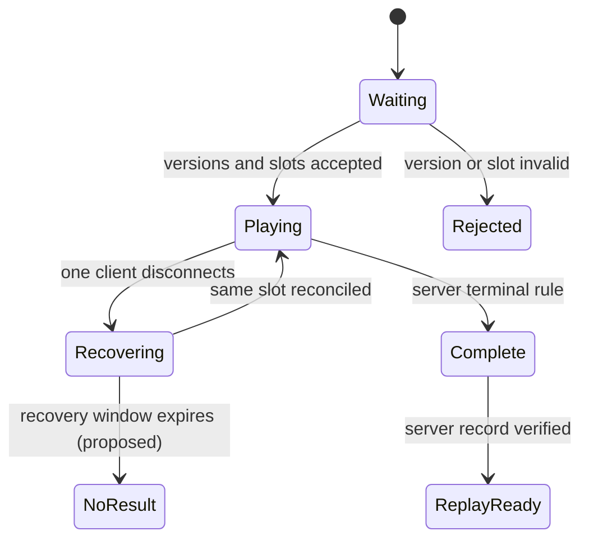

# Pitch — Prove multiplayer and replays

Moves: `return_to_match` · Tests: value proposition, still an assumption.

## The ask, as given

> Hi codex Refine seed:
> #14
> Prove multiplayer and replays (Roadmap/00-ideas/seeds/prove-multiplayer.md) as per golden frijoles methodology, ensure to follow ways of work, team memory etc to ensure a smooth flight

The original seed asks for a measured synchronization choice, semantic commands, slots/teams, version negotiation, state checks, desync diagnosis, reconnect, replay compatibility, result integrity, one real two-client/server full match and delay/loss and cross-platform checks. It reserves matchmaking and ranked policy for the owner.

### Claims

1. Refine idea #14 into reviewable multiplayer and replay work using Golden Frijoles.
2. Follow this repo's ways of working and project learnings.
3. Preserve the seed's synchronization, reconnect, replay, integrity and real network-match requirements.

**Teach-back:** pending — You want the next shared-match bet shaped from actual simulation evidence, with a replay and a real two-client/server proof, before approving build scope.

## Problem

The finishable Godot match is solo. Local replay verification helps diagnose the simulation but cannot let two people play together or watch a shared match afterward. There is no multiplayer demand signal, network prototype or eligible retention cohort.

## Appetite

**L — approved planning commitment.** Re-evaluate after the model proof and each playable wave. It buys one private 1v1 path, a Restricted remote host with individual invite codes, recovery, replay and integrity evidence, with no public matchmaking or competitive operations.

quote: $50–300 (L, n=0, wide)

## Outcome & signal

Two human clients on declared macOS and Linux builds join one Restricted remote server-controlled match with separate invite codes, play to the same terminal result, recover one disconnect and open a compatible post-match replay. The owner can inspect a test record of accepted/rejected orders, first divergence, network conditions, server resource use, replay verification and exactly one terminal result per participant. Later-day completion remains a candidate North Star input, not a success claim without an eligible cohort.

**Plan decision, 2026-10-19:** The owner approved the plan with a Restricted remote host via invite code. The proposed 60-second no-result recovery policy and participant-only, fog-preserving replay were accepted with the rest of the plan. Merges and Restricted releases for this epic are pre-approved, subject to the recorded acceptance checks.

## Stage-2.5 bucket

**Genuinely new.** Versioned solo commands, state and diagnostic replay already exist; no transport, shared authority, player replay or online result trust exists. A replay-only enhancement would be lighter but would not prove the seed's shared match.

## Bill of materials (What / Why)

| What | Why |
| --- | --- |
| Measured model decision | Short cross-OS hash fixtures cannot establish a safe network model. |
| Restricted two-player session and server authority | Friends need one shared rules outcome and a real second client reachable by invite. |
| Recovery and diagnosis | Delay, loss and disconnection need explicit outcomes. |
| Participant replay | Both players should be able to review the completed match. |
| Result acceptance boundary | A local client claim must not become a trusted public result. |

## Scope

**In v1:** A private, unranked 1v1 match on one existing map/rules version; two human slots with stable opposing team IDs and no team diplomacy; a Restricted HTTPS/TLS remote host on the existing alpha VM; separate revocable invite codes bound to each participant and session; direct session join; server validation and ordered semantic commands; protocol/game/content negotiation; state snapshots and client reconciliation; measured delay/loss and macOS/Linux client tests; bounded reconnect; diagnostic state checks; participant-only post-match replay with play/pause and explicit incompatibility errors; one server-issued terminal match record tested against the existing ingest acceptance contract. Initial traffic is test-tagged and excluded from public cohorts. Release means an owner-accessible Restricted build and host; wider invitation requires its own notice and access checks.

**Out of v1 (no-gos):** Public matchmaking, ranked ratings, spectators, chat, lobbies, team modes, cross-platform release promises, mobile controls, mid-match game-version migration, replay sharing/cloud library, anti-cheat claims and accepting `client_reported` events as authoritative online results. [Alternate modes](add-more-ways-to-play.md) and [cross-platform production support](prove-cross-platform-play.md) remain separate ideas.

## Rabbit holes

- [ADR 004](../../../docs/architecture-decisions/004-synchronization-model.md) favors server authority provisionally. Sprint 1 compares a representative four-resource, fogged large-army scenario across macOS/Linux and a Web feasibility run; record RTT/loss, command bursts, reconciliation, CPU/memory/bandwidth and first divergence. Proposed network profiles are baseline, 100 ms RTT with no loss, and 150 ms RTT with 1% packet loss. Keep or amend the ADR before transport work. Fixed ticks and two equal 700-tick hashes do not prove lockstep.
- The current replay records one human side and regenerates AI orders. Multiplayer replay needs both sides' ordered accepted commands or server state checkpoints, a version contract, bounded parsing and a verifier. Do not reinterpret old solo files silently.
- Reconnect needs an authoritative snapshot, last accepted command index and a clear timeout/no-result policy. Proposed proof policy: a 60-second rejoin window, then a visible no-result for both players. A client must not replay an acknowledged order twice or rejoin a different slot.
- Online identity and result trust must be designed with the alpha ingest. The current service accepts only `client_reported` play; changing trust labels, eligibility or player identity requires a contract review and second reviewer.
- The existing Oracle VM and Restricted alpha route provide a bounded hosting rail. Reuse the invite-code store and HTTPS ingress; keep match authority isolated from ingest and database permissions. Record VM capacity, backup/restore and participant notice impacts before issuing a second-person code. The owner approved a Restricted remote host via invite code on 2026-10-19; no public release or open signup follows.

## What already exists (reuse, don't rebuild)

- [`game/skirmish.gd`](../../../game/skirmish.gd), [`game/rules_content.gd`](../../../game/rules_content.gd) and [`game/content/skirmish.v1.json`](../../../game/content/skirmish.v1.json): one fixed-tick rules authority, validated semantic commands, stable content IDs and hashes. Do not create a second rules engine.
- [`game/skirmish_persistence.gd`](../../../game/skirmish_persistence.gd) and [`game/skirmish_replay.gd`](../../../game/skirmish_replay.gd): canonical snapshots, save checks, diagnostic replay and divergent-tick reporting. Extend versions deliberately.
- [ADR 003](../../../docs/architecture-decisions/003-simulation-contract.md), [ADR 004](../../../docs/architecture-decisions/004-synchronization-model.md) and the [foundation benchmark](../../../docs/simulation-benchmark-2026-10-16.md): contracts, provisional model and narrow measurements.
- [`game/skirmish_main.gd`](../../../game/skirmish_main.gd) and the HUD: input and rendering shell for connected match/replay views.
- [`game/funnel_outbox.gd`](../../../game/funnel_outbox.gd), [`src/funnel/ingest.mjs`](../../../src/funnel/ingest.mjs) and the [funnel contract](../../../docs/launch-funnel-contract.md): match IDs, test exclusion, receipts and duplicate guards. Keep Golden Frijoles as the flag/measurement provider.

## Visuals







Proposed protocol examples (illustrative, not a final wire schema):

| Record | Key fields | Expected handling |
| --- | --- | --- |
| Join | `protocol=1`, `game=skirmish-5`, `content=<hash>`, `slot=A` | Reject mismatched versions before state starts. |
| Order | `match=m-001`, `slot=A`, `sequence=12`, `issued_tick=240`, `kind=move` | Server validates ownership and sequence once. |
| Checkpoint | `match=m-001`, `tick=250`, `state_hash=<sha256>` | Compare and report first divergence; hash is diagnostic, not authentication. |

Replay view, conceptual native-game route:

```surface
state: replay-idle
route: /replays/match
- head "Match replay" action "Play"
- summary "Players, map, result and rules version"
- toolbar "Pause, speed and exit"
- note "This replay is available to match participants."
```

```surface
state: replay-error
route: /replays/match
- head "Replay unavailable" action "Back to matches"
- note "This match uses a different game or content version. Your file was kept."
```

## UX heuristics & rails check

- **CI guards:** Godot headless command/content/save/replay and cross-platform hash suites, Node ingest contract and project CI exist; add network/reconnect cases at the same boundaries.
- **Audits lens:** No `Roadmap/00-ideas/audits/` finding or separate team-memory file was found; `Roadmap/LEARNINGS.md` supplies project memory.
- **Design-language debt:** The native HUD lacks network status, recovery and replay controls. Reuse its readable command/status language and verify messages at 1024×700 and 1280×800; cultural references must not be needed to understand them.

## Kill-switch / runtime gate

Proposed safety-only enablement flag `multiplayer.private_match_enabled`: disabled by default in every environment. The server checks it at session admission through the Golden Frijoles provider using the participant's existing pseudonymous ID; the read key remains server-side. In-progress matches keep pinned rules and state if admission is switched off. Before any external session, verify each environment serves `off vN` or the intentionally approved `on vN`; a bare `off` is not a configured switch. No client-bundled key or second flag store. Decide Measure rollout and adoption event when a real invited cohort is authorized; the controlled proof stays test-tagged and cannot establish retention.

## Slices, risk and QA

| Sprint / story | Player or operator outcome and observable check | Risk | QA stage and owner |
| --- | --- | --- | --- |
| 1.1 Model proof | A builder runs a representative match matrix and chooses a sync model from cross-OS, Web-feasibility and delay/loss evidence; ADR 004 records costs, reconciliation and go/no-go. | High | Headless and network-emulation probes; independent architecture review; owner approves model boundary. |
| 1.2 Session contract | An invited player joins only the correct version and human slot; malformed, duplicate, revoked-code and unauthorized orders leave state unchanged. | High | Pure protocol/authority tests and two-client headless join; independent security review. |
| 2.1 Shared match and host | Two separately invited players finish one existing map with a common server terminal result on separate macOS/Linux clients through the Restricted remote host under declared RTT/loss. | High | Two real client windows plus remote server, TLS/invite/health checks, full-match record, CPU/memory/bandwidth and state-check report; owner smoke. |
| 2.2 Recovery | A disconnected player rejoins the same slot without duplicate orders; expiry gives both clients the agreed no-result or forfeit outcome. | High | Drop/reconnect and invalid-token/slot tests, rendered recovery smoke; owner decides terminal policy. |
| 3.1 Replay | A participant plays/pauses a finished recording; both see the same terminal result, while corrupt/incompatible files fail clearly and remain intact. | High | Replay/hash, parser bounds and cross-OS fixture tests; rendered native smoke and second review. |
| 3.2 Result integrity | An operator distinguishes server-confirmed online results from client claims; forged/duplicate finishes never enter eligible reporting and test traffic stays excluded. | High | Node ingest plus Godot outbox contract, two-player audit and second data-integrity review. |
| 3.3 Acceptance | The owner follows a numbered download, separate-code join, match, disconnect, replay and test-receipt walkthrough on a source-traceable Restricted build. | High | Downloaded-build and remote-host smoke on declared devices; no public invitation or retention claim. |

At each boundary, record build IDs, conditions, expected/actual results and a numbered owner smoke. Stop after Sprint 1 if the chosen model cannot meet the declared scenario; re-scope before transport. A merged PR is integration evidence, not a deployed game.

## Acceptance criteria

1. The model decision names tested OS/Godot versions, map, units, duration, seed, RTT/loss profiles and measured server tick CPU, memory and network volume. It explains divergence/reconciliation and updates ADR 004 before the 1v1 build continues.
2. Two separate human clients join the Restricted TLS host only with distinct, revocable invite codes, matching protocol/game/content versions and bound slots; invalid or revoked codes, commands and versions never mutate server state. Secrets stay out of client exports and logs.
3. A complete 1v1 on separate macOS/Linux clients through the remote host under baseline and the declared 150 ms RTT/1% loss profile produces one identical server terminal result and no unexplained divergence. A failure under impairment blocks the reliability claim and triggers re-scope; local solo tests cannot prove a shared match.
4. Reconnect restores the same slot from server state without duplicate commands or completions. Timeout behavior is visible to both players and documented before implementation.
5. Both participants open a server-recorded replay, play/pause it and reproduce its result; corruption/version mismatches are named errors preserving the file. Hashes are diagnostic, not tamper proof.
6. Server-confirmed test results are deduplicated and excluded from public cohorts. Review the backend contract before any trust-label or eligibility change; client-only claims remain `client_reported`.
7. The owner has a numbered, source-build-traceable Restricted download and remote-host smoke walkthrough, independent high-risk review, invite revocation and privacy/backup checks. The host and build are available only through approved Restricted access; no public cohort is inferred.

## Open risks / research

- The owner chose the Restricted remote host and separate invite codes on 2026-10-19. Confirm the exact VM service boundary, TLS route, capacity and participant notice before issuing a second-person invite.
- Decide disconnect expiry: proposed no-result after 60 seconds, with no automatic win claim. Participant messaging needs owner agreement.
- Confirm participant-only replay visibility after match; proposed playback retains each participant's fog view.
- Declare target hardware, battle size and acceptable server cost/latency before Sprint 1 measurements; do not infer budgets from the solo 48×48/163-entity debug case.
- Public result trust and identity need a separate contract revision. No observed cohort supports a numerical `return_to_match` target yet.

## Intent match

The pinned kit attempted 18 advisory Jev questions but could not look: its network request failed. No score was written. The claims, criteria and visuals remain available for the owner's direct review.
