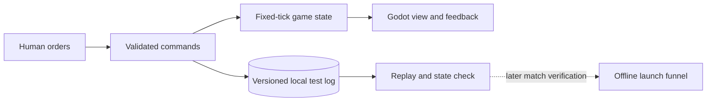

# Pitch — Prove the RTS core

Moves: `first_match_completion` · Tests: Value proposition, at the level of RTS controls and economy. A finishable match is E2.

## The ask, as given

> excellent, lets go ahead. lets shape the first playable match with the launch funnel events. Ive added the extensive design work in the foder docs/design-prework , please review it in full first. Ive also ran a spike with outputs in docs/architecture-decisions also review in full before. Then lets start planning the overall project. Please act as my coach. Maybe based on the extensive design work we can lay out the roadmap at length and prioritize by slices a la scrum/agile overall. We already have a seed and strating point, so help me evaluate and suggest a way forward
>
> i approve te plan in general, what would be the epics scaffolded? what are the iterations you are planning to slice?
>
> approved as recommended

### Claims

1. Shape a first playable match that carries the launch-funnel event contract.
2. Base it on the complete design prework and architecture spike.
3. Keep a longer, prioritized roadmap of integrated, reviewable slices.
4. Start with the recommended E1 boundary: command/move, gather/deliver, build/replay, then review the engine choice.

**Choices supplied:** A traditional, rule-based computer opponent for E2; a subset of ages and resources in the first finishable match; L appetite for the first playable goal across several waves; offline solo matches must eventually count after sync. E1 is an M-sized first bet within that larger goal.

## Problem

There is no game project or playable RTS loop. The design bible and Godot recommendation cannot establish whether selection, commands, movement, gathering and construction work together. Building combat or a funnel service before testing this core would commit to an unproven simulation boundary.

## Appetite

**M — three connected, reviewable iterations.** A1 selects and moves, A2 gathers and delivers, A3 places and constructs. Stop after A3 to decide whether Godot and the fixed-tick command/state approach hold up. The owner chose L for the full first-playable goal; this first epic consumes one smaller wave.

quote: $20–120 (M, n=0, wide)

## Outcome & signal

A tester can open an original-content Godot build, select and command one worker, turn one resource into a visible stockpile, spend it on a structure, and understand invalid actions. A scripted command sequence replays to the same state on the pinned development build. The owner can decide whether to proceed to E2's combat and computer opponent from a real demo and recorded performance observations. No match is finishable or counted in a launch cohort at E1.

## Stage-2.5 bucket

**Genuinely new.** The repo has design and strategy documents, a Golden Frijoles connection and a provisional Godot ADR, but no engine project, simulation, assets or game telemetry code. The openage spike did not demonstrate a runnable alternative.

## Bill of materials (What / Why)

| What | Why |
| --- | --- |
| Original Godot project with a pinned version and reproducible boot | The team can demonstrate and verify one playable client from a fresh checkout. |
| One map, one worker, one resource and one building | The smallest integrated economy exposes the control, pathing and construction problems. |
| Fixed-tick command/state rules and local command replay | The same rule boundary can later serve the computer opponent and offline match verification. |
| Visible selection, orders, stockpile and rejection feedback | Testers can understand what happened without a coach or cultural context. |
| Versioned local test log and event-field contract | Later match events can be added without changing identity, sequence and build metadata late in the funnel work. |

## Scope

**In this epic:** A1–A3 in [the delivery roadmap](../../DELIVERY-ROADMAP.md). Pin and document one exact Godot version. Build one original symmetric test map, one worker, one resource and one constructible structure. Select and move the worker; visibly reject unreachable orders. Gather, carry/deliver, deplete, interrupt and resume. Preview, place, pay for and construct a structure; reject blocked or unaffordable placement and update pathing. Use a fixed-tick command/state simulation, replay known commands to the same state on the pinned build, and record versioned local test metadata with stable IDs and test flags. Run headless rule checks and a rendered input smoke. Measure prototype frame time and pathing at a declared small scale before the engine review.

**Out of this epic:** Combat, unit production, opponent AI, terminal match results, public cohort events, Golden Frijoles ingest, full economy and age progression, faction differences, district objective, multiplayer, final assets and balance. E2 owns the finishable match; E4 owns accepted offline sync and reporting. No ingest key ships in a client.

## Rabbit holes

- Godot physics is not deterministic. Gameplay results belong in the custom command/state simulation; E1 proves repeatability on the pinned development platform, not cross-device match authority.
- One worker does not prove crowd pathing. Record limits and defer representative army benchmarks to the later match and multiplayer decisions.
- Use simple placeholder art made for this project. Do not import Age of Empires assets or pursue visual polish before the loop works.
- Keep the local log versioned and marked as test traffic. Do not emit fake match starts or completions from a prototype without a match.

## What already exists (reuse, don't rebuild)

- [Full design bible](../../../docs/design-prework/README.md): confirmed combat and tone, proposed economy/factions/modes and the scope principle.
- [Engine ADR](../../../docs/architecture-decisions/001-engine-selection.md) and [prototype plan](../../../docs/prototype-plan.md): provisional Godot choice, command/state boundary and worker/gather/build checks.
- [North Star](../../00-strategy/north-star.md) and [funnel idea](track-launch-play-funnel.md): agreed names and cohort rules; offline acceptance still needs an amendment before real playtests.
- Golden Frijoles product `aomx` and ignored local credentials. There is no SDK to integrate into E1.

## Visuals

## UX heuristics & rails check

- **CI guards covering this surface:** None yet. E1 creates the smallest headless rule/replay check and a rendered client smoke.
- **Audits-lens findings that apply:** None recorded in `Roadmap/00-ideas/audits/`.
- **Design-language debt:** No game UI exists. Show selection, valid and invalid commands, resource ownership and stockpile without relying only on color.

## Acceptance criteria

1. From a fresh checkout, a tester opens the pinned Godot build, selects one worker on an original map, moves it to a reachable point, and sees a clear rejection for an unreachable point.
2. The worker gathers one resource, delivers it to a visible stockpile, depletes a source, and can interrupt and resume without creating or spending resources twice.
3. The player spends that stockpile once to preview, place and finish one structure; blocked or unaffordable placement is rejected, and the completed footprint changes movement.
4. A scripted sequence of move, gather and build commands replays to the same positions, resource totals and building state on the pinned development build; the local record carries stable IDs, build/content version and a test flag.
5. Headless rule checks and a rendered control smoke pass. The A3 review records boot steps, frame time, pathing limits and a continue/revisit decision for Godot before E2 starts.

## Open risks / research

- Pin an exact Godot release at A1 and record the editor, headless and export commands. The [Godot archive](https://godotengine.org/download/archive/) and [command-line guide](https://docs.godotengine.org/en/stable/tutorials/editor/command_line_tutorial.html) are the source for current releases and CLI behavior.
- [Godot physics documentation](https://docs.godotengine.org/en/stable/tutorials/physics/physics_introduction.html) warns that physics is not deterministic. Cross-device replay and offline result acceptance remain E4 decisions.
- The event contract starts with IDs, version and test tagging, but E1 produces no eligible `match_started` or `match_completed` event.
