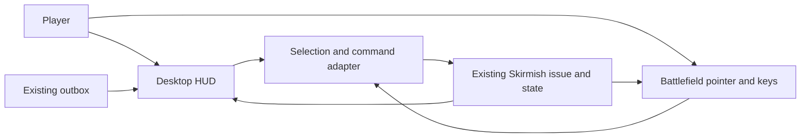

# Pitch — Readable battlefield HUD

Moves: first_match_completion · Tests: Value proposition

## The ask, as given

> its looking really great so far and i am conducting qa. ive ran a few maches now. one thing thats standing out is the difficulty to select my units or once selected point them at gold to start collecting for example. Lets apply some type of light hover effect so players now they are on that item and can be selected by clicking on it, on selection lets also make it clear which unit is currently selected and active. Furthermore, the people scale is a little bit off, what i mean is that they look taller or on par with with buildings, not sure if the buildings should be taller or the people smaller, please evaluate. other than that its honestly looking absolutely great and the game is progressing as expected. One follow up question, on 04a1d5324f0edb9c8e41f5a474ec3f49255671b7baf530e4de7f154e661cce23.jpg we have more art for the controls and onscreen items, maybe you can take it from there what im asking. But in general, were you planning that as another epic to follow up? if not thats ok, just want to know. if we need one, lets do it so its easier to understand everything going on. Keep up the outstanding quality

### Claims

1. Units and gold need a visible hover cue and reliable click target.
2. The selected active unit must be clear.
3. People and buildings need credible relative scale.
4. The concept's controls and onscreen information need a follow-on epic if it helps players understand the match.

**Teach-back:** partly — The owner confirmed the pointer and scale problem in play, and conditionally authorized a separate HUD epic if needed. PR #27 delivered the pointer and scale corrections; this pitch covers the interface.

## Problem

The running skirmish exposes match state and hotkeys mostly through text labels. A new player must remember commands and infer whether a selection, resource, district state, and order succeeded while watching combat. The approved concept shows a coherent control surface, but it also depicts systems absent from the current simulation.

## Appetite

M — several connected slices for one command adapter, status and selection panels, and rendered usability review. Keep the solo match rules.

quote: $20–120 (M, n=0, wide)

## Outcome & signal

Without coaching, a new player can identify current gold and win progress; select a worker, gather gold, choose a post, recruit a fighter, and attack using visible controls. The same actions remain available by keyboard and right click. Record task failures in owner and two blind reviewer playthroughs. Once real cohort data exists, read first-match completion under the agreed North Star definition without attributing any change solely to the HUD.

## Stage-2.5 bucket

Genuinely new: the game has CanvasLayer text, hotkeys and world feedback, but no selection panel or contextual command controls. The hover/selection/scale portion was a light enhancement delivered in PR #27.

## Bill of materials (What / Why)

| What | Why |
|---|---|
| Selection and command view model | Keeps visible controls aligned with validated simulation orders. |
| Compact match status | Makes real gold, district hold, result and sync state readable. |
| Selection panel | Names the active unit or building and its condition. |
| Contextual command buttons | Shows available orders and why one is unavailable. |
| Alerts and responsive desktop layout | Confirms input without obscuring the battlefield or private-alpha controls. |

## Scope

**In v1:** Current desktop solo skirmish; one gold resource; worker, melee, ranged and posts; portrait/health/queue/progress where data exists; move, gather, build, train and attack based on current legal commands; district and match result; pending/offline sync; mouse and keyboard parity; readable at 1280×800 and supported window/zoom sizes.

**Out of v1 (no-gos):** Food/wood/stone, ages, population, multiple selection, new units/buildings, minimap navigation and camera pan, mobile/touch HUD, new combat or economy rules, and a flattened concept image overlay. The concept is art direction rather than a promise of absent mechanics.

## Rabbit holes

- Buttons must use current order validation, avoiding a second game-rules path.
- Disabled state must distinguish affordability, selection and target-required orders. A target-required button arms a clear board interaction with cancel.
- The fixed board is fully visible; a decorative minimap would mislead players and consume space.
- Panels must not intercept playable sprite clicks or cover invite and support controls.
- Cultural copy must work without knowledge of regional jokes.

## What already exists (reuse, don't rebuild)

- `game/skirmish.gd`: entities, gold, district state, `issue()` validation and outcome.
- `game/skirmish_main.gd`: CanvasLayer, selection ID, pointer feedback, keyboard/mouse routing, match and outbox status.
- `game/art_catalog.gd` and `game/assets/`: faction and entity art usable for portraits.
- `game/funnel_outbox.gd`: pending/offline/sync state.
- `docs/art/ui-component-spec.md`: reusable Godot Control plan and unsupported concept features.
- [Approved HUD concept](../../../docs/art/approved-hud-concept.jpg): tracked visual reference, not a runtime dependency.

## Visuals



```surface
state: match-empty
route: Godot skirmish
- status "Gold 30 · La Roma neutral · 00:42 · Sync pending"
- empty "Select a unit or building for details and orders"
- help "Click a unit · Right-click a destination · B builds"
```

```surface
state: worker-selected
route: Godot skirmish
- status "Gold 30 · La Roma neutral · 00:42"
- selection "Foráneo · Worker · 18/20 HP"
- commands "Move" "Gather gold" "Build post"
- help "Gather gold: choose the gold cart"
```

```surface
state: recruit-disabled
route: Godot skirmish
- selection "Barracks · 70/100 HP"
- commands "Recruit fighter — need 10 gold" disabled
- alert "Not enough gold"
```

## UX heuristics & rails check

- **CI guards covering this surface:** Godot headless skirmish client/rules tests, asset manifest validation and Node event contract. Add a rendered walkthrough for layout and input parity.
- **Audits-lens findings that apply:** No project audit file found for this HUD.
- **Design-language debt:** Raw fixed-position labels; art spec defines charcoal/stone, bronze and warm type but no shared Control theme or responsive layout.

## Acceptance criteria

1. Empty selection shows actual gold, district state, win route, clock/result and pending/offline sync clearly; absent resources and ages never appear.
2. Selecting each owned unit and building updates portrait/name/role/faction/health and applicable queue/progress; board selection remains visible.
3. A worker can gather and a post can recruit via onscreen controls, with mouse and existing keys yielding the same simulation result. Move and attack targeting show the next click and support cancel.
4. Unavailable commands give a reason, and successful/failed orders give readable feedback without blocking board input.
5. Rendered Godot QA at target and smaller supported viewport/zoom states confirms focus, contrast, unclipped text, board picking and private-alpha controls. Owner and the two arranged blind reviewers can complete core tasks without instructions.

## Open risks / research

- Owner and blind reviewer QA is ongoing; task evidence may change layout or wording.
- Art epic close-out awaits two blind cultural-comprehension checks. This HUD epic does not mark it shipped.
- No real first-match completion baseline exists; no numeric uplift is promised.
