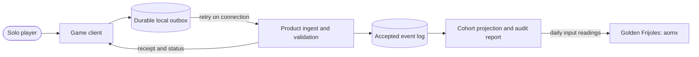
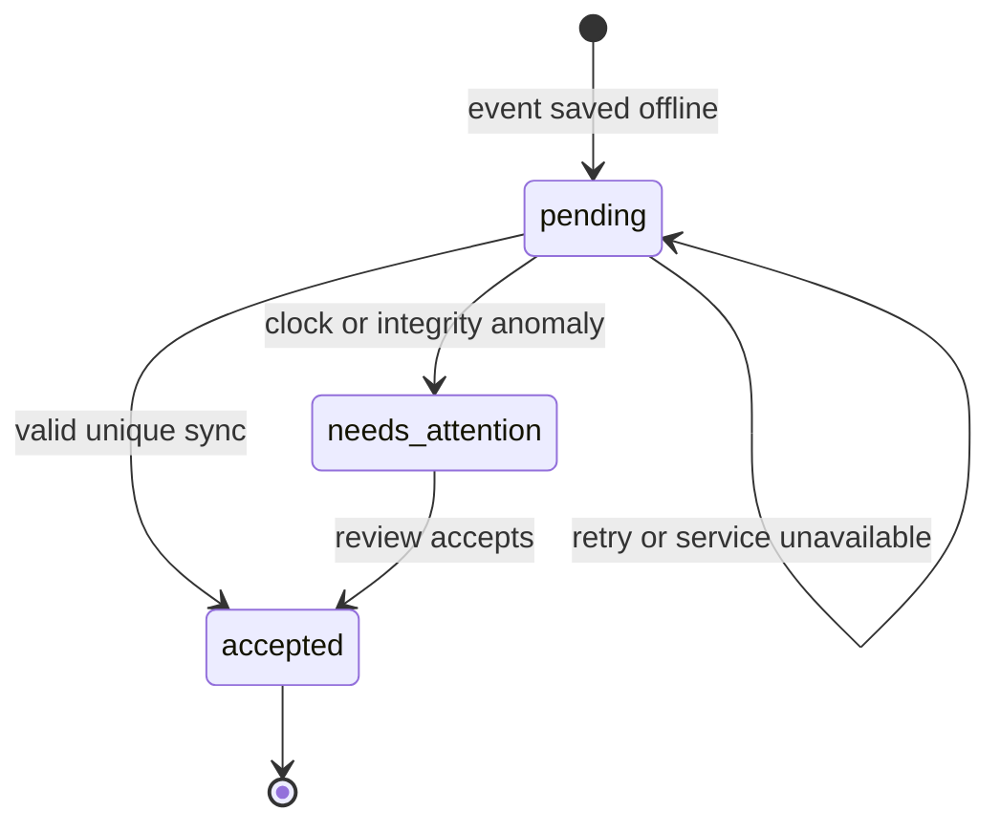

# Pitch — Track the launch play funnel

Moves: makes `new_players`, `first_match_completion`, `return_to_match` and `match_completion` readable · Tests: whether the launch cohorts can be measured; this does not itself prove the value proposition.

## The ask, as given

> A is great, just consider that this is brand new launch so lets ensure the funnel is setup correctly so we can track it all along

### Claims

1. Use Returning commanders as the North Star.
2. Measure the whole launch journey from the beginning, so early cohorts are not lost.

**Teach-back:** partly — the owner clarified that the launch funnel is the first build, ahead of the RTS core; offline solo play must count after accepted sync and the first invited cohort must be auditable.

## Problem

The first invited players may play offline. If their first open, match start or terminal result is missing or counted twice, later-day completion and the 15% launch goal cannot be read honestly. E1's local replay metadata is test-only; E2 has yet to produce a terminal solo match. The agreed [North Star](../../00-strategy/north-star.md) assumes backend-authoritative results, while an offline match necessarily ends before any backend sees it.

## Appetite

**L — several waves.** This is worth doing before inviting a measured cohort because lost first-session events cannot be recovered. Keep the work to one solo mode, one player identity policy, one accepted offline result path, the agreed metrics and an auditable readout. Revisit the appetite if versioned replay proves too costly.

quote: $50–300 (L, n=0, wide)

## Outcome & signal

For the first invited cohort, a tester can trace each stage from first open to a later-day completed match, including offline play that synced later. Stage counts, mature cohort denominators, excluded events, timestamp confidence and Golden Frijoles input readings reconcile from the same accepted records. The first cohort establishes the baseline; the proposed 15% `return_to_match` launch goal remains provisional, with a first read 30 days after playable launch and ideally at least 100 mature first-match completers. An immature cohort reads **pending**, never zero.

## Stage-2.5 bucket

**Genuinely new.** E1 only defines local test IDs and replay metadata. There is no game event transport, accepted offline match policy, backend cohort store or product measurement pipeline to configure today.

## Bill of materials (What / Why)

| What | Why |
|---|---|
| Durable local event outbox | A first session must survive offline play and app restart. |
| Accepted-result ingest | The server must deduplicate and distinguish verified from client-reported outcomes. |
| Cohort projection and audit report | The agreed six stages and four inputs need one reproducible denominator. |
| Golden Frijoles `external_push` | Product measurements belong in the existing aomx product. |
| Player sync status | A player should know when an offline result is still pending. |

## Scope

**In v1:**

- Record first open, eligible solo match start and terminal result with pseudonymous installation ID, match ID, event ID, claimed UTC time, monotonic local sequence, mode, faction, build/content version and test marker. Persist before acknowledging each event; retry idempotently when online.
- Accept offline solo results after sync under a documented trust and time-confidence policy. Try versioned command replay from E1/E2 as the first validation path. If replay is not feasible for the target build, label accepted results as client-reported and show that limitation in the readout. Use a server receipt time as well as the claimed play time; quarantine unresolved clock anomalies rather than silently moving them between cohorts.
- Derive the [agreed six-stage funnel](../../00-strategy/north-star.md) and Returning commanders from accepted, deduplicated records. Exclude bots, tutorials, developer/test identities, abandoned matches, duplicates and results still pending or quarantined. Keep never-synced events local and visibly pending; they cannot enter aggregate counts.
- Calculate `new_players`, `first_match_completion`, `return_to_match` and `match_completion` from the same data. Publish daily numeric input readings to the linked aomx Golden Frijoles product through `external_push`; retain a reproducible raw-event/cohort audit report with counts and conversion rates.
- Give the player a small sync state for offline results: pending, accepted or needs attention. Do not expose a service credential in the game client.

**Out of v1 (no-gos):** multiplayer attribution, account sign-in or cross-device identity, a new product analytics vendor, a custom analytics dashboard, live balance telemetry, public leaderboards, and claiming that event capture improves retention. E1's internal prototype and E2's internal matches remain test-tagged and outside public cohorts.

## Slices and QA

| Slice | Player-visible or owner-visible result | Proof before close |
|---|---|---|
| F1 · Event contract and fixture ingest | The team can submit a first-open, match-start and terminal-result fixture through one deduplicating contract before a game client exists. | Schema, identity, exclusion, timestamp and retry fixtures; inspect accepted and rejected records. |
| F2 · Offline client outbox | In the E1 game client, a first open and match start survive restart and show pending sync. | Headless persistence and retry tests; rendered offline/status walkthrough. |
| F3 · Accepted result and cohort read | An E2 terminal solo result syncs once; the owner sees mature stage counts, rates and four aomx input readings. | Replay or documented client-report policy; clock, duplicate and late-sync fixtures; audit report matches Golden Frijoles. |

Build F1 first. F2 integrates with E1's game client after its first usable runtime slice. F3 needs E2's terminal result. The first external playtest invitation waits for E2's finishable match, this measurement path, and E3's distinctive two-faction/district experience. This dependency makes per-sprint kickoff appropriate; pause the funnel epic between F1, F2 and F3 while the core and solo match supply their required game behavior.

## Rabbit holes

- **Trust:** Offline completion cannot be backend-authoritative at play time. Decide whether replay is feasible from representative E2 builds. If it is not, report accepted client claims separately and require explicit owner agreement before the first cohort.
- **Identity:** A persistent installation ID is only a proxy for a human. Reinstall and cross-device play can split one person. State this in the North Star readout; defer account linking.
- **Clock:** Claimed local UTC can be wrong. Preserve original claim and server receipt, detect large reversals/drift, and quarantine unresolved cases. The owner must approve the final cohort date policy.
- **Late sync:** Do not rewrite a published mature cohort silently. Recompute versioned readings with a correction note when late accepted events change it.
- **Availability:** The game must remain playable when the ingest service or Golden Frijoles is unavailable; the outbox retries and the metrics publisher can catch up.

## What already exists (reuse, don't rebuild)

- [E1 RTS core](../../01-core-play/prove-rts-core/README.md) defines local replay metadata and test tags; its sprint 3 engine review decides the replay foundation.
- [E2 solo-skirmish idea](finish-solo-skirmish.md) defines the future terminal result and rule-based computer opponent. The AI is authored game logic, not a generative model.
- [North Star](../../00-strategy/north-star.md) defines eligibility, events, distinct UTC days, seven-day windows and four `external_push` inputs. Its backend-authority wording needs an approved offline amendment before public measurement.
- This repo has no game runtime, backend route, event store, CI guard, or deployed game to reuse yet. Golden Frijoles is the roadmap and input-metric destination, not the game server.

## Visuals





Example audit rows (illustrative, not observed player data):

| Event | Claimed UTC day | Receipt UTC day | Outcome |
|---|---|---|---|
| First solo finish, event A | Day 1 | Day 2 | Accepted once; first-match cohort Day 1 if time confidence passes. |
| Re-upload of event A | Day 1 | Day 2 | Duplicate; no additional match or player count. |
| Later solo finish, event B | Day 4 | Day 5 | Accepted once; later-day stage after Day 1 cohort matures. |

```surface
state: match-sync-pending
route: /game/results
- head "Match finished"
- note "Saved on this device. Your result will count after it syncs."
```

```surface
state: match-sync-error
route: /game/results
- head "Match finished"
- note "Result needs attention. It is saved on this device and has not been counted yet."
```

## UX heuristics & rails check

- **CI guards covering this surface:** none yet; create headless contract/aggregation checks and a rendered client walkthrough in this work.
- **Audits-lens findings that apply:** no project audit findings exist yet.
- **Design-language debt:** no runtime UI system exists; reuse E2's result treatment and keep sync language plain in Spanish and English when those locales are available.

## Kill-switch / runtime gate

Use one Golden Frijoles enablement flag, `telemetry.play_funnel_enabled`, off until scripted reconciliation passes. Evaluate it on the server for the pseudonymous player ID, report that flag evaluation with the same user ID used by `match_result_synced` and `later_day_match_completed`, and keep credentials out of the client. The flag is planned here; the build creates and checks its served state in each environment. Measurement of this epic's success is the reconciled cohort report, not a claim of improved player retention.

## Acceptance criteria

1. On a clean install, first open and match start are saved with stable IDs; closing and reopening offline preserves them and never creates a second first open.
2. A finishable E2 solo match played offline shows **pending**, survives restart and syncs when connected. The server produces one accepted terminal result or a named needs-attention state; it never counts a button press as completion.
3. Re-uploading the same event or match result changes no stage count, North Star count or input reading. An abandoned match, bot, tutorial and test-tagged match never become eligible completions.
4. The report shows counts and conversion rates for all six stages, the eligible denominator, event and receipt times, trust status, exclusions and pending seven-day cohorts. It distinguishes no data from zero.
5. A scripted player finishing on two distinct UTC days within seven days counts once as a Returning commander. A same-day second finish does not. A late but accepted sync revises the correct cohort with a visible correction; a clock anomaly remains quarantined until resolved.
6. Daily `external_push` readings for the four agreed inputs in aomx match a recomputation from accepted raw events. A publisher retry does not double-count a day. The client contains no Golden Frijoles secret.
7. The owner can follow a fresh-checkout walkthrough that plays offline, finishes, reconnects, observes acceptance, inspects the audit report and compares the Golden Frijoles readings before any external invitation.

## Decisions carried into the build

1. **Offline authority and dates:** Try versioned replay when feasible; otherwise accept labelled client-reported solo results after integrity checks, retain the claimed play date when confidence passes, and quarantine anomalies. Amend the agreed North Star wording to match before a real cohort. The exact drift threshold is an implementation decision validated by fixtures, not an invented product constant here.
2. **Identity:** Use a persistent pseudonymous installation ID for the first solo cohort, with an explicit limitation that it is not verified distinct humans. Revisit identity when cross-device play becomes a real requirement.
3. **Flag:** The approved plan uses the Golden Frijoles enablement flag above; no hosted flag is created by the planning scaffold.
4. **Baseline and timing:** There is no observed `target_from`. Keep the 15% goal provisional and read the first mature cohort 30 days after the first invited playable launch, or later if fewer than 100 first-match completers have matured.
